# Design Document

## Overview

The Advanced Volcanic Dashboard Enhancement system represents a paradigm shift in volcanic monitoring and analysis, integrating cutting-edge technologies from advanced AI, holographic visualization, consciousness-inspired modeling, and interdimensional analysis. This design creates the world's most sophisticated volcanic research platform, combining practical advanced features like multi-chamber modeling and stacked-sill visualization with revolutionary theoretical capabilities that push the boundaries of scientific computing.

The system architecture leverages advanced GPU computing, consciousness-inspired algorithms, holographic display technology, and novel mathematical approaches for higher-dimensional analysis. The design integrates seamlessly with the existing Prometheus AI Platform while introducing entirely new paradigms for volcanic system understanding and visualization.

## Architecture

### High-Level System Architecture

```mermaid
graph TB
    subgraph "Advanced GPU Computing Layer"
        GPU[GPU Compute Clusters]
        CUDA[CUDA Acceleration]
        ML[Advanced Machine Learning]
        OPT[High-Performance Optimization]
    end
    
    subgraph "Consciousness-Inspired Intelligence"
        CSI[Consciousness Simulation Engine]
        ESB[Emergent System Behavior]
        SMA[System Memory & Adaptation]
        ITC[Inter-system Communication]
    end
    
    subgraph "Advanced Volcanic Modeling Core"
        MCS[Multi-Chamber System Modeling]
        SSC[Stacked-Sill Complex Engine]
        RCD[Resurgent Caldera Dynamics]
        MMM[Magma Mixing & Mingling]
        VDP[Volatile Degassing Pathways]
        TRE[Thermal-Rheological Evolution]
    end
    
    subgraph "Multi-Physics Coupling Engine"
        PINN[Physics-Informed Neural Networks]
        MPM[Multi-Physics Modeling]
        CEM[Coupled Evolution Modeling]
        UQ[Uncertainty Quantification]
    end
    
    subgraph "Advanced Monitoring Integration"
        SSC_MON[Seismic Source Characterization]
        TAV[Thermal Analysis & Visualization]
        PDM[Plume Dispersion Modeling]
        SVE[Submarine/Ice Volcano Engine]
        VLE[Volcanic Lightning & EM]
        BSD[Biosignature Detection]
    end
    
    subgraph "Holographic Visualization System"
        HDE[Holographic Display Engine]
        GBI[Gesture-Based Interaction]
        HFB[Haptic Feedback System]
        MUH[Multi-User Holographic Sessions]
        PHD[Portable Holographic Displays]
    end
    
    subgraph "Interdimensional Analysis Engine"
        HDA[Higher-Dimensional Analysis]
        DPE[Dimensional Pattern Engine]
        MDV[Multidimensional Visualization]
        HPD[Hidden Pattern Discovery]
        DVT[Dimensional Validation Tools]
    end
    
    subgraph "Metamaterial Analysis System"
        NPA[Nanoparticle Analysis]
        MFM[Metamaterial Formation Modeling]
        MPC[Material Property Characterization]
        TAI[Technological Application Identification]
        MET[Material Evolution Tracking]
    end
    
    subgraph "Digital Twin Framework"
        VDT[Volcanic Digital Twins]
        VEE[Virtual Experimentation Engine]
        MSO[Monitoring Strategy Optimization]
        PSE[Predictive System Evolution]
        CMV[Continuous Model Validation]
    end
    
    subgraph "Climate & Atmospheric Impact"
        CAI[Climate Analysis Integration]
        AIM[Atmospheric Impact Modeling]
        AET[Aerosol Evolution Tracking]
        EIA[Environmental Impact Assessment]
        HCE[Historical Comparison Engine]
    end
    
    subgraph "Real-Time Hazard Assessment"
        RHA[Real-Time Hazard Analysis]
        PHM[Probabilistic Hazard Mapping]
        DRA[Dynamic Risk Assessment]
        HCI[Hazard Communication Interface]
        SDP[Scenario-Based Decision Planning]
    end
    
    GPU --> CUDA
    CUDA --> ML
    ML --> OPT
    OPT --> MCS
    
    CSI --> ESB
    ESB --> SMA
    SMA --> ITC
    ITC --> MCS
    
    MCS --> SSC
    SSC --> RCD
    RCD --> MMM
    MMM --> VDP
    VDP --> TRE
    
    TRE --> PINN
    PINN --> MPM
    MPM --> CEM
    CEM --> UQ
    
    UQ --> SSC_MON
    SSC_MON --> TAV
    TAV --> PDM
    PDM --> SVE
    SVE --> VLE
    VLE --> BSD
    
    BSD --> HDE
    HDE --> GBI
    GBI --> HFB
    HFB --> MUH
    MUH --> PHD
    
    PHD --> HDA
    HDA --> DPE
    DPE --> MDV
    MDV --> HPD
    HPD --> DVT
    
    DVT --> NPA
    NPA --> MFM
    MFM --> MPC
    MPC --> TAI
    TAI --> MET
    
    MET --> VDT
    VDT --> VEE
    VEE --> MSO
    MSO --> PSE
    PSE --> CMV
    
    CMV --> CAI
    CAI --> AIM
    AIM --> AET
    AET --> EIA
    EIA --> HCE
    
    HCE --> RHA
    RHA --> PHM
    PHM --> DRA
    DRA --> HCI
    HCI --> SDP
```



### Advanced GPU-Accelerated Architecture

The system employs a high-performance GPU-accelerated computing architecture that leverages parallel processing advantages for complex volcanic modeling tasks while maintaining efficient CPU processing for real-time operations:

1. **GPU Compute Layer**: Handles molecular-scale simulations, complex optimization, and pattern recognition in high-dimensional datasets using CUDA and OpenCL
2. **CPU Processing Layer**: Manages real-time data processing, user interfaces, and traditional computational tasks
3. **Hybrid Interface**: Seamlessly integrates GPU and CPU results with load balancing and performance optimization

## Components and Interfaces

### 1. GPU-Accelerated Volcanic Modeling Engine

**Purpose**: Leverage GPU computing advantages for complex volcanic process simulations that require massive parallel processing.

**Key Components**:
- `GPUMagmaSimulator`: Molecular-scale magma property calculations using GPU-accelerated computational chemistry
- `CUDAOptimizer`: Multi-parameter volcanic system optimization using GPU-accelerated optimization algorithms
- `GPULinearSolver`: Large-scale multi-physics equation solving with GPU-accelerated linear algebra
- `GPUMLEngine`: Pattern recognition in high-dimensional volcanic datasets using GPU-accelerated machine learning
- `PerformanceOptimizer`: GPU-CPU load balancing and performance optimization

**Interfaces**:
```python
class GPUVolcanicModelingEngine:
    async def simulate_molecular_magma_properties(self, composition: MagmaComposition, conditions: PhysicalConditions) -> GPUSimulationResult
    async def optimize_volcanic_system_parameters(self, system_config: VolcanicSystemConfig, constraints: OptimizationConstraints) -> GPUOptimizationResult
    async def solve_multiphysics_equations(self, equation_system: MultiPhysicsSystem, boundary_conditions: BoundaryConditions) -> GPUSolutionResult
    async def discover_gpu_patterns(self, volcanic_dataset: HighDimensionalData, pattern_config: PatternConfig) -> GPUPatternResult
    async def validate_gpu_results(self, gpu_result: GPUResult, cpu_benchmark: CPUResult) -> ValidationResult
    async def manage_gpu_resources(self, computation_request: GPUComputationRequest) -> ResourceAllocationResult
```

### 2. Multi-Chamber Volcanic System Modeling

**Purpose**: Provide comprehensive modeling and visualization of complex multi-chamber volcanic systems with interconnected magma reservoirs.

**Key Components**:
- `ChamberGeometryEngine`: 3D chamber shape modeling based on geophysical data
- `PressureCouplingSimulator`: Real-time pressure coupling and magma transfer between chambers
- `CompositionEvolutionTracker`: Temporal evolution of magma composition in interconnected chambers
- `EruptionTriggerAnalyzer`: Analysis of eruption triggering mechanisms across chamber systems
- `ChamberVisualizationEngine`: Advanced 3D/4D visualization of multi-chamber systems

**Interfaces**:
```python
class MultiChamberVolcanicSystem:
    async def model_chamber_geometry(self, geophysical_data: GeophysicalDataset, inversion_params: InversionParameters) -> ChamberGeometry
    async def simulate_pressure_coupling(self, chamber_network: ChamberNetwork, time_step: float) -> PressureCouplingResult
    async def track_composition_evolution(self, initial_compositions: Dict[str, MagmaComposition], mixing_params: MixingParameters) -> CompositionEvolution
    async def analyze_eruption_triggers(self, chamber_system: ChamberSystem, trigger_conditions: TriggerConditions) -> EruptionTriggerAnalysis
    async def visualize_chamber_system(self, chamber_data: ChamberSystemData, visualization_config: VisualizationConfig) -> ChamberVisualization
    async def validate_chamber_model(self, model_results: ChamberModelResults, observational_data: ObservationalData) -> ModelValidation
```

### 3. Stacked-Sill Complex Visualization Engine

**Purpose**: Advanced modeling and visualization of stacked-sill intrusion complexes with detailed geometric relationships and emplacement mechanisms.

**Key Components**:
- `SillGeometryModeler`: 3D geometric modeling of stacked-sill complexes
- `EmplacementMechanismSimulator`: Magma injection and sill emplacement process simulation
- `DeformationCorrelator`: Correlation between sill emplacement and surface deformation
- `SillEvolutionAnimator`: Temporal animation of sill growth and evolution
- `HazardPredictor`: Eruption location prediction based on sill complex geometry

**Interfaces**:
```python
class StackedSillComplexEngine:
    async def model_sill_geometry(self, structural_data: StructuralData, intrusion_params: IntrusionParameters) -> SillGeometry
    async def simulate_emplacement_mechanism(self, host_rock_properties: RockProperties, magma_properties: MagmaProperties) -> EmplacementSimulation
    async def correlate_surface_deformation(self, sill_geometry: SillGeometry, deformation_data: DeformationData) -> DeformationCorrelation
    async def animate_sill_evolution(self, evolution_params: EvolutionParameters, time_range: TimeRange) -> SillEvolutionAnimation
    async def predict_eruption_locations(self, sill_complex: SillComplex, stress_field: StressField) -> EruptionLocationPrediction
    async def assess_sill_hazards(self, sill_system: SillSystem, hazard_criteria: HazardCriteria) -> SillHazardAssessment
```

### 4. Consciousness-Inspired Volcanic Intelligence

**Purpose**: Implement consciousness-inspired algorithms to model volcanic systems as intelligent, self-organizing entities with emergent behaviors.

**Key Components**:
- `ConsciousnessSimulationEngine`: Core consciousness modeling for volcanic systems
- `EmergentBehaviorDetector`: Detection and analysis of emergent volcanic system behaviors
- `SystemMemoryManager`: Modeling of volcanic system memory and learning from past events
- `InterSystemCommunicator`: Information transfer between different parts of volcanic systems
- `AdaptationPredictor`: Prediction of how volcanic systems adapt to changing conditions

**Interfaces**:
```python
class ConsciousnessInspiredVolcanicIntelligence:
    async def simulate_system_consciousness(self, volcanic_system: VolcanicSystem, consciousness_params: ConsciousnessParameters) -> ConsciousnessSimulation
    async def detect_emergent_behavior(self, system_data: SystemData, emergence_criteria: EmergenceCriteria) -> EmergentBehaviorDetection
    async def manage_system_memory(self, historical_events: List[VolcanicEvent], memory_config: MemoryConfig) -> SystemMemoryState
    async def facilitate_inter_system_communication(self, system_network: VolcanicSystemNetwork, communication_params: CommunicationParameters) -> CommunicationResult
    async def predict_system_adaptation(self, current_state: SystemState, environmental_changes: EnvironmentalChanges) -> AdaptationPrediction
    async def analyze_system_intelligence(self, intelligence_metrics: IntelligenceMetrics, analysis_config: AnalysisConfig) -> IntelligenceAnalysis
```

### 5. Holographic Visualization System

**Purpose**: Provide true 3D holographic visualization and interaction capabilities for volcanic data exploration and presentation.

**Key Components**:
- `HolographicDisplayEngine`: Core holographic rendering and display management
- `GestureInteractionProcessor`: Gesture-based interaction with holographic volcanic models
- `HapticFeedbackSystem`: Tactile feedback for holographic interaction
- `MultiUserHolographicSession`: Collaborative holographic data exploration
- `PortableHolographicDisplay`: Mobile holographic visualization for field work

**Interfaces**:
```python
class HolographicVisualizationSystem:
    async def render_holographic_display(self, volcanic_data: VolcanicData3D, hologram_config: HologramConfig) -> HolographicDisplay
    async def process_gesture_interaction(self, gesture_data: GestureData, interaction_context: InteractionContext) -> GestureResponse
    async def provide_haptic_feedback(self, interaction_point: Point3D, feedback_type: HapticFeedbackType) -> HapticResponse
    async def create_multi_user_session(self, session_config: MultiUserSessionConfig, participants: List[User]) -> HolographicSession
    async def deploy_portable_display(self, field_location: GeographicLocation, display_config: PortableDisplayConfig) -> PortableHologramResult
    async def calibrate_holographic_system(self, calibration_params: CalibrationParameters, environment_data: EnvironmentData) -> CalibrationResult
```

### 6. Interdimensional Analysis Engine

**Purpose**: Explore higher-dimensional representations of volcanic processes to discover hidden patterns and relationships invisible in traditional analysis.

**Key Components**:
- `HigherDimensionalProjector`: Project volcanic data into higher-dimensional spaces
- `DimensionalPatternRecognizer`: Identify patterns across different dimensional representations
- `MultidimensionalVisualizer`: Visualize higher-dimensional volcanic process relationships
- `HiddenPatternDiscoverer`: Discover previously unknown volcanic process connections
- `DimensionalValidator`: Validate higher-dimensional insights against physical processes

**Interfaces**:
```python
class InterdimensionalAnalysisEngine:
    async def project_to_higher_dimensions(self, volcanic_data: VolcanicDataset, dimension_config: DimensionConfig) -> HigherDimensionalProjection
    async def recognize_dimensional_patterns(self, dimensional_data: HigherDimensionalData, pattern_criteria: PatternCriteria) -> DimensionalPatterns
    async def visualize_multidimensional_relationships(self, relationships: MultidimensionalRelationships, viz_config: VisualizationConfig) -> MultidimensionalVisualization
    async def discover_hidden_patterns(self, dimensional_analysis: DimensionalAnalysis, discovery_params: DiscoveryParameters) -> HiddenPatternDiscovery
    async def validate_dimensional_insights(self, dimensional_insights: DimensionalInsights, physical_validation: PhysicalValidation) -> ValidationResult
    async def translate_to_physical_space(self, dimensional_result: DimensionalResult, translation_params: TranslationParameters) -> PhysicalInterpretation
```

### 7. Advanced Seismic Source Characterization

**Purpose**: Provide sophisticated seismic analysis capabilities for complex volcanic earthquake sources with advanced machine learning classification.

**Key Components**:
- `MomentTensorInverter`: Advanced moment tensor inversion for volcanic earthquakes
- `SeismicEventClassifier`: Machine learning-based classification of volcanic seismic events
- `SwarmAnalyzer`: Spatial-temporal analysis of volcanic earthquake swarms
- `MagmaticProcessCorrelator`: Correlation between seismic activity and magmatic processes
- `SeismicSourceVisualizer`: 3D visualization of seismic sources and stress fields

**Interfaces**:
```python
class AdvancedSeismicSourceCharacterization:
    async def invert_moment_tensor(self, seismic_data: SeismicWaveforms, station_geometry: StationGeometry) -> MomentTensorResult
    async def classify_seismic_events(self, event_features: SeismicEventFeatures, classification_model: MLModel) -> EventClassification
    async def analyze_earthquake_swarms(self, swarm_data: EarthquakeSwarmData, analysis_params: SwarmAnalysisParams) -> SwarmAnalysis
    async def correlate_with_magmatic_processes(self, seismic_activity: SeismicActivity, magmatic_indicators: MagmaticIndicators) -> ProcessCorrelation
    async def visualize_seismic_sources(self, source_data: SeismicSourceData, visualization_params: VisualizationParams) -> SeismicVisualization
    async def characterize_stress_field(self, focal_mechanisms: List[FocalMechanism], stress_inversion_params: StressInversionParams) -> StressFieldCharacterization
```

### 8. Metamaterial and Nanoparticle Analysis System

**Purpose**: Analyze novel metamaterials and nanoparticles produced by volcanic activity for understanding material formation processes and potential applications.

**Key Components**:
- `NanoparticleCharacterizer`: Size distribution and composition analysis of volcanic nanoparticles
- `MetamaterialFormationModeler`: Modeling of extreme condition metamaterial formation
- `MaterialPropertyAnalyzer`: Analysis of unique optical, magnetic, and electrical properties
- `ApplicationIdentifier`: Identification of technological applications for volcanic materials
- `MaterialEvolutionTracker`: Monitoring of material changes during transport and deposition

**Interfaces**:
```python
class MetamaterialNanoparticleAnalysisSystem:
    async def characterize_nanoparticles(self, particle_samples: ParticleSamples, characterization_methods: CharacterizationMethods) -> NanoparticleCharacterization
    async def model_metamaterial_formation(self, formation_conditions: ExtremeConditions, material_precursors: MaterialPrecursors) -> MetamaterialFormationModel
    async def analyze_material_properties(self, material_samples: MaterialSamples, property_tests: PropertyTests) -> MaterialPropertyAnalysis
    async def identify_applications(self, material_properties: MaterialProperties, application_database: ApplicationDatabase) -> ApplicationIdentification
    async def track_material_evolution(self, initial_materials: InitialMaterials, environmental_conditions: EnvironmentalConditions) -> MaterialEvolutionTracking
    async def validate_material_models(self, model_predictions: MaterialModelPredictions, experimental_data: ExperimentalData) -> MaterialModelValidation
```

## Data Models

### Core Data Structures

```python
@dataclass
class GPUVolcanicSimulation:
    simulation_id: str
    gpu_algorithm: GPUAlgorithm
    cpu_validation: CPUValidation
    gpu_acceleration_factor: float
    memory_usage: float
    cuda_cores_utilized: int
    simulation_results: GPUSimulationResults
    uncertainty_bounds: GPUUncertaintyBounds
    computational_resources: GPUResourceUsage

@dataclass
class MultiChamberSystem:
    system_id: str
    chambers: List[MagmaChamber]
    interconnections: List[ChamberConnection]
    pressure_coupling_matrix: np.ndarray
    composition_evolution: TemporalCompositionData
    eruption_triggers: List[EruptionTrigger]
    system_geometry: ChamberSystemGeometry
    validation_metrics: SystemValidationMetrics

@dataclass
class MagmaChamber:
    chamber_id: str
    geometry: ChamberGeometry3D
    depth_range: Tuple[float, float]
    volume: float
    composition: MagmaComposition
    temperature: float
    pressure: float
    crystallinity: float
    volatile_content: VolatileContent
    rheological_properties: RheologicalProperties

@dataclass
class StackedSillComplex:
    complex_id: str
    sill_layers: List[SillLayer]
    host_rock_properties: RockProperties
    emplacement_sequence: EmplacementSequence
    deformation_signature: DeformationSignature
    thermal_evolution: ThermalEvolution
    stress_field_influence: StressFieldInfluence
    eruption_potential: EruptionPotential

@dataclass
class ConsciousVolcanicSystem:
    system_id: str
    consciousness_level: float
    emergent_behaviors: List[EmergentBehavior]
    system_memory: SystemMemory
    adaptation_history: List[AdaptationEvent]
    inter_system_communications: List[SystemCommunication]
    intelligence_metrics: IntelligenceMetrics
    self_organization_patterns: List[SelfOrganizationPattern]

@dataclass
class HolographicVisualization:
    hologram_id: str
    display_technology: HolographicDisplayTech
    spatial_resolution: SpatialResolution3D
    temporal_resolution: float
    interaction_methods: List[InteractionMethod]
    haptic_feedback_config: HapticConfig
    multi_user_support: bool
    portable_deployment: PortableConfig

@dataclass
class InterdimensionalAnalysis:
    analysis_id: str
    source_dimensions: int
    target_dimensions: int
    dimensional_projection: DimensionalProjection
    hidden_patterns: List[HiddenPattern]
    pattern_significance: float
    physical_interpretation: PhysicalInterpretation
    validation_results: DimensionalValidation

@dataclass
class VolcanicMetamaterial:
    material_id: str
    formation_conditions: ExtremeConditions
    nanostructure: NanostructureGeometry
    optical_properties: OpticalProperties
    magnetic_properties: MagneticProperties
    electrical_properties: ElectricalProperties
    mechanical_properties: MechanicalProperties
    potential_applications: List[TechnologicalApplication]
    stability_analysis: StabilityAnalysis

@dataclass
class VolcanicDigitalTwin:
    twin_id: str
    physical_system: VolcanicSystem
    digital_representation: DigitalSystemModel
    real_time_synchronization: SynchronizationStatus
    virtual_experiments: List[VirtualExperiment]
    optimization_results: OptimizationResults
    predictive_capabilities: PredictiveCapabilities
    validation_metrics: TwinValidationMetrics

@dataclass
class BiosignatureDetection:
    detection_id: str
    volcanic_environment: VolcanicEnvironment
    microbial_communities: List[MicrobialCommunity]
    extremophile_activity: ExtremophileActivity
    metabolic_pathways: List[MetabolicPathway]
    astrobiology_implications: AstrobiologyImplications
    ecosystem_dynamics: EcosystemDynamics
    environmental_correlations: EnvironmentalCorrelations
```

### Advanced Database Schema Extensions

**GPU Simulation Results (PostgreSQL + GPU Performance DB)**:
```sql
CREATE TABLE gpu_volcanic_simulations (
    simulation_id UUID PRIMARY KEY,
    gpu_algorithm VARCHAR(200) NOT NULL,
    cuda_cores_used INTEGER,
    memory_usage_gb FLOAT,
    gpu_acceleration_factor FLOAT,
    parallel_efficiency FLOAT,
    simulation_results JSONB,
    uncertainty_bounds JSONB,
    computational_cost FLOAT,
    validation_score FLOAT,
    created_at TIMESTAMP DEFAULT NOW()
);

CREATE INDEX idx_gpu_acceleration ON gpu_volcanic_simulations(gpu_acceleration_factor DESC);
CREATE INDEX idx_gpu_algorithm ON gpu_volcanic_simulations(gpu_algorithm);
```

**Multi-Chamber Systems (PostgreSQL + PostGIS)**:
```sql
CREATE TABLE multi_chamber_systems (
    system_id UUID PRIMARY KEY,
    location GEOMETRY(POINT, 4326),
    chamber_count INTEGER,
    total_volume FLOAT,
    pressure_coupling_strength FLOAT,
    eruption_potential FLOAT,
    last_activity TIMESTAMP,
    monitoring_status VARCHAR(50),
    system_geometry JSONB,
    validation_metrics JSONB
);

CREATE TABLE magma_chambers (
    chamber_id UUID PRIMARY KEY,
    system_id UUID REFERENCES multi_chamber_systems(system_id),
    geometry GEOMETRY(POLYGON, 4326),
    depth_min FLOAT,
    depth_max FLOAT,
    volume FLOAT,
    composition JSONB,
    temperature FLOAT,
    pressure FLOAT,
    crystallinity FLOAT
);
```

**Holographic Visualizations (PostgreSQL + Binary Storage)**:
```sql
CREATE TABLE holographic_visualizations (
    hologram_id UUID PRIMARY KEY,
    volcanic_system_id UUID,
    display_technology VARCHAR(100),
    spatial_resolution JSONB,
    temporal_resolution FLOAT,
    interaction_methods TEXT[],
    haptic_enabled BOOLEAN,
    multi_user_support BOOLEAN,
    hologram_data_path TEXT,
    created_at TIMESTAMP DEFAULT NOW()
);
```

**Interdimensional Analysis Results (Specialized High-Dimensional DB)**:
```sql
CREATE TABLE interdimensional_analyses (
    analysis_id UUID PRIMARY KEY,
    source_data_id UUID,
    source_dimensions INTEGER,
    target_dimensions INTEGER,
    projection_method VARCHAR(100),
    hidden_patterns_count INTEGER,
    pattern_significance FLOAT,
    physical_interpretation TEXT,
    validation_score FLOAT,
    dimensional_data_path TEXT
);
```

## Error Handling

### Comprehensive Error Management for Advanced Systems

**1. GPU Computing Errors**:
- GPU memory overflow, CUDA kernel failures, GPU-CPU synchronization errors, parallel processing race conditions
- **Response**: Implement GPU memory management, CUDA error handling, and graceful degradation to CPU processing

**2. Consciousness Modeling Errors**:
- Emergent behavior detection failures, system memory corruption, consciousness simulation instabilities
- **Response**: Provide fallback to traditional modeling, consciousness model validation, and adaptive consciousness parameters

**3. Holographic Display Errors**:
- Hologram rendering failures, gesture recognition errors, haptic feedback malfunctions, multi-user synchronization issues
- **Response**: Implement display fallback modes, gesture calibration systems, and alternative interaction methods

**4. Interdimensional Analysis Errors**:
- Dimensional projection failures, pattern recognition errors, physical interpretation validation failures
- **Response**: Provide dimensional analysis validation, alternative projection methods, and uncertainty quantification

### Error Handling Implementation

```python
class AdvancedVolcanicDashboardErrorHandler:
    def __init__(self):
        self.quantum_error_corrector = QuantumErrorCorrector()
        self.consciousness_validator = ConsciousnessValidator()
        self.holographic_fallback = HolographicFallbackSystem()
        self.dimensional_validator = DimensionalValidator()
    
    async def handle_quantum_error(self, error: QuantumError) -> ErrorResponse:
        if error.type == QuantumErrorType.DECOHERENCE:
            return await self.quantum_error_corrector.apply_error_correction(error)
        elif error.type == QuantumErrorType.ALGORITHM_FAILURE:
            return await self.fallback_to_classical_method(error)
    
    async def handle_consciousness_error(self, error: ConsciousnessError) -> ErrorResponse:
        if error.type == ConsciousnessErrorType.EMERGENT_BEHAVIOR_DETECTION_FAILURE:
            return await self.consciousness_validator.validate_and_correct(error)
        elif error.type == ConsciousnessErrorType.SYSTEM_MEMORY_CORRUPTION:
            return await self.restore_system_memory_from_backup(error)
    
    async def handle_holographic_error(self, error: HolographicError) -> ErrorResponse:
        if error.type == HolographicErrorType.DISPLAY_FAILURE:
            return await self.holographic_fallback.activate_backup_display(error)
        elif error.type == HolographicErrorType.GESTURE_RECOGNITION_FAILURE:
            return await self.recalibrate_gesture_system(error)
    
    async def handle_dimensional_error(self, error: DimensionalError) -> ErrorResponse:
        if error.type == DimensionalErrorType.PROJECTION_FAILURE:
            return await self.dimensional_validator.try_alternative_projection(error)
        elif error.type == DimensionalErrorType.PATTERN_VALIDATION_FAILURE:
            return await self.validate_against_physical_constraints(error)
```

## Testing Strategy

### 1. Quantum Computing Validation
- **Scope**: Validation of quantum algorithms against classical benchmarks and known quantum advantages
- **Framework**: Quantum circuit simulators and actual quantum hardware testing
- **Coverage**: All quantum algorithms and hybrid quantum-classical interfaces
- **Focus**: Quantum advantage verification, error correction effectiveness, and result accuracy

### 2. Consciousness Model Testing
- **Scope**: Validation of consciousness-inspired algorithms against emergent behavior benchmarks
- **Framework**: Complex systems testing with synthetic and real volcanic data
- **Coverage**: All consciousness modeling components and emergent behavior detection
- **Focus**: Emergent behavior accuracy, system adaptation prediction, and intelligence metrics validation

### 3. Holographic System Testing
- **Scope**: Holographic display accuracy, interaction responsiveness, and multi-user functionality
- **Framework**: Holographic display testing with user experience validation
- **Coverage**: All holographic components and interaction methods
- **Focus**: Display quality, interaction accuracy, and collaborative functionality

### 4. Interdimensional Analysis Validation
- **Scope**: Higher-dimensional analysis accuracy and physical interpretation validation
- **Framework**: Mathematical validation with synthetic high-dimensional datasets
- **Coverage**: All dimensional analysis algorithms and pattern recognition methods
- **Focus**: Pattern discovery accuracy, physical interpretation validity, and dimensional projection correctness

### Testing Implementation

```python
class AdvancedVolcanicDashboardTestSuite:
    def __init__(self):
        self.quantum_simulator = QuantumCircuitSimulator()
        self.consciousness_benchmarks = ConsciousnessBenchmarks()
        self.holographic_test_environment = HolographicTestEnvironment()
        self.dimensional_validators = DimensionalValidators()
    
    async def test_quantum_advantage(self):
        """Validate quantum algorithms provide advantage over classical methods"""
        for quantum_algorithm in self.quantum_algorithms:
            quantum_result = await self.quantum_simulator.run_algorithm(quantum_algorithm)
            classical_result = await self.classical_simulator.run_equivalent(quantum_algorithm)
            advantage = self.calculate_quantum_advantage(quantum_result, classical_result)
            assert advantage > 1.0, f"No quantum advantage found for {quantum_algorithm.name}"
    
    async def test_consciousness_emergence(self):
        """Test consciousness model ability to detect emergent behaviors"""
        for benchmark in self.consciousness_benchmarks:
            detected_behaviors = await self.consciousness_engine.detect_emergent_behavior(benchmark.data)
            accuracy = self.compare_with_known_behaviors(detected_behaviors, benchmark.known_behaviors)
            assert accuracy > 0.85, f"Consciousness detection accuracy too low: {accuracy}"
    
    async def test_holographic_accuracy(self):
        """Test holographic display accuracy and interaction responsiveness"""
        test_volcanic_data = self.generate_test_volcanic_data()
        hologram = await self.holographic_system.render_hologram(test_volcanic_data)
        accuracy = self.measure_holographic_accuracy(hologram, test_volcanic_data)
        assert accuracy > 0.95, f"Holographic accuracy too low: {accuracy}"
    
    async def test_dimensional_pattern_discovery(self):
        """Test interdimensional analysis pattern discovery accuracy"""
        synthetic_data = self.generate_high_dimensional_volcanic_data()
        discovered_patterns = await self.dimensional_engine.discover_patterns(synthetic_data)
        accuracy = self.validate_pattern_discovery(discovered_patterns, synthetic_data.known_patterns)
        assert accuracy > 0.80, f"Dimensional pattern discovery accuracy too low: {accuracy}"
    
    async def test_integrated_system_performance(self):
        """Test performance of integrated advanced systems"""
        full_system_test = await self.run_full_system_simulation()
        performance_metrics = self.analyze_system_performance(full_system_test)
        assert performance_metrics.overall_score > 0.90, f"Integrated system performance too low"
```

This comprehensive design provides a revolutionary architecture for the most advanced volcanic monitoring and analysis system ever conceived. The integration of quantum computing, consciousness-inspired modeling, holographic visualization, and interdimensional analysis creates unprecedented capabilities that would establish clear technological leadership in the field of volcanology and beyond.