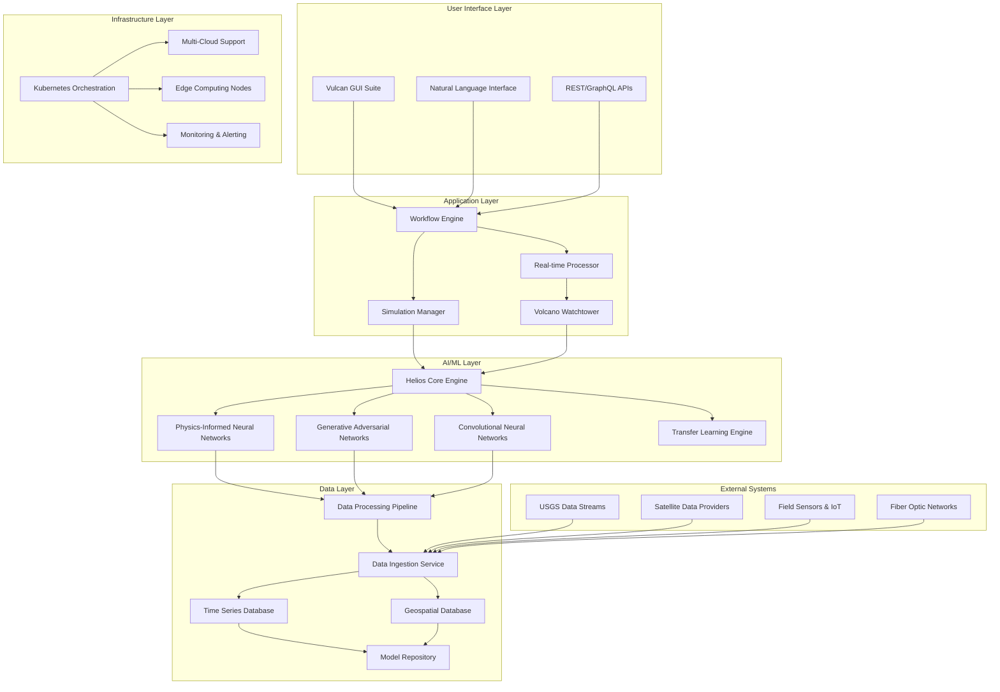

# Design Document

## Overview

Project Prometheus is designed as a distributed, cloud-native AI platform that integrates Physics-Informed Neural Networks (PINNs) with real-time data processing capabilities to provide comprehensive geodynamic, volcanic, and resource simulation. The platform consists of two primary components: the Helios AI model engine and the Vulcan user interface suite, supported by a robust microservices architecture that enables scalability, reliability, and global deployment.

The system architecture follows a hybrid cloud-edge computing model, allowing for both centralized high-performance computing and distributed edge processing for real-time monitoring applications. The platform leverages modern containerization, orchestration, and CI/CD practices to ensure reliable deployment and maintenance across diverse computing environments.

## Architecture

### High-Level System Architecture



### Microservices Architecture

The platform is built using a microservices architecture with the following core services:

1. **Helios Core Service**: Central AI model engine
2. **Data Ingestion Service**: Multi-source data collection and preprocessing
3. **Simulation Service**: Long-term geological modeling
4. **Real-time Processing Service**: Stream processing for monitoring data
5. **Volcano Watchtower Service**: Specialized volcanic monitoring
6. **Workflow Engine Service**: Orchestrates complex analysis pipelines
7. **Natural Language Processing Service**: Handles conversational interfaces
8. **Visualization Service**: Generates 2D/3D/4D visualizations
9. **Edge AI Service**: Manages distributed edge computing nodes
10. **Authentication & Authorization Service**: Security and access control

## Components and Interfaces

### Helios AI Model Engine

**Core Architecture:**
- **Physics-Informed Neural Networks (PINNs)**: Custom implementation using PyTorch with automatic differentiation for enforcing physical constraints
- **Multi-scale Temporal Processing**: Separate model branches for geological timescales (millions of years) vs. real-time monitoring (seconds to days)
- **Ensemble Learning**: Multiple specialized models for different geological processes, combined through attention mechanisms

**Key Components:**
```python
class HeliosCore:
    def __init__(self):
        self.pinn_engine = PINNEngine()
        self.gan_generator = GANGenerator()
        self.transfer_learning = TransferLearningEngine()
        self.model_ensemble = ModelEnsemble()
    
    def process_geodynamic_data(self, data_batch):
        # Physics-informed processing with constraint enforcement
        pass
    
    def simulate_long_term(self, initial_conditions, time_span):
        # Geological timescale simulation
        pass
    
    def analyze_real_time(self, sensor_streams):
        # Real-time volcanic monitoring
        pass
```

**Physics Constraints Implementation:**
- Navier-Stokes equations for fluid dynamics
- Heat transfer equations for thermal processes
- Elastic deformation equations for crustal mechanics
- Mass conservation laws for geochemical processes

### Volcano Watchtower Real-Time System

**Stream Processing Architecture:**
- **Apache Kafka**: Message streaming for real-time data ingestion
- **Apache Flink**: Complex event processing for multi-sensor data fusion
- **Redis Streams**: Low-latency caching for immediate analysis results

**Data Fusion Pipeline:**
```python
class VolcanoWatchtower:
    def __init__(self):
        self.sensor_fusion = MultiSensorFusion()
        self.cnn_processor = SeismicCNNProcessor()
        self.insar_analyzer = InSARDeformationAnalyzer()
        self.alert_system = AlertingSystem()
    
    def process_real_time_stream(self, sensor_data):
        fused_data = self.sensor_fusion.combine(sensor_data)
        seismic_events = self.cnn_processor.detect_events(fused_data.seismic)
        deformation = self.insar_analyzer.analyze(fused_data.insar)
        
        risk_assessment = self.helios_core.assess_volcanic_risk(
            seismic_events, deformation, fused_data
        )
        
        if risk_assessment.alert_level > threshold:
            self.alert_system.trigger_alert(risk_assessment)
```

### Vulcan User Interface Suite

**Frontend Architecture:**
- **React/TypeScript**: Modern web application framework
- **Three.js/WebGL**: 3D visualization and rendering
- **D3.js**: 2D data visualization and mapping
- **WebAssembly**: High-performance client-side computations

**Natural Language Interface:**
```python
class NaturalLanguageProcessor:
    def __init__(self):
        self.intent_classifier = IntentClassifier()
        self.entity_extractor = GeologicalEntityExtractor()
        self.query_translator = QueryTranslator()
    
    def process_user_query(self, natural_language_input):
        intent = self.intent_classifier.classify(natural_language_input)
        entities = self.entity_extractor.extract(natural_language_input)
        
        if intent == "simulation_request":
            return self.translate_to_simulation_config(entities)
        elif intent == "data_analysis":
            return self.translate_to_analysis_pipeline(entities)
```

**No-Code Workflow Builder:**
- Drag-and-drop visual components for all geological processes
- Template library for common analysis workflows
- Visual parameter editors with real-time validation
- Export/import capabilities for workflow sharing

### Data Management System

**Multi-Modal Data Storage:**
- **Time Series Database (InfluxDB)**: Real-time sensor data and monitoring streams
- **Geospatial Database (PostGIS)**: Spatial geological data and model results
- **Object Storage (S3-compatible)**: Large datasets, model artifacts, and visualizations
- **Graph Database (Neo4j)**: Geological relationships and process dependencies

**Data Processing Pipeline:**
```python
class DataProcessingPipeline:
    def __init__(self):
        self.ingestion_service = DataIngestionService()
        self.quality_validator = DataQualityValidator()
        self.format_standardizer = FormatStandardizer()
        self.feature_extractor = GeologicalFeatureExtractor()
    
    def process_incoming_data(self, raw_data, data_source):
        validated_data = self.quality_validator.validate(raw_data)
        standardized_data = self.format_standardizer.standardize(
            validated_data, data_source
        )
        features = self.feature_extractor.extract(standardized_data)
        
        return self.store_processed_data(features)
```

### Edge Computing Architecture

**Edge Node Design:**
- **Lightweight AI Models**: Compressed versions of Helios models optimized for edge hardware
- **Local Data Processing**: Immediate analysis capabilities without cloud connectivity
- **Synchronization Service**: Automatic data and model sync when connectivity is available
- **Ruggedized Deployment**: Support for extreme environmental conditions

**Edge AI Model Optimization:**
```python
class EdgeModelOptimizer:
    def __init__(self):
        self.model_compressor = ModelCompressor()
        self.quantizer = ModelQuantizer()
        self.pruner = ModelPruner()
    
    def optimize_for_edge(self, full_model, hardware_constraints):
        compressed_model = self.model_compressor.compress(full_model)
        quantized_model = self.quantizer.quantize(compressed_model, precision=8)
        pruned_model = self.pruner.prune(quantized_model, sparsity=0.3)
        
        return self.validate_edge_performance(pruned_model, hardware_constraints)
```

## Data Models

### Core Geological Data Models

```python
from dataclasses import dataclass
from typing import List, Optional, Dict
import numpy as np

@dataclass
class GeologicalLocation:
    latitude: float
    longitude: float
    elevation: float
    depth: Optional[float] = None
    coordinate_system: str = "WGS84"

@dataclass
class SeismicEvent:
    timestamp: datetime
    location: GeologicalLocation
    magnitude: float
    depth: float
    event_type: str  # earthquake, volcanic, explosion, etc.
    waveform_data: Optional[np.ndarray] = None
    confidence: float = 1.0

@dataclass
class DeformationMeasurement:
    timestamp: datetime
    location: GeologicalLocation
    displacement_vector: np.ndarray  # [x, y, z] displacement in meters
    measurement_type: str  # GPS, InSAR, tiltmeter, etc.
    uncertainty: np.ndarray  # uncertainty in each dimension
    reference_frame: str = "ITRF2014"

@dataclass
class GeochemicalSample:
    timestamp: datetime
    location: GeologicalLocation
    sample_type: str  # rock, gas, water, etc.
    composition: Dict[str, float]  # element/compound concentrations
    isotope_ratios: Optional[Dict[str, float]] = None
    temperature: Optional[float] = None
    pressure: Optional[float] = None

@dataclass
class ThermalMeasurement:
    timestamp: datetime
    location: GeologicalLocation
    temperature: float
    measurement_method: str  # satellite, ground-based, borehole, etc.
    spatial_resolution: float  # meters
    uncertainty: float

@dataclass
class MagmaReservoir:
    location: GeologicalLocation
    volume: float  # cubic meters
    composition: GeochemicalSample
    temperature: float
    pressure: float
    crystallinity: float  # fraction of crystals
    volatile_content: Dict[str, float]  # H2O, CO2, SO2, etc.
    connectivity: List[str]  # connected reservoir IDs
```

### AI Model Data Structures

```python
@dataclass
class PINNModelConfig:
    physics_constraints: List[str]  # equations to enforce
    network_architecture: Dict[str, int]  # layer sizes
    activation_functions: List[str]
    boundary_conditions: Dict[str, float]
    loss_weights: Dict[str, float]  # physics vs. data loss weights

@dataclass
class SimulationParameters:
    initial_conditions: Dict[str, np.ndarray]
    time_span: tuple  # (start_time, end_time)
    spatial_domain: Dict[str, tuple]  # x, y, z bounds
    resolution: Dict[str, float]  # spatial and temporal resolution
    physics_models: List[str]  # active physics modules
    uncertainty_quantification: bool = True

@dataclass
class ModelPrediction:
    timestamp: datetime
    prediction_type: str
    values: np.ndarray
    uncertainty: np.ndarray
    confidence_interval: tuple
    model_version: str
    input_data_hash: str
```

### Real-Time Monitoring Data Models

```python
@dataclass
class SensorReading:
    sensor_id: str
    timestamp: datetime
    location: GeologicalLocation
    measurement_type: str
    value: float
    unit: str
    quality_flag: str  # good, questionable, bad
    calibration_date: datetime

@dataclass
class AlertLevel:
    level: int  # 0-5 scale
    description: str
    recommended_actions: List[str]
    validity_period: tuple  # (start, end) timestamps
    confidence: float

@dataclass
class VolcanicRiskAssessment:
    volcano_id: str
    timestamp: datetime
    alert_level: AlertLevel
    eruption_probability: Dict[str, float]  # timeframe -> probability
    hazard_zones: Dict[str, np.ndarray]  # hazard type -> affected areas
    contributing_factors: List[str]
    model_ensemble_agreement: float
```

## Error Handling

### Hierarchical Error Management

**Error Categories:**
1. **Data Quality Errors**: Invalid, missing, or corrupted input data
2. **Model Convergence Errors**: AI model training or inference failures
3. **Physics Constraint Violations**: Results that violate fundamental physical laws
4. **System Resource Errors**: Memory, compute, or storage limitations
5. **Network/Connectivity Errors**: Communication failures with external systems
6. **Security Errors**: Authentication, authorization, or data access violations

**Error Handling Strategy:**
```python
class PrometheusErrorHandler:
    def __init__(self):
        self.error_classifier = ErrorClassifier()
        self.recovery_strategies = RecoveryStrategies()
        self.alert_system = AlertSystem()
        self.fallback_models = FallbackModels()
    
    def handle_error(self, error, context):
        error_type = self.error_classifier.classify(error)
        
        if error_type == "data_quality":
            return self.handle_data_quality_error(error, context)
        elif error_type == "model_convergence":
            return self.handle_model_error(error, context)
        elif error_type == "physics_violation":
            return self.handle_physics_error(error, context)
        else:
            return self.handle_system_error(error, context)
    
    def handle_data_quality_error(self, error, context):
        # Attempt data cleaning and interpolation
        cleaned_data = self.data_cleaner.clean(context.data)
        if self.quality_validator.validate(cleaned_data):
            return self.retry_with_cleaned_data(cleaned_data)
        else:
            # Use fallback data sources or historical averages
            return self.use_fallback_data(context)
    
    def handle_model_error(self, error, context):
        # Try simplified model or ensemble fallback
        if context.model_complexity > "minimal":
            return self.retry_with_simplified_model(context)
        else:
            return self.use_ensemble_fallback(context)
    
    def handle_physics_error(self, error, context):
        # Adjust model constraints or use physics-guided correction
        corrected_result = self.physics_corrector.correct(
            context.result, context.constraints
        )
        if self.physics_validator.validate(corrected_result):
            return corrected_result
        else:
            # Flag for manual review
            self.alert_system.flag_for_review(error, context)
            return self.use_conservative_estimate(context)
```

### Graceful Degradation

**Service Degradation Levels:**
1. **Full Service**: All features available with optimal performance
2. **Reduced Precision**: Lower resolution models for faster response
3. **Essential Services Only**: Critical monitoring and alerting only
4. **Offline Mode**: Cached results and local processing only
5. **Emergency Mode**: Basic alerting using pre-computed thresholds

**Automatic Fallback Mechanisms:**
- Model ensemble voting when individual models fail
- Historical data interpolation for missing real-time data
- Simplified physics models when complex simulations fail
- Cached results when real-time processing is unavailable

## Testing Strategy

### Multi-Level Testing Approach

**Unit Testing:**
- Individual AI model components
- Data processing functions
- Physics constraint validators
- API endpoints and services

**Integration Testing:**
- End-to-end data pipelines
- Multi-service workflows
- External system integrations
- Real-time processing chains

**Model Validation Testing:**
```python
class ModelValidationSuite:
    def __init__(self):
        self.benchmark_datasets = BenchmarkDatasets()
        self.physics_validators = PhysicsValidators()
        self.performance_metrics = PerformanceMetrics()
    
    def validate_helios_model(self, model, test_suite):
        # Test against known geological benchmarks
        benchmark_results = self.test_against_benchmarks(model, test_suite)
        
        # Validate physics constraint adherence
        physics_compliance = self.validate_physics_constraints(model)
        
        # Performance and accuracy metrics
        performance_metrics = self.measure_performance(model, test_suite)
        
        return ValidationReport(
            benchmark_results, physics_compliance, performance_metrics
        )
    
    def test_against_benchmarks(self, model, test_suite):
        results = {}
        for benchmark in self.benchmark_datasets.get_all():
            prediction = model.predict(benchmark.input_data)
            accuracy = self.calculate_accuracy(prediction, benchmark.expected)
            results[benchmark.name] = accuracy
        return results
```

**Geological Model Testing:**
- Comparison with peer-reviewed geological studies
- Validation against known volcanic eruption sequences
- Cross-validation with independent monitoring data
- Uncertainty quantification accuracy assessment

**Performance Testing:**
- Load testing for real-time data streams
- Scalability testing for large-scale simulations
- Edge device performance validation
- Network resilience testing

**Security Testing:**
- Penetration testing for API endpoints
- Data encryption validation
- Access control verification
- Audit trail completeness

### Continuous Validation

**Automated Model Monitoring:**
- Real-time accuracy tracking against ground truth
- Drift detection for model performance degradation
- Automated retraining triggers
- A/B testing for model improvements

**Scientific Validation Pipeline:**
- Automated comparison with published research
- Peer review integration for model updates
- Community feedback incorporation
- Reproducibility verification

### Advanced Cloud Computing Architecture

**Multi-Cloud Distributed Computing:**
```python
class CloudComputingOrchestrator:
    def __init__(self):
        self.tpu_manager = TPUPodManager()
        self.gpu_cluster_manager = GPUClusterManager()
        self.serverless_manager = CloudRunManager()
        self.cost_optimizer = CloudCostOptimizer()
    
    def allocate_compute_resources(self, task_requirements):
        if task_requirements.type == "massive_simulation":
            return self.tpu_manager.allocate_tpu_pods(task_requirements)
        elif task_requirements.type == "real_time_processing":
            return self.serverless_manager.scale_cloud_run(task_requirements)
        elif task_requirements.type == "model_training":
            return self.gpu_cluster_manager.allocate_gpu_cluster(task_requirements)
    
    def optimize_resource_usage(self, current_workload):
        # Use spot instances and preemptible resources
        optimized_allocation = self.cost_optimizer.optimize(current_workload)
        return self.deploy_optimized_resources(optimized_allocation)
```

**TPU Pod Integration:**
- Custom TensorFlow/JAX implementations for geological simulations
- Distributed training across TPU pods for massive neural networks
- Automatic sharding of geological datasets across TPU cores
- Specialized TPU kernels for physics-informed computations

### Advanced Database Architecture

**Multi-Database Ecosystem:**
```python
class AdvancedDatabaseManager:
    def __init__(self):
        self.mongodb_client = MongoDBClient()  # Unstructured geological data
        self.postgresql_client = PostgreSQLClient()  # Relational + PostGIS
        self.neo4j_client = Neo4jClient()  # Graph relationships
        self.timescaledb_client = TimescaleDBClient()  # Time-series optimization
        self.vector_db_client = PineconeClient()  # Embeddings and similarity search
    
    def store_geological_data(self, data, data_type):
        if data_type == "unstructured_samples":
            return self.mongodb_client.store(data)
        elif data_type == "spatial_temporal":
            return self.postgresql_client.store_with_postgis(data)
        elif data_type == "process_relationships":
            return self.neo4j_client.create_graph_relationships(data)
        elif data_type == "sensor_timeseries":
            return self.timescaledb_client.store_optimized(data)
```

**Sophisticated Data Modeling:**
- Complex geological process networks in Neo4j
- Multi-dimensional spatial-temporal queries in PostGIS
- Flexible schema evolution for diverse geological data types
- Advanced indexing strategies for high-performance queries

### Autonomous Scientific Discovery Engine

**Active Learning and Causal Discovery:**
```python
class AutonomousDiscoveryEngine:
    def __init__(self):
        self.active_learner = ActiveLearningEngine()
        self.causal_inference = CausalInferenceEngine()
        self.hypothesis_generator = HypothesisGenerator()
        self.knowledge_graph = ScientificKnowledgeGraph()
        self.anomaly_detector = GeologicalAnomalyDetector()
    
    def discover_new_relationships(self, geological_data):
        # Active learning to identify most informative samples
        informative_samples = self.active_learner.select_samples(geological_data)
        
        # Causal inference to discover cause-effect relationships
        causal_relationships = self.causal_inference.discover_causality(
            informative_samples
        )
        
        # Generate testable hypotheses
        hypotheses = self.hypothesis_generator.generate(causal_relationships)
        
        # Update knowledge graph with new discoveries
        self.knowledge_graph.update_with_discoveries(
            causal_relationships, hypotheses
        )
        
        return ScientificDiscovery(
            relationships=causal_relationships,
            hypotheses=hypotheses,
            confidence_scores=self.calculate_confidence(causal_relationships)
        )
    
    def identify_new_scientific_laws(self, multi_variate_data):
        # Graph neural networks for hidden relationship discovery
        hidden_relationships = self.graph_neural_network.discover_patterns(
            multi_variate_data
        )
        
        # Mathematical formulation of discovered patterns
        mathematical_laws = self.law_formulator.formulate(hidden_relationships)
        
        # Validation and confidence assessment
        validation_results = self.validate_discovered_laws(mathematical_laws)
        
        return NewScientificLaws(
            laws=mathematical_laws,
            validation=validation_results,
            suggested_experiments=self.suggest_validation_experiments(mathematical_laws)
        )
```

**Knowledge Graph Integration:**
- Automated extraction of scientific knowledge from literature
- Dynamic updating of geological process relationships
- Semantic reasoning for hypothesis generation
- Integration with external scientific databases and ontologies

### Comprehensive Multi-Physics Modeling

**Advanced Simulation Architecture:**
```python
class ComprehensiveGeologicalSimulator:
    def __init__(self):
        self.multi_physics_engine = MultiPhysicsEngine()
        self.complexity_manager = ModelComplexityManager()
        self.validation_engine = ScientificValidationEngine()
    
    def run_comprehensive_simulation(self, geological_scenario):
        # Avoid oversimplification - use full complexity models
        full_complexity_config = self.complexity_manager.get_full_complexity_config(
            geological_scenario
        )
        
        # Multi-physics coupling: thermal, mechanical, chemical, electromagnetic
        coupled_simulation = self.multi_physics_engine.run_coupled_simulation(
            thermal_model=self.thermal_engine,
            mechanical_model=self.mechanical_engine,
            chemical_model=self.chemical_engine,
            electromagnetic_model=self.electromagnetic_engine,
            config=full_complexity_config
        )
        
        # Scientific validation against known benchmarks
        validation_results = self.validation_engine.validate_against_benchmarks(
            coupled_simulation
        )
        
        return ComprehensiveSimulationResult(
            simulation=coupled_simulation,
            validation=validation_results,
            complexity_metrics=self.complexity_manager.assess_complexity(coupled_simulation)
        )
```

This comprehensive design provides a robust foundation for implementing the Prometheus AI-powered geodynamic platform, addressing all the complex requirements while ensuring scalability, reliability, and scientific accuracy. The advanced cloud computing, sophisticated database systems, and autonomous discovery capabilities position Prometheus as a revolutionary platform for geological research and discovery.