# Design Document

## Overview

The Prometheus AI Platform is a comprehensive geodynamic and volcanic monitoring system that integrates over 100 specialized modules into a unified AI-powered platform. The system combines advanced machine learning, physics-informed neural networks, real-time data processing, and long-term geological simulation capabilities to serve researchers and industry professionals in geophysics, volcanology, and resource assessment.

The platform is built around several core engines:
- **Helios AI Engine**: Physics-informed neural networks with geological constraints
- **Volcano Watchtower**: Real-time volcanic monitoring and eruption forecasting
- **Digital Twin Earth**: Comprehensive Earth system modeling with data assimilation
- **Prospectivity Engine**: AI-powered mineral and energy resource assessment
- **Multi-Physics Coupling Engine**: Advanced thermal-mechanical-chemical-electromagnetic coupling
- **Scientific Knowledge Graph**: Automated knowledge extraction and semantic reasoning

The system follows a modular, event-driven architecture with microservices patterns, enabling independent scaling while maintaining tight integration for complex multi-physics simulations.

## Architecture

### High-Level System Architecture

```mermaid
graph TB
    subgraph "External Data Sources"
        A[IRIS/EarthScope Seismic]
        B[Copernicus Satellites]
        C[ASF-Hyp3 InSAR]
        D[USGS Monitoring]
        E[NASA EarthData]
        F[Wikidata/GeoNames]
        G[Connected Papers API]
    end
    
    subgraph "API Gateway & Security"
        H[Flask/FastAPI Gateway]
        I[JWT Authentication]
        J[Zero-Trust Security Framework]
        K[Rate Limiting & Load Balancing]
    end
    
    subgraph "Core AI Engines"
        L[Helios PINN Engine]
        M[Multi-Physics Coupling]
        N[Geological Constraints]
        O[Uncertainty Quantification GANs]
        P[Scientific Knowledge Graph]
        Q[Causal Inference Engine]
    end
    
    subgraph "Specialized Processing Systems"
        R[Volcano Watchtower]
        S[Digital Twin Earth]
        T[Prospectivity Engine]
        U[Seismic Transformer]
        V[Eruption Forecaster ML]
        W[Caldera System Classifier]
        X[Thermodynamic Engine]
        Y[Multi-Sensor Fusion]
    end
    
    subgraph "Advanced Analytics"
        Z[3D Geological Modeler]
        AA[3D Magmatic System Modeler]
        BB[Advanced GNN Implementations]
        CC[Crystallographic Methods]
        DD[Stress Field Mapper]
        EE[Mantle Convection 3D]
        FF[Plate Evolution Engine]
    end
    
    subgraph "MLOps & Management"
        GG[MLOps Pipeline]
        HH[Model Manager]
        II[Performance Benchmarking]
        JJ[Adaptive Model Selection]
        KK[Hyperparameter Optimization]
    end
    
    subgraph "Data Layer"
        LL[InfluxDB - Time Series]
        MM[PostgreSQL+PostGIS - Geospatial]
        NN[Neo4j - Knowledge Graph]
        OO[Redis - Cache/Sessions]
        PP[SQLite - Local Storage]
    end
    
    subgraph "Visualization & Interface"
        QQ[High Resolution Visualization]
        RR[Digital Twin Visualization]
        SS[Real-time Dashboards]
        TT[3D/4D Geological Rendering]
    end
    
    A --> H
    B --> H
    C --> H
    D --> H
    E --> H
    F --> H
    G --> H
    
    H --> L
    H --> R
    H --> S
    H --> T
    
    L --> M
    M --> N
    N --> O
    L --> P
    P --> Q
    
    R --> Y
    S --> Z
    T --> AA
    U --> V
    V --> W
    W --> X
    
    Z --> BB
    AA --> CC
    BB --> DD
    CC --> EE
    DD --> FF
    
    GG --> HH
    HH --> II
    II --> JJ
    JJ --> KK
    
    R --> LL
    S --> MM
    T --> NN
    U --> OO
    V --> PP
    
    L --> QQ
    R --> RR
    S --> SS
    T --> TT
```



### Service Architecture Pattern

Each major component follows a consistent microservice pattern:

- **API Layer**: FastAPI for Python services, Express.js for Node.js gateway
- **Business Logic**: Domain-specific processing with clear interfaces
- **Data Access**: Repository pattern with database abstraction
- **Event Handling**: Async message processing with Kafka
- **Health Monitoring**: Comprehensive health checks and metrics

## Components and Interfaces

### 1. Core AI Engine (Helios)

**Purpose**: Central AI processing engine that coordinates all geological modeling and prediction tasks using physics-informed neural networks.

**Key Components**:
- `GeologicalPhysicsInformedNeuralNetworks`: Advanced PINN framework with geological constraints
- `MultiPhysicsCouplingEngine`: Thermal-mechanical-chemical-electromagnetic coupling with adaptive time-stepping
- `GeologicalConstraintsEngine`: Enforces conservation laws and geological principles
- `UncertaintyQuantificationGANs`: Generates realistic geological scenarios with uncertainty bounds
- `AdaptiveModelSelection`: Intelligent model selection based on data characteristics
- `CausalInferenceEngine`: Discovers causal relationships in geological processes

**Interfaces**:
```python
class HeliosAIEngine:
    async def initialize_models(self, config: GeologicalPINNConfig) -> bool
    async def process_geological_data(self, data: GeologicalDataset) -> ModelResults
    async def run_physics_simulation(self, params: SimulationParameters) -> SimulationResults
    async def quantify_uncertainty(self, scenario: GeologicalScenario) -> UncertaintyBounds
    async def discover_causal_relationships(self, data: MultiVariateData) -> CausalGraph
    async def adapt_model_architecture(self, performance_metrics: Dict) -> ModelArchitecture
```

### 2. Volcano Watchtower (Real-time Monitoring)

**Purpose**: Comprehensive real-time volcanic monitoring system that integrates multiple data sources for advanced eruption forecasting and caldera system analysis.

**Key Components**:
- `SeismicTransformer`: Advanced transformer models for seismic phase picking and event classification
- `EruptionForecasterML`: Physics-informed neural networks for eruption prediction with uncertainty quantification
- `CalderaSystemClassifier`: Machine learning classification of caldera types and formation mechanisms
- `MultiSensorFusion`: Real-time data integration from IRIS, Copernicus, ASF-Hyp3, USGS, NASA EarthData
- `DeformationAnalyzer`: Advanced InSAR and GPS processing with CNN-based pattern recognition
- `ResurgentCalderaMonitoring`: Specialized monitoring for large caldera systems
- `SupereruptionAnalysis`: Analysis of supereruption potential and hazard assessment

**Interfaces**:
```python
class VolcanoWatchtower:
    async def ingest_realtime_data(self, stream: DataStream) -> ProcessingStatus
    async def detect_seismic_events(self, seismic_data: SeismicData) -> List[SeismicEvent]
    async def analyze_deformation(self, insar_data: InSARData) -> DeformationAnalysis
    async def forecast_eruption(self, volcano_id: str) -> EruptionForecast
    async def classify_caldera_system(self, caldera_data: CalderaFeatures) -> CalderaClassification
    async def assess_supereruption_risk(self, caldera_id: str) -> SupereruptionRiskAssessment
    async def monitor_resurgent_dome(self, dome_data: ResurgentDomeData) -> DomeAnalysis
```

### 3. Digital Twin Earth System

**Purpose**: Comprehensive Earth system modeling with real-time data assimilation, multi-scale coupling, and advanced visualization capabilities.

**Key Components**:
- `DigitalTwinEarth`: Global Earth system representation with multi-physics coupling
- `DigitalTwinDataManagement`: Advanced data management with versioning and lineage tracking
- `DigitalTwinMonitoring`: Real-time system monitoring and performance optimization
- `DigitalTwinVisualization`: High-resolution 3D/4D visualization with interactive capabilities
- `DigitalTwinMultiuser`: Multi-user collaboration and access control
- `DigitalTwinPerformanceOptimization`: Automated performance tuning and resource management
- `ManteConvection3D`: Advanced 3D mantle convection modeling
- `PlateEvolutionEngine`: Long-term tectonic plate evolution simulation

**Interfaces**:
```python
class DigitalTwinEarth:
    async def initialize_earth_model(self, region: GeographicRegion) -> EarthModel
    async def assimilate_observations(self, observations: ObservationData) -> AssimilationResults
    async def update_model_state(self, timestamp: datetime) -> ModelState
    async def generate_predictions(self, forecast_horizon: timedelta) -> Predictions
    async def simulate_mantle_convection(self, params: ConvectionParameters) -> ConvectionResults
    async def evolve_plate_boundaries(self, time_span: GeologicalTimeSpan) -> PlateEvolution
    async def optimize_performance(self, metrics: PerformanceMetrics) -> OptimizationResults
```

### 4. Resource Assessment Engine

**Purpose**: Advanced AI-powered mineral and energy resource prospectivity mapping with multi-commodity targeting and uncertainty quantification.

**Key Components**:
- `ProspectivityEngine`: State-of-the-art deep learning models (CNN, Transformer, GNN) for resource mapping
- `ResourceEvaluator`: Comprehensive resource assessment with Bayesian uncertainty quantification
- `EconomicOptimizer`: Economic viability analysis with market dynamics and risk assessment
- `GeochemicalML`: Advanced machine learning for geochemical data analysis and interpretation
- `GeologicalFeatureExtractor`: Automated geological feature engineering with domain knowledge
- `IsotopeModeler`: Isotopic analysis for resource characterization and genesis studies
- `HydrothermalFlowEngine`: Hydrothermal system modeling for ore deposit formation

**Interfaces**:
```python
class ResourceAssessmentEngine:
    async def analyze_prospectivity(self, region: GeographicRegion) -> ProspectivityMap
    async def evaluate_resources(self, prospect: ResourceProspect) -> ResourceAssessment
    async def optimize_economics(self, assessment: ResourceAssessment) -> EconomicAnalysis
    async def generate_report(self, analysis: EconomicAnalysis) -> AssessmentReport
    async def analyze_geochemistry(self, samples: GeochemicalSamples) -> GeochemicalAnalysis
    async def model_isotopes(self, isotope_data: IsotopeData) -> IsotopeModel
    async def simulate_hydrothermal_flow(self, params: HydrothermalParameters) -> FlowResults
```

### 5. Advanced Analytics and Modeling Systems

**Purpose**: Comprehensive geological modeling and analysis capabilities with advanced machine learning and physics-based approaches.

**Key Components**:
- `3DGeologicalModeler`: Advanced 3D geological modeling with implicit surface techniques
- `3DMagmaticSystemModeler`: Comprehensive magmatic system modeling from seismic tomography
- `AdvancedGNNImplementations`: Graph neural networks for geological relationship modeling
- `AdvancedCrystallographicMethods`: Crystallographic analysis with database integration
- `StressFieldMapper`: Advanced stress field analysis and visualization
- `GeodynamoSimulator`: Earth's magnetic field generation modeling
- `ThermodynamicEngine`: Advanced thermodynamic calculations and phase diagram generation
- `AdvancedGeologicalGAT`: Graph attention networks for geological analysis

**Interfaces**:
```python
class AdvancedAnalyticsEngine:
    async def model_3d_geology(self, data: GeologicalData) -> GeologicalModel3D
    async def analyze_magmatic_system(self, seismic_data: SeismicTomography) -> MagmaticSystemModel
    async def process_with_gnn(self, graph_data: GeologicalGraph) -> GNNResults
    async def analyze_crystallography(self, crystal_data: CrystalData) -> CrystallographicAnalysis
    async def map_stress_field(self, stress_data: StressData) -> StressFieldMap
    async def simulate_geodynamo(self, params: GeodynamoParameters) -> MagneticFieldModel
    async def calculate_thermodynamics(self, conditions: ThermodynamicConditions) -> PhaseResults
```

### 6. MLOps and Model Management

**Purpose**: Comprehensive machine learning operations pipeline for model lifecycle management, monitoring, and optimization.

**Key Components**:
- `MLOpsPipeline`: Automated ML lifecycle management with deployment strategies
- `ModelManager`: Model versioning, storage, and serving with Azure VM integration
- `PerformanceBenchmarkingProfiling`: Advanced performance analysis and optimization
- `AdaptiveModelSelection`: Intelligent model selection based on data characteristics and constraints
- `HyperparameterOptimizer`: Automated hyperparameter tuning using Optuna and Vizier
- `ModelDatabase`: Centralized model metadata and artifact management

**Interfaces**:
```python
class MLOpsEngine:
    async def deploy_model(self, model: MLModel, strategy: DeploymentStrategy) -> DeploymentResult
    async def monitor_model_performance(self, model_id: str) -> PerformanceMetrics
    async def optimize_hyperparameters(self, model_config: ModelConfig) -> OptimizedConfig
    async def select_optimal_model(self, data_characteristics: DataCharacteristics) -> ModelRecommendation
    async def benchmark_performance(self, system_con

## Data Models

### Core Geological Data Structures

```python
@dataclass
class GeologicalDataset:
    id: str
    timestamp: datetime
    data_type: DataType
    spatial_extent: GeographicBounds
    temporal_range: TemporalRange
    quality_metrics: QualityMetrics
    metadata: Dict[str, Any]

@dataclass
class SeismicEvent:
    event_id: str
    timestamp: datetime
    location: Point3D
    magnitude: float
    depth: float
    event_type: SeismicEventType
    confidence: float
    waveform_data: Optional[np.ndarray]
    moment_tensor: Optional[MomentTensorSolution]
    source_mechanism: Optional[SourceMechanism]

@dataclass
class VolcanicState:
    volcano_id: str
    timestamp: datetime
    alert_level: AlertLevel
    magma_chamber_pressure: float
    deformation_rate: float
    gas_emissions: GasComposition
    thermal_anomalies: List[ThermalAnomaly]
    eruption_probability: float
    caldera_classification: Optional[CalderaClassification]
    supereruption_risk: Optional[SupereruptionRiskAssessment]

@dataclass
class ResourceProspect:
    prospect_id: str
    location: GeographicRegion
    resource_type: ResourceType
    geological_setting: GeologicalSetting
    geophysical_signature: GeophysicalData
    geochemical_signature: GeochemicalData
    prospectivity_score: float
    confidence_interval: Tuple[float, float]
    economic_assessment: Optional[EconomicAnalysis]

@dataclass
class MagmaticSystem:
    system_id: str
    parent_volcanic_system: str
    chambers: List[MagmaReservoir]
    composition: MagmaComposition
    thermal_state: ThermalModel
    seismic_properties: SeismicProperties
    melt_fraction_model: MeltFractionModel
    validation_metrics: Dict[str, float]

@dataclass
class GeologicalModel3D:
    model_id: str
    spatial_grid: np.ndarray
    lithology_units: List[LithologyUnit]
    structural_features: List[StructuralFeature]
    implicit_surfaces: List[ImplicitSurface]
    grade_interpolation: Optional[GradeInterpolation]
    uncertainty_bounds: Optional[UncertaintyBounds]

@dataclass
class StreamEvent:
    event_id: str
    event_type: StreamEventType
    timestamp: datetime
    source_id: str
    data: Dict[str, Any]
    metadata: Dict[str, Any]
    location: Optional[Tuple[float, float, float]]
    processing_status: ProcessingStatus

@dataclass
class CausalRelationship:
    source_variable: str
    target_variable: str
    relationship_type: GeologicalCausalRelationType
    strength: float
    confidence: float
    temporal_lag: Optional[timedelta]
    spatial_scale: str
    evidence: List[str]

@dataclass
class GeneratedHypothesis:
    id: str
    hypothesis_type: HypothesisType
    description: str
    mathematical_formulation: MathematicalFormulation
    causal_basis: List[CausalEdge]
    confidence_score: float
    statistical_evidence: Dict[str, float]
    experimental_design: Dict[str, Any]
    validation_status: str
```

### Database Schema Design

**InfluxDB (Time-Series Data)**:
- Measurement: `seismic_events`
  - Tags: `station_id`, `event_type`, `volcano_id`
  - Fields: `magnitude`, `depth`, `latitude`, `longitude`
  - Time: Event timestamp

- Measurement: `deformation_data`
  - Tags: `sensor_id`, `measurement_type`, `volcano_id`
  - Fields: `displacement_x`, `displacement_y`, `displacement_z`
  - Time: Measurement timestamp

**PostgreSQL+PostGIS (Geospatial Data)**:
```sql
CREATE TABLE volcanoes (
    id UUID PRIMARY KEY,
    name VARCHAR(255) NOT NULL,
    location GEOMETRY(POINT, 4326),
    elevation FLOAT,
    volcano_type VARCHAR(100),
    last_eruption DATE,
    hazard_level INTEGER
);

CREATE TABLE geological_units (
    id UUID PRIMARY KEY,
    name VARCHAR(255),
    age_min FLOAT,
    age_max FLOAT,
    lithology VARCHAR(100),
    geometry GEOMETRY(MULTIPOLYGON, 4326)
);
```

**Neo4j (Knowledge Graph)**:
```cypher
// Geological process relationships
CREATE (magma:Process {name: "Magma Generation", type: "thermal"})
CREATE (transport:Process {name: "Magma Transport", type: "mechanical"})
CREATE (eruption:Process {name: "Volcanic Eruption", type: "explosive"})

CREATE (magma)-[:LEADS_TO]->(transport)
CREATE (transport)-[:LEADS_TO]->(eruption)
```

## Error Handling

### Error Classification and Response Strategy

**1. Data Quality Errors**:
- Missing or corrupted sensor data
- Spatial/temporal gaps in datasets
- Inconsistent data formats

**Response**: Implement data validation pipelines with automatic correction where possible, graceful degradation for missing data, and clear error reporting.

**2. Model Computation Errors**:
- Physics constraint violations
- Numerical instability in simulations
- Memory/computational resource exhaustion

**Response**: Implement circuit breakers, automatic parameter adjustment, and fallback to simpler models when needed.

**3. System Integration Errors**:
- Service communication failures
- Database connection issues
- External API timeouts

**Response**: Implement retry logic with exponential backoff, health checks, and service mesh for resilient communication.

**4. Real-time Processing Errors**:
- Data stream interruptions
- Processing latency issues
- Alert system failures

**Response**: Implement buffering, parallel processing, and redundant alert channels.

### Error Handling Implementation

```python
class PrometheusErrorHandler:
    def __init__(self):
        self.circuit_breakers = {}
        self.retry_policies = {}
        
    async def handle_data_error(self, error: DataError) -> ErrorResponse:
        if error.is_recoverable():
            return await self.attempt_data_recovery(error)
        else:
            return await self.log_and_degrade(error)
    
    async def handle_model_error(self, error: ModelError) -> ErrorResponse:
        if error.type == ModelErrorType.PHYSICS_VIOLATION:
            return await self.adjust_constraints(error)
        elif error.type == ModelErrorType.NUMERICAL_INSTABILITY:
            return await self.fallback_to_stable_method(error)
```

## Testing Strategy

### 1. Unit Testing
- **Scope**: Individual module functions and classes
- **Framework**: pytest for Python, Jest for Node.js
- **Coverage**: Minimum 80% code coverage for all modules
- **Focus**: Physics calculations, data transformations, API endpoints

### 2. Integration Testing
- **Scope**: Module-to-module communication and data flow
- **Framework**: pytest with async support, Docker Compose for services
- **Coverage**: All major data pipelines and service interactions
- **Focus**: Database operations, external API calls, message passing

### 3. Performance Testing
- **Scope**: System performance under load and stress conditions
- **Framework**: k6 for load testing, custom benchmarking for ML models
- **Metrics**: Response times, throughput, resource utilization
- **Focus**: Real-time processing capabilities, large-scale simulations

### 4. End-to-End Testing
- **Scope**: Complete user workflows from data ingestion to results
- **Framework**: Selenium for UI testing, API testing with Newman
- **Coverage**: Critical user journeys and business processes
- **Focus**: Volcanic monitoring workflows, resource assessment pipelines

### 5. Geological Validation Testing
- **Scope**: Validation against known geological phenomena and datasets
- **Framework**: Custom validation framework with geological benchmarks
- **Coverage**: Physics model accuracy, prediction validation
- **Focus**: Eruption forecasting accuracy, resource prediction validation

### Testing Implementation

```python
class GeologicalValidationSuite:
    def __init__(self):
        self.benchmark_datasets = self.load_benchmarks()
        self.validation_metrics = ValidationMetrics()
        self.advanced_testing_framework = AdvancedTestingFramework()
    
    async def test_eruption_forecasting(self):
        """Test eruption forecasting against historical data"""
        for volcano in self.benchmark_datasets.volcanoes:
            forecast = await self.volcano_watchtower.forecast_eruption(volcano.id)
            accuracy = self.validate_against_historical(forecast, volcano.eruption_history)
            assert accuracy > 0.75, f"Forecast accuracy too low for {volcano.name}"
    
    async def test_physics_constraints(self):
        """Validate that physics constraints are properly enforced"""
        simulation = await self.helios_engine.run_physics_simulation(test_params)
        violations = self.check_physics_violations(simulation.results)
        assert len(violations) == 0, f"Physics violations detected: {violations}"
    
    async def test_3d_geological_modeling(self):
        """Test 3D geological modeling accuracy"""
        test_data = self.benchmark_datasets.geological_models
        for model_data in test_data:
            result = await self.advanced_analytics.model_3d_geology(model_data.input)
            accuracy = self.compare_geological_models(result, model_data.expected)
            assert accuracy > 0.80, f"3D modeling accuracy too low: {accuracy}"
    
    async def test_multi_sensor_fusion(self):
        """Test real-time multi-sensor data fusion"""
        synthetic_streams = self.generate_synthetic_sensor_streams()
        fusion_result = await self.data_integration.fuse_sensor_data(synthetic_streams)
        assert fusion_result.quality_score > 0.85, "Sensor fusion quality insufficient"
    
    async def test_federated_learning(self):
        """Test federated learning convergence and privacy"""
        federated_config = self.create_test_federated_config()
        model = await self.advanced_ai.train_federated_model(federated_config)
        assert model.convergence_achieved, "Federated learning failed to converge"
        assert model.privacy_preserved, "Privacy constraints violated"
    
    async def test_performance_benchmarks(self):
        """Test system performance against benchmarks"""
        performance_results = await self.infrastructure.benchmark_performance(self.test_config)
        assert performance_results.throughput > self.min_throughput, "Throughput below minimum"
        assert performance_results.latency < self.max_latency, "Latency above maximum"
```

## Frontend Architecture Details

### Geophysically Accurate Visualization Requirements

The frontend must maintain strict geophysical accuracy in all visualizations:

**Coordinate Systems and Projections**:
- Support for multiple coordinate reference systems (WGS84, UTM, local grids)
- Accurate map projections for global and regional data visualization
- Proper handling of elevation and depth coordinates with geoid corrections

**3D/4D Geological Rendering**:
- WebGL-based rendering with geological color schemes and scientific accuracy
- Real-time subsurface visualization with proper depth scaling
- Time-series animation capabilities for 4D geological evolution
- Cross-sectional views with accurate geological layer representation

**Scientific Data Visualization Standards**:
- Proper color scales for geophysical parameters (velocity, density, temperature)
- Uncertainty visualization with confidence intervals and error bars
- Multi-scale visualization from mineral-scale to global-scale phenomena
- Interactive tools for data exploration and analysis

**Real-time Dashboard Requirements**:
- Sub-second update capabilities for real-time monitoring data
- Scalable visualization for large datasets (millions of data points)
- Responsive design for multiple screen sizes and devices
- Accessibility compliance for scientific visualization standards

This comprehensive design provides a robust, scalable architecture that can handle the complexity of your 100+ module system while maintaining clear interfaces, proper separation of concerns, and geophysical accuracy. The modular design allows for independent development and deployment while ensuring tight integration for complex geological simulations and real-time monitoring capabilities.

### 5. Advanced Analytics and Modeling Systems

**Purpose**: Comprehensive suite of specialized geological modeling and analysis systems.

**Key Components**:
- `3DGeologicalModeler`: Advanced 3D geological modeling with implicit surface modeling and structural geology
- `3DMagmaticSystemModeler`: Physics-informed neural networks for magmatic system modeling with seismic tomography integration
- `AdvancedGNNImplementations`: Graph neural networks for geological relationship modeling and independence testing
- `AdvancedGeologicalGAT`: Geological Graph Attention Networks with hierarchical and physics-informed attention
- `CrystallographicMethods`: Advanced crystallographic calculations with database integration
- `StressFieldMapper`: Stress field analysis and visualization with fault system modeling
- `MantleConvection3D`: 3D mantle convection modeling with thermal evolution
- `PlateEvolutionEngine`: Long-term plate tectonic evolution and reconstruction

**Interfaces**:
```python
class AdvancedAnalyticsEngine:
    async def model_3d_geology(self, data: GeologicalData) -> GeologicalModel3D
    async def analyze_magmatic_system(self, seismic_data: SeismicTomography) -> MagmaticSystemModel
    async def process_gnn_relationships(self, graph_data: GeologicalGraph) -> RelationshipAnalysis
    async def calculate_stress_field(self, structural_data: StructuralData) -> StressFieldModel
    async def simulate_mantle_convection(self, params: ConvectionParams) -> ConvectionResults
    async def evolve_plate_system(self, time_span: GeologicalTime) -> PlateEvolution
```

### 6. Data Integration and External Connectors

**Purpose**: Unified data ingestion, processing, and management system with extensive external data source integration.

**Key Components**:
- `DataIntegrationPipeline`: Multi-layer geological data processing with advanced preprocessing and quality control
- `MultiSensorFusion`: Real-time integration from IRIS/EarthScope, Copernicus, ASF-Hyp3, USGS, NASA EarthData
- `AdditionalDataConnectors`: Wikidata SPARQL, GeoNames, Connected Papers API integration
- `AdvancedDatabaseIntegration`: Real-time geological data management with multi-database support
- `SatelliteScheduler`: Advanced satellite acquisition planning and ASF integration
- `StreamProcessing`: Apache Kafka integration with real-time aggregation and event-driven architecture
- `ExternalDataConnectors`: Comprehensive external API integration and data source management

**Interfaces**:
```python
class DataIntegrationPipeline:
    async def ingest_data(self, source: DataSource) -> IngestionResults
    async def validate_quality(self, dataset: Dataset) -> QualityReport
    async def interpolate_spatial_data(self, points: SpatialData) -> GriddedData
    async def engineer_features(self, raw_data: RawData) -> FeatureSet
    async def fuse_sensor_data(self, streams: List[DataStream]) -> FusedData
    async def schedule_satellite_acquisition(self, requirements: AcquisitionRequirements) -> ScheduleResults
    async def process_stream_events(self, events: List[StreamEvent]) -> ProcessedEvents
```

### 7. Advanced AI and Machine Learning Systems

**Purpose**: Comprehensive MLOps, autonomous discovery, and advanced AI capabilities.

**Key Components**:
- `MLOpsPipeline`: Automated ML lifecycle management with model monitoring and deployment
- `ModelManager`: ML model management with Azure VM integration and prediction services
- `AdaptiveModelSelection`: Intelligent model selection based on data characteristics and computational constraints
- `HypothesisGenerationSystem`: Automated hypothesis generation from causal relationships with mathematical formulation
- `AutonomousGeoscience`: AI-driven hypothesis generation and closed-loop scientific discovery
- `ScientificKnowledgeGraph`: Automated knowledge extraction, semantic reasoning, and federated causal discovery
- `FederatedLearning`: Distributed machine learning for geological monitoring networks with privacy preservation
- `EdgeComputing`: Sensor-level processing and distributed computing for geological monitoring

**Interfaces**:
```python
class AdvancedAIEngine:
    async def manage_model_lifecycle(self, model: MLModel) -> LifecycleResults
    async def select_optimal_model(self, data_characteristics: DataCharacteristics) -> ModelRecommendation
    async def generate_hypotheses(self, causal_graph: CausalGraph) -> List[GeneratedHypothesis]
    async def discover_autonomous_insights(self, domain_data: DomainData) -> DiscoveryResults
    async def extract_knowledge(self, literature: LiteratureData) -> KnowledgeGraph
    async def train_federated_model(self, distributed_data: FederatedData) -> FederatedModel
    async def process_edge_computation(self, sensor_data: EdgeData) -> EdgeResults
```

### 8. Comprehensive Frontend Architecture (Vulcan UI Suite)

**Purpose**: Advanced web-based interface with 3D/4D visualization capabilities, real-time dashboards, and geophysically accurate rendering.

**Key Components**:

#### Core Frontend Framework
- `ModernDashboardFramework`: Dash/Plotly-like components with modern UI/UX features
- `PrometheusComponents`: Custom geological visualization components
- `ThemeManager`: Dark/light theme management with geological color schemes
- `PerformanceManager`: Frontend performance optimization and resource management
- `CacheSystem`: Intelligent caching for large geological datasets

#### Specialized Visualization Modules
- `VolcanicSystems`: Comprehensive volcano database, ML prediction, and eruption forecasting interfaces
- `SeismicAnalysis`: ML earthquake prediction, stress visualization, fault analysis, and 3D tomography
- `MantleDynamics`: Mantle convection modeling, plate reconstruction, and thermal visualization
- `ResourceExploration`: Prospectivity mapping, geochemical analysis, and economic assessment interfaces
- `InSARAnalysis`: Advanced InSAR deformation analysis and time series visualization
- `EarthImaging`: High-resolution Earth imaging and satellite data visualization
- `AnomalyDetection`: Real-time anomaly detection dashboards and alert systems
- `IntegratedAnalysis`: Multi-disciplinary analysis interfaces and cross-correlation tools

#### Advanced Visualization Engines
- `HighResolutionVisualization`: WebGL-based 3D/4D geological rendering with geophysical accuracy
- `DigitalTwinVisualization`: Real-time digital twin visualization with interactive capabilities
- `GeologicalAnomalyDetection`: Visual anomaly detection interfaces with ML integration
- `3DGeologicalRendering`: Advanced 3D geological model rendering with subsurface visualization

#### Analytics and ML Integration
- `MLVisualizer`: Machine learning model visualization and interpretation tools
- `ModelEnsemble`: Ensemble model management and comparison interfaces
- `ModelMetricsDashboard`: Real-time model performance monitoring and metrics visualization
- `AutoOptimizer`: Automated optimization interfaces and parameter tuning tools
- `ProcessingQueue`: Real-time processing queue management and status monitoring

**Frontend Interfaces**:
```javascript
class VulcanUIFramework {
    async initializeDashboard(config) -> DashboardInstance
    async renderGeological3D(modelData) -> Visualization3D
    async displayRealTimeData(streamData) -> LiveDashboard
    async visualizeSeismicData(seismicEvents) -> SeismicVisualization
    async showVolcanicSystem(volcanoData) -> VolcanicInterface
    async renderMantleDynamics(mantleModel) -> MantleVisualization
    async displayResourceMaps(prospectivityData) -> ResourceInterface
    async showAnomalyDetection(anomalies) -> AnomalyDashboard
}
```

### 9. Advanced Geophysical Analysis Systems

**Purpose**: Specialized geophysical analysis and inversion systems for comprehensive Earth system characterization.

**Key Components**:
- `AmbientNoiseEngine`: Continuous monitoring, velocity change detection, and Green's function extraction using ambient seismic noise
- `ArrayProcessorML`: ML-enhanced beamforming, automatic array response optimization, and slowness vector estimation
- `JointInversionFramework`: Advanced Bayesian joint inversion of seismic, gravity, electromagnetic, and other geophysical data
- `LargeScaleGeologicalGraphSAGE`: Distributed GraphSAGE with mini-batch training for geological domain specialization
- `MagmaReservoirMonitoring`: At-depth crustal and mantle magma chamber analysis with multi-physics modeling
- `MomentTensorInversion`: Full moment tensor solutions with uncertainty estimation and non-double-couple analysis
- `PaleomagneticDatabase`: Comprehensive rock magnetic data integration with global paleomagnetic records
- `OptimizationFramework`: Advanced ML optimization strategies for TensorFlow/PyTorch with comprehensive optimization methods

**Interfaces**:
```python
class AdvancedGeophysicalEngine:
    async def analyze_ambient_noise(self, noise_data: NoiseData) -> VelocityChanges
    async def process_seismic_array(self, array_data: ArrayData) -> BeamformingResults
    async def perform_joint_inversion(self, multi_physics_data: GeophysicalData) -> EarthModel
    async def analyze_large_scale_graph(self, geological_graph: LargeGraph) -> GraphAnalysis
    async def monitor_magma_reservoir(self, reservoir_data: ReservoirData) -> ReservoirState
    async def invert_moment_tensor(self, seismic_data: SeismicData) -> MomentTensorSolution
    async def query_paleomagnetic_data(self, query: PaleoQuery) -> PaleomagneticRecords
    async def optimize_ml_model(self, model: MLModel, config: OptimizationConfig) -> OptimizedModel
```

### 10. Computational Infrastructure and Performance Systems

**Purpose**: High-performance computing infrastructure with parallel processing, optimization, and distributed computing capabilities.

**Key Components**:
- `ParallelComputing`: Advanced GPU/TPU optimization and distributed processing with CUDA, Spark, Dask, and Ray integration
- `PerformanceBenchmarkingProfiling`: Multi-dimensional performance analysis with automated optimization and energy consumption analysis
- `OptimizationFramework`: Comprehensive optimization strategies including genetic algorithms, particle swarm, and simulated annealing
- `ConcurrentExecutionManager`: Advanced parallel processing and resource management with thread/process pools
- `SystemPerformanceOptimizer`: Automated performance tuning and resource optimization with ML-based predictions
- `EdgeComputing`: Sensor-level processing and distributed computing for geological monitoring networks
- `FederatedLearning`: Distributed machine learning with privacy preservation and secure aggregation

**Interfaces**:
```python
class ComputationalInfrastructureEngine:
    async def execute_parallel_computation(self, computation: ParallelTask) -> ComputationResults
    async def benchmark_performance(self, system_config: SystemConfig) -> PerformanceMetrics
    async def optimize_system_parameters(self, current_state: SystemState) -> OptimizationResults
    async def manage_concurrent_tasks(self, tasks: List[Task]) -> ExecutionResults
    async def process_edge_computation(self, edge_data: EdgeData) -> EdgeResults
    async def train_federated_model(self, federated_config: FederatedConfig) -> FederatedResults
```

### 11. Security and Infrastructure Systems

**Purpose**: Comprehensive security framework with zero-trust architecture and advanced threat protection.

**Key Components**:
- `SecurityFramework`: Zero-trust security with quantum-resistant cryptography and comprehensive threat protection
- `AdvancedErrorHandlingValidation`: Geological domain-aware error handling with recovery strategies and validation systems
- `ComprehensiveLoggingMonitoring`: Structured logging with correlation IDs and real-time monitoring capabilities
- `AdvancedTestingFramework`: Comprehensive testing system with statistical analysis and property-based testing
- `DatabaseDeploymentConfig`: Advanced database deployment and configuration management
- `MonitoringDemonstration`: Real-time system monitoring and demonstration capabilities

**Interfaces**:
```python
class SecurityInfrastructureEngine:
    async def authenticate_user(self, credentials: UserCredentials) -> AuthenticationResult
    async def authorize_access(self, user: User, resource: Resource) -> AuthorizationResult
    async def monitor_threats(self, system_events: List[SystemEvent]) -> ThreatAssessment
    async def handle_errors(self, error: SystemError) -> ErrorResponse
    async def validate_data(self, data: Any, validation_rules: ValidationRules) -> ValidationResult
    async def log_system_events(self, events: List[SystemEvent]) -> LoggingResults
    async def run_comprehensive_tests(self, test_suite: TestSuite) -> TestResults
```