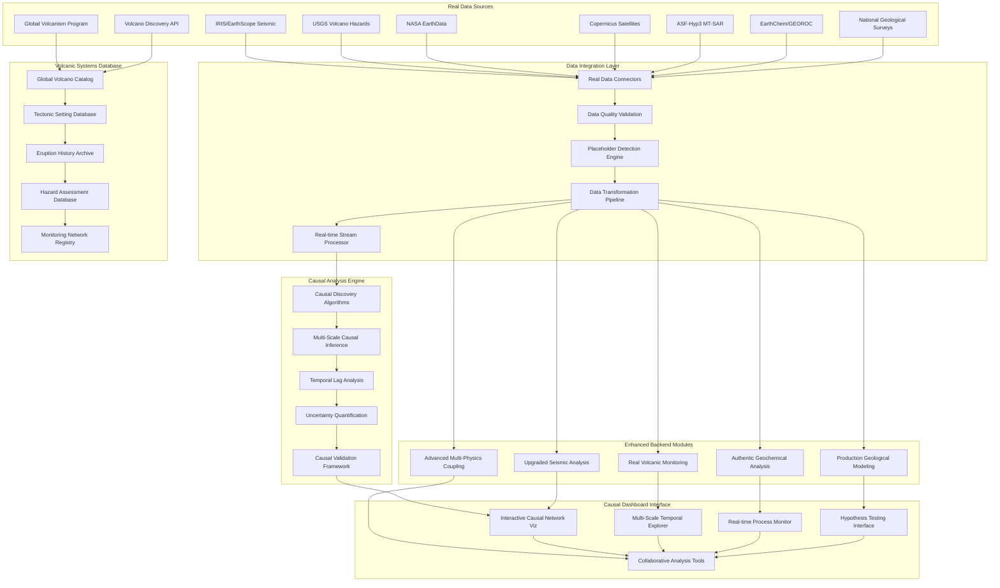

# Design Document

## Overview

The Real Data Integration and Causal Dashboard system transforms the Prometheus AI Platform from a development prototype into a production-ready geological analysis platform. The design focuses on three core components: (1) a comprehensive Real Data Integration Engine that replaces all placeholder implementations with authentic geological data sources, (2) an Advanced Causal Analysis Engine that discovers and quantifies relationships between geological processes, and (3) an Interactive Causal Dashboard that provides sophisticated visualization and exploration capabilities.

The system architecture leverages the existing 100+ backend modules while systematically upgrading them with real data connectors, advanced algorithms, and production-grade implementations. The causal dashboard serves as the primary interface, integrating the best features from all modules into a cohesive analytical environment that supports multi-scale, multi-physics geological analysis.

## Architecture

### High-Level System Architecture



### Data Flow Architecture

The system follows a layered architecture where real data flows through validation, transformation, and causal analysis before being presented in the interactive dashboard:

1. **Data Ingestion**: Real-time and batch ingestion from authoritative geological sources
2. **Quality Validation**: Comprehensive data quality checks and anomaly detection
3. **Placeholder Replacement**: Systematic identification and replacement of mock implementations
4. **Causal Analysis**: Advanced causal discovery and relationship quantification
5. **Dashboard Visualization**: Interactive exploration of causal networks and geological processes

## Components and Interfaces

### 1. Real Data Integration Engine

**Purpose**: Systematically replace all placeholder, mock, and simulated data with authentic geological observations from authoritative sources.

**Key Components**:
- `RealDataConnectors`: Authenticated connections to IRIS, USGS, NASA, Copernicus, ASF-Hyp3 MT-SAR with multi-temporal processing
- `PlaceholderDetectionEngine`: Automated identification of mock data and simplified implementations
- `DataQualityValidator`: Comprehensive validation against geological standards and cross-source verification
- `DataTransformationPipeline`: Standardization and harmonization of multi-source geological data including MT-SAR time-series
- `RealTimeStreamProcessor`: Low-latency processing of streaming geological observations
- `MTSARProcessor`: Multi-temporal SAR interferometry processing for deformation time-series analysis

**Interfaces**:
```python
class RealDataIntegrationEngine:
    async def connect_to_data_sources(self, credentials: Dict[str, Any]) -> ConnectionStatus
    async def detect_placeholders(self, module_path: str) -> List[PlaceholderInstance]
    async def replace_placeholder_data(self, placeholder: PlaceholderInstance, real_source: DataSource) -> ReplacementResult
    async def validate_data_quality(self, dataset: GeologicalDataset) -> QualityReport
    async def transform_to_standard_format(self, raw_data: RawGeologicalData) -> StandardizedData
    async def stream_real_time_data(self, source_config: StreamConfig) -> AsyncIterator[GeologicalObservation]
    async def audit_data_authenticity(self, module_list: List[str]) -> AuthenticityReport
```

### 2. Advanced Causal Analysis Engine

**Purpose**: Discover, quantify, and validate causal relationships between geological processes across multiple spatial and temporal scales.

**Key Components**:
- `CausalDiscoveryAlgorithms`: PC algorithm, GES, LiNGAM, causal forests for geological process discovery
- `MultiScaleCausalInference`: Cross-scale causal analysis from mineral to global scales
- `TemporalLagAnalysis`: Time-series causal analysis with geological time-scale awareness
- `UncertaintyQuantification`: Bayesian uncertainty estimation for causal relationships
- `CausalValidationFramework`: Cross-validation and bootstrap confidence intervals for causal discoveries

**Interfaces**:
```python
class AdvancedCausalAnalysisEngine:
    async def discover_causal_relationships(self, geological_data: MultiVariateTimeSeries) -> CausalGraph
    async def quantify_causal_strength(self, relationship: CausalEdge) -> CausalStrengthMetrics
    async def analyze_temporal_lags(self, time_series_data: TemporalGeologicalData) -> LagAnalysisResults
    async def estimate_uncertainty(self, causal_model: CausalModel) -> UncertaintyBounds
    async def validate_causal_discovery(self, discovered_relationships: CausalGraph) -> ValidationResults
    async def perform_multi_scale_analysis(self, multi_scale_data: MultiScaleGeologicalData) -> MultiScaleCausalModel
    async def test_causal_hypothesis(self, hypothesis: CausalHypothesis, data: GeologicalDataset) -> HypothesisTestResult
```

### 3. Interactive Causal Dashboard

**Purpose**: Provide comprehensive visualization and exploration interface for causal relationships and geological processes, integrating the best features from all backend modules.

**Key Components**:
- `InteractiveCausalNetworkViz`: Advanced graph visualization with force-directed layouts and hierarchical clustering
- `MultiScaleTemporalExplorer`: 4D visualization of causal relationships evolving across time and scale
- `RealTimeProcessMonitor`: Live monitoring of geological processes with causal context
- `HypothesisTestingInterface`: Interactive tools for proposing and testing causal hypotheses
- `CollaborativeAnalysisTools`: Multi-user annotation, sharing, and collaborative exploration

**Interfaces**:
```python
class InteractiveCausalDashboard:
    async def render_causal_network(self, causal_graph: CausalGraph, layout_config: LayoutConfig) -> NetworkVisualization
    async def explore_temporal_evolution(self, time_series_causality: TemporalCausalModel) -> TemporalVisualization
    async def monitor_real_time_processes(self, stream_config: MonitoringConfig) -> RealTimeDisplay
    async def test_user_hypothesis(self, user_hypothesis: UserCausalHypothesis) -> InteractiveTestResult
    async def enable_collaborative_session(self, session_config: CollaborationConfig) -> CollaborativeSession
    async def export_causal_findings(self, export_config: ExportConfig) -> ExportResult
    async def integrate_module_features(self, module_selection: List[str]) -> IntegratedInterface
```

### 4. Volcanic Systems Database Manager

**Purpose**: Comprehensive management and integration of global volcanic system data from authoritative sources.

**Key Components**:
- `GlobalVolcanoCatalog`: Complete integration with Global Volcanism Program and Volcano Discovery
- `TectonicSettingDatabase`: Volcanic systems organized by tectonic environment and regional geology
- `EruptionHistoryArchive`: Comprehensive eruption records with temporal analysis capabilities
- `HazardAssessmentDatabase`: Volcanic hazard maps, population exposure, and risk assessments
- `MonitoringNetworkRegistry`: Global inventory of volcanic monitoring stations and capabilities

**Interfaces**:
```python
class VolcanicSystemsDatabaseManager:
    async def query_volcanoes_by_region(self, geographic_bounds: GeographicRegion) -> List[VolcanicSystem]
    async def get_tectonic_context(self, volcano_id: str) -> TectonicSetting
    async def retrieve_eruption_history(self, volcano_id: str, time_range: TimeRange) -> EruptionHistory
    async def assess_volcanic_hazards(self, volcano_id: str) -> HazardAssessment
    async def find_monitoring_networks(self, region: GeographicRegion) -> List[MonitoringNetwork]
    async def synchronize_with_sources(self, source_list: List[str]) -> SynchronizationReport
    async def validate_volcano_data(self, volcano_data: VolcanicSystemData) -> ValidationResult
```

### 5. Module Enhancement Framework

**Purpose**: Systematic upgrade of existing backend modules to eliminate placeholders and implement production-grade functionality.

**Key Components**:
- `ModuleAuditor`: Automated detection of placeholder implementations and simplified algorithms
- `RealDataUpgrader`: Replacement of mock data with real geological observations
- `AlgorithmEnhancer`: Upgrade of basic implementations to state-of-the-art methods
- `ProductionValidator`: Validation that upgraded modules meet production standards
- `IntegrationTester`: Comprehensive testing of enhanced modules with real data

**Interfaces**:
```python
class ModuleEnhancementFramework:
    async def audit_module_implementations(self, module_path: str) -> ModuleAuditReport
    async def upgrade_to_real_data(self, module: GeologicalModule, data_sources: List[DataSource]) -> UpgradeResult
    async def enhance_algorithms(self, module: GeologicalModule, enhancement_config: EnhancementConfig) -> EnhancementResult
    async def validate_production_readiness(self, enhanced_module: GeologicalModule) -> ProductionValidationResult
    async def test_integration(self, module_list: List[GeologicalModule]) -> IntegrationTestResult
    async def generate_enhancement_report(self, enhancement_results: List[EnhancementResult]) -> ComprehensiveReport
```

## Data Models

### Core Data Structures

```python
@dataclass
class CausalRelationship:
    source_variable: str
    target_variable: str
    causal_strength: float
    confidence_interval: Tuple[float, float]
    temporal_lag: Optional[timedelta]
    spatial_scale: str
    statistical_significance: float
    discovery_method: str
    validation_status: ValidationStatus
    geological_context: GeologicalContext

@dataclass
class GeologicalObservation:
    observation_id: str
    timestamp: datetime
    location: Point3D
    observation_type: ObservationType
    value: Union[float, np.ndarray, Dict]
    uncertainty: Optional[float]
    data_source: str
    quality_flags: List[QualityFlag]
    processing_history: List[ProcessingStep]
    metadata: Dict[str, Any]

@dataclass
class VolcanicSystem:
    volcano_id: str
    name: str
    location: Point3D
    tectonic_setting: TectonicSetting
    volcano_type: VolcanoType
    eruption_history: List[EruptionEvent]
    monitoring_status: MonitoringStatus
    hazard_level: HazardLevel
    population_exposure: PopulationExposure
    last_update: datetime
    data_sources: List[str]

@dataclass
class CausalGraph:
    nodes: List[CausalNode]
    edges: List[CausalEdge]
    temporal_structure: TemporalStructure
    spatial_structure: SpatialStructure
    confidence_metrics: ConfidenceMetrics
    discovery_metadata: DiscoveryMetadata
    validation_results: ValidationResults

@dataclass
class PlaceholderInstance:
    module_path: str
    file_path: str
    line_number: int
    placeholder_type: PlaceholderType
    description: str
    replacement_priority: Priority
    suggested_real_source: Optional[str]
    impact_assessment: ImpactAssessment

@dataclass
class RealDataSource:
    source_id: str
    name: str
    api_endpoint: str
    authentication_method: AuthMethod
    data_types: List[DataType]
    update_frequency: timedelta
    spatial_coverage: GeographicRegion
    temporal_coverage: TimeRange
    quality_metrics: QualityMetrics
    reliability_score: float

@dataclass
class MTSARObservation:
    observation_id: str
    acquisition_date: datetime
    satellite_platform: str  # Sentinel-1, ALOS-2, etc.
    orbit_direction: str  # ascending/descending
    interferogram_pair: Tuple[datetime, datetime]
    coherence_map: np.ndarray
    displacement_map: np.ndarray  # Line-of-sight displacement
    uncertainty_map: np.ndarray
    processing_parameters: Dict[str, Any]
    baseline_info: BaselineInfo
    atmospheric_correction: bool
    reference_point: Point3D

@dataclass
class MultiScaleCausalModel:
    scale_levels: List[ScaleLevel]
    cross_scale_relationships: List[CrossScaleRelationship]
    scale_coupling_strength: Dict[Tuple[str, str], float]
    emergent_properties: List[EmergentProperty]
    validation_across_scales: ScaleValidationResults
```

### Database Schema Extensions

**Causal Relationships Table (PostgreSQL)**:
```sql
CREATE TABLE causal_relationships (
    id UUID PRIMARY KEY,
    source_variable VARCHAR(255) NOT NULL,
    target_variable VARCHAR(255) NOT NULL,
    causal_strength FLOAT NOT NULL,
    confidence_lower FLOAT NOT NULL,
    confidence_upper FLOAT NOT NULL,
    temporal_lag INTERVAL,
    spatial_scale VARCHAR(100),
    statistical_significance FLOAT,
    discovery_method VARCHAR(100),
    validation_status VARCHAR(50),
    geological_context JSONB,
    created_at TIMESTAMP DEFAULT NOW(),
    updated_at TIMESTAMP DEFAULT NOW()
);

CREATE INDEX idx_causal_source_target ON causal_relationships(source_variable, target_variable);
CREATE INDEX idx_causal_strength ON causal_relationships(causal_strength DESC);
CREATE INDEX idx_causal_spatial_scale ON causal_relationships(spatial_scale);
```

**Real Data Sources Registry (PostgreSQL)**:
```sql
CREATE TABLE real_data_sources (
    source_id UUID PRIMARY KEY,
    name VARCHAR(255) NOT NULL,
    api_endpoint TEXT,
    authentication_method VARCHAR(100),
    data_types TEXT[],
    update_frequency INTERVAL,
    spatial_coverage GEOMETRY(POLYGON, 4326),
    temporal_start TIMESTAMP,
    temporal_end TIMESTAMP,
    quality_score FLOAT,
    reliability_score FLOAT,
    last_accessed TIMESTAMP,
    status VARCHAR(50)
);
```

**Placeholder Audit Log (PostgreSQL)**:
```sql
CREATE TABLE placeholder_audit_log (
    audit_id UUID PRIMARY KEY,
    module_path VARCHAR(500) NOT NULL,
    file_path VARCHAR(500) NOT NULL,
    placeholder_type VARCHAR(100),
    description TEXT,
    replacement_date TIMESTAMP,
    replacement_method VARCHAR(200),
    validation_status VARCHAR(50),
    performance_impact JSONB,
    created_at TIMESTAMP DEFAULT NOW()
);
```

## Error Handling

### Comprehensive Error Management Strategy

**1. Real Data Source Failures**:
- API timeouts, authentication failures, data format changes
- **Response**: Implement circuit breakers, fallback data sources, and graceful degradation with cached data

**2. Causal Analysis Errors**:
- Insufficient data for causal discovery, statistical significance failures, conflicting causal relationships
- **Response**: Provide uncertainty bounds, alternative causal models, and confidence-based filtering

**3. Placeholder Detection Failures**:
- False positives in placeholder detection, incomplete replacement validation
- **Response**: Manual review workflows, confidence scoring, and iterative improvement of detection algorithms

**4. Dashboard Visualization Errors**:
- Large graph rendering failures, real-time data streaming interruptions, user interaction conflicts
- **Response**: Progressive loading, data sampling strategies, and conflict resolution mechanisms

### Error Handling Implementation

```python
class RealDataIntegrationErrorHandler:
    def __init__(self):
        self.circuit_breakers = {}
        self.fallback_sources = {}
        self.error_recovery_strategies = {}
    
    async def handle_data_source_failure(self, source_id: str, error: DataSourceError) -> ErrorResponse:
        if self.circuit_breakers[source_id].is_open():
            return await self.use_fallback_source(source_id)
        else:
            return await self.retry_with_backoff(source_id, error)
    
    async def handle_causal_analysis_error(self, error: CausalAnalysisError) -> ErrorResponse:
        if error.type == CausalErrorType.INSUFFICIENT_DATA:
            return await self.suggest_additional_data_sources(error)
        elif error.type == CausalErrorType.STATISTICAL_INSIGNIFICANCE:
            return await self.provide_uncertainty_bounds(error)
    
    async def handle_placeholder_detection_error(self, error: PlaceholderDetectionError) -> ErrorResponse:
        return await self.escalate_to_manual_review(error)
```

## Testing Strategy

### 1. Real Data Integration Testing
- **Scope**: Validation of authentic data sources and placeholder replacement
- **Framework**: pytest with real API testing and data validation
- **Coverage**: All data source connectors and transformation pipelines
- **Focus**: Data authenticity, quality validation, and integration accuracy

### 2. Causal Analysis Validation
- **Scope**: Validation of causal discovery algorithms against known geological relationships
- **Framework**: Custom validation framework with geological benchmarks
- **Coverage**: All causal discovery methods and uncertainty quantification
- **Focus**: Scientific accuracy of causal relationships and statistical validity

### 3. Dashboard Interaction Testing
- **Scope**: User interface functionality and visualization accuracy
- **Framework**: Playwright for end-to-end testing with visual regression
- **Coverage**: All dashboard components and user interaction workflows
- **Focus**: Visualization accuracy, performance under load, and accessibility

### 4. Production Readiness Testing
- **Scope**: Comprehensive validation that all modules meet production standards
- **Framework**: Custom production validation suite
- **Coverage**: All enhanced modules and integrated systems
- **Focus**: Performance, reliability, and scientific accuracy

### Testing Implementation

```python
class RealDataIntegrationTestSuite:
    def __init__(self):
        self.real_data_sources = self.load_test_sources()
        self.causal_benchmarks = self.load_causal_benchmarks()
        self.production_standards = self.load_production_criteria()
    
    async def test_real_data_authenticity(self):
        """Validate that all data sources provide authentic geological data"""
        for source in self.real_data_sources:
            data = await self.data_integration.fetch_data(source)
            authenticity = self.validate_data_authenticity(data, source.validation_criteria)
            assert authenticity.is_authentic, f"Data from {source.name} failed authenticity check"
    
    async def test_causal_discovery_accuracy(self):
        """Test causal discovery against known geological relationships"""
        for benchmark in self.causal_benchmarks:
            discovered_relationships = await self.causal_engine.discover_relationships(benchmark.data)
            accuracy = self.compare_with_known_causality(discovered_relationships, benchmark.known_relationships)
            assert accuracy > 0.80, f"Causal discovery accuracy too low: {accuracy}"
    
    async def test_placeholder_elimination(self):
        """Verify that all placeholders have been successfully replaced"""
        audit_results = await self.enhancement_framework.audit_all_modules()
        remaining_placeholders = [r for r in audit_results if r.has_placeholders]
        assert len(remaining_placeholders) == 0, f"Placeholders still exist in: {remaining_placeholders}"
    
    async def test_dashboard_performance(self):
        """Test dashboard performance with large causal networks"""
        large_causal_graph = self.generate_large_causal_graph(nodes=10000, edges=50000)
        render_time = await self.dashboard.measure_render_time(large_causal_graph)
        assert render_time < 2.0, f"Dashboard rendering too slow: {render_time}s"
    
    async def test_production_readiness(self):
        """Validate that all components meet production standards"""
        for module in self.enhanced_modules:
            readiness_score = await self.production_validator.assess_readiness(module)
            assert readiness_score > 0.90, f"Module {module.name} not production ready: {readiness_score}"
```

This comprehensive design provides a robust architecture for transforming the Prometheus AI Platform into a production-ready system with authentic geological data integration and sophisticated causal analysis capabilities. The modular design allows for systematic replacement of placeholder implementations while maintaining the existing module ecosystem and adding powerful new analytical capabilities through the causal dashboard interface.