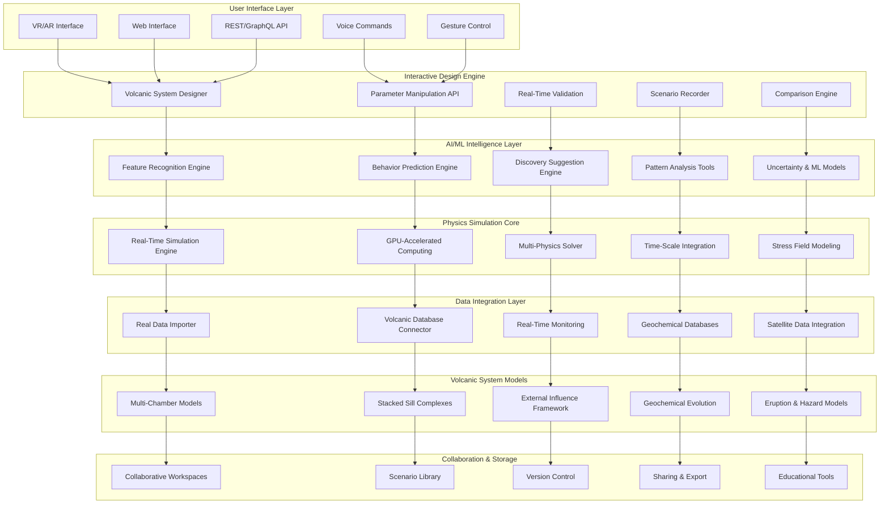

# Design Document

## Overview

The Volcanic Playground represents a paradigm shift in volcanic research methodology, creating the world's first fully interactive, AI-powered volcanic simulation environment. This system combines advanced physics simulation, machine learning, real-time data integration, and immersive visualization to create a virtual laboratory where researchers can manipulate every aspect of volcanic systems and observe emergent behaviors.

The design leverages cutting-edge technologies including physics-informed neural networks (PINNs), real-time GPU-accelerated multi-physics simulation, advanced ML pattern recognition, immersive VR/AR interfaces, and distributed cloud computing. The architecture supports everything from molecular-scale magma property modeling to regional-scale tectonic interactions, enabling unprecedented scientific exploration of volcanic processes.

## Architecture

### High-Level System Architecture



### Distributed Computing Architecture

The system employs a hybrid cloud-edge computing architecture to handle the computational demands of real-time volcanic simulation while maintaining interactive responsiveness:

1. **Edge Computing Layer**: Local GPU clusters for real-time interaction and immediate feedback
2. **Cloud Computing Layer**: Scalable cloud resources for complex simulations and ML training
3. **Hybrid Processing**: Intelligent workload distribution between edge and cloud based on computational requirements

## Components and Interfaces

### 1. Interactive Volcanic System Designer

**Purpose**: Provide intuitive tools for designing and modifying complete volcanic systems with real-time physics validation.

**Key Components**:
- `VolcanicSystemBuilder`: Core system for creating and modifying volcanic architectures
- `ParameterManipulator`: Real-time parameter adjustment with immediate physics updates
- `GeometryEditor`: 3D geometric modeling tools for chambers, sills, and conduits
- `PhysicsValidator`: Real-time validation of geological and physical constraints
- `TemplateLibrary`: Pre-built volcanic system templates and components

**Interfaces**:
```python
class InteractiveVolcanicSystemDesigner:
    async def create_volcanic_system(self, system_config: VolcanicSystemConfig) -> VolcanicSystem
    async def modify_chamber_geometry(self, chamber_id: str, geometry_params: GeometryParameters) -> GeometryUpdateResult
    async def adjust_magma_properties(self, chamber_id: str, magma_props: MagmaProperties) -> PropertyUpdateResult
    async def add_external_influence(self, influence_type: ExternalInfluenceType, params: InfluenceParameters) -> InfluenceResult
    async def validate_system_physics(self, system: VolcanicSystem) -> ValidationResult
    async def save_system_template(self, system: VolcanicSystem, template_name: str) -> TemplateResult
    async def load_system_template(self, template_name: str) -> VolcanicSystem
    async def get_modification_suggestions(self, current_system: VolcanicSystem) -> List[ModificationSuggestion]
```

### 2. Real Volcanic Data Integration Engine

**Purpose**: Import, process, and integrate real volcanic data from global databases with ML-powered feature recognition.

**Key Components**:
- `DataImporter`: Multi-source data import from GVP, observatories, and scientific databases
- `FeatureRecognitionML`: Advanced ML algorithms for automatic volcanic feature identification
- `DigitalTwinBuilder`: Creation of accurate digital twins from real volcanic data
- `DataValidator`: Quality assessment and uncertainty quantification for imported data
- `ContinuousUpdater`: Real-time integration of new monitoring data

**Interfaces**:
```python
class RealVolcanicDataIntegration:
    async def import_volcano_data(self, volcano_id: str, data_sources: List[DataSource]) -> VolcanoDataset
    async def recognize_volcanic_features(self, dataset: VolcanoDataset, ml_config: MLConfig) -> FeatureRecognitionResult
    async def build_digital_twin(self, volcano_data: VolcanoDataset, twin_config: DigitalTwinConfig) -> VolcanicDigitalTwin
    async def validate_data_quality(self, dataset: VolcanoDataset) -> DataQualityReport
    async def update_with_monitoring_data(self, twin: VolcanicDigitalTwin, monitoring_data: MonitoringData) -> UpdateResult
    async def get_confidence_metrics(self, recognition_result: FeatureRecognitionResult) -> ConfidenceMetrics
    async def export_digital_twin(self, twin: VolcanicDigitalTwin, export_format: ExportFormat) -> ExportResult
```

### 3. Advanced Magma Chamber Manipulation Engine

**Purpose**: Provide comprehensive control over magma chamber properties with real-time physics simulation.

**Key Components**:
- `ChamberGeometryEngine`: Real-time 3D chamber geometry modification and validation
- `MagmaPropertyController`: Dynamic control of composition, temperature, pressure, and volatiles
- `InterChamberConnector`: Management of chamber interconnections and magma transfer
- `CrystallizationSimulator`: Real-time crystallization and phase equilibrium calculations
- `DegassingModeler`: Volatile evolution and degassing process simulation

**Interfaces**:
```python
class AdvancedMagmaChamberManipulation:
    async def modify_chamber_geometry(self, chamber: MagmaChamber, new_geometry: ChamberGeometry) -> GeometryModificationResult
    async def adjust_magma_composition(self, chamber: MagmaChamber, composition: MagmaComposition) -> CompositionResult
    async def set_thermal_conditions(self, chamber: MagmaChamber, temperature: float, cooling_rate: float) -> ThermalResult
    async def modify_pressure_conditions(self, chamber: MagmaChamber, pressure: float, pressure_gradient: float) -> PressureResult
    async def connect_chambers(self, chamber1: MagmaChamber, chamber2: MagmaChamber, connection: ChamberConnection) -> ConnectionResult
    async def simulate_crystallization(self, chamber: MagmaChamber, crystallization_params: CrystallizationParams) -> CrystallizationResult
    async def model_degassing(self, chamber: MagmaChamber, degassing_params: DegassingParams) -> DegassingResult
    async def predict_chamber_evolution(self, chamber: MagmaChamber, time_horizon: float) -> EvolutionPrediction
```

### 4. Stacked Sill Complex and Intrusion Designer

**Purpose**: Advanced tools for designing and manipulating complex intrusion networks with realistic geological constraints.

**Key Components**:
- `SillComplexBuilder`: Creation and modification of multi-level sill systems
- `DikeNetworkDesigner`: Design tools for realistic dike swarm geometries
- `IntrusionMechanicsSimulator`: Physics-based intrusion emplacement simulation
- `DeformationCalculator`: Surface deformation prediction from intrusion networks
- `EruptionPathwayPredictor`: Prediction of eruption locations based on intrusion geometry

**Interfaces**:
```python
class StackedSillComplexDesigner:
    async def create_sill_complex(self, complex_config: SillComplexConfig) -> SillComplex
    async def add_sill_layer(self, complex: SillComplex, sill_params: SillParameters) -> SillAdditionResult
    async def design_dike_network(self, network_config: DikeNetworkConfig, stress_field: StressField) -> DikeNetwork
    async def simulate_intrusion_emplacement(self, intrusion: Intrusion, host_rock: RockProperties) -> EmplacementResult
    async def calculate_surface_deformation(self, intrusion_network: IntrusionNetwork) -> DeformationPrediction
    async def predict_eruption_pathways(self, intrusion_network: IntrusionNetwork, stress_analysis: StressAnalysis) -> EruptionPathways
    async def optimize_intrusion_geometry(self, constraints: GeologicalConstraints, objectives: OptimizationObjectives) -> OptimizedGeometry
    async def validate_geological_realism(self, intrusion_network: IntrusionNetwork) -> RealismValidation
```

### 5. External Influence Simulation Engine

**Purpose**: Simulate external influences on volcanic systems including tectonic events, stress changes, and regional processes.

**Key Components**:
- `TectonicEventSimulator`: Earthquake and fault movement simulation with stress transfer
- `SlowSlipEventModeler`: Subduction zone slow-slip event simulation and effects
- `RegionalStressModifier`: Regional stress field manipulation and volcanic system coupling
- `ExternalMagmaInjector`: Simulation of external magma inputs and interactions
- `TriggerEffectivenessAnalyzer`: Quantitative analysis of trigger mechanisms and effectiveness

**Interfaces**:
```python
class ExternalInfluenceSimulationEngine:
    async def simulate_tectonic_event(self, event: TectonicEvent, volcanic_system: VolcanicSystem) -> TectonicEffectResult
    async def model_slow_slip_event(self, slip_event: SlowSlipEvent, affected_volcanoes: List[VolcanicSystem]) -> SlowSlipEffectResult
    async def modify_regional_stress(self, stress_modification: StressModification, region: GeographicRegion) -> StressModificationResult
    async def inject_external_magma(self, injection: MagmaInjection, target_system: VolcanicSystem) -> InjectionResult
    async def analyze_trigger_effectiveness(self, trigger: ExternalTrigger, system_response: SystemResponse) -> TriggerAnalysis
    async def predict_cascading_effects(self, initial_event: ExternalEvent, volcanic_network: VolcanicNetwork) -> CascadingEffectPrediction
    async def quantify_trigger_probability(self, trigger_scenario: TriggerScenario) -> TriggerProbability
```

### 6. Advanced Seismic Stress Field Modeling

**Purpose**: Comprehensive 3D stress field modeling and manipulation with coupling to volcanic processes.

**Key Components**:
- `StressFieldCalculator`: 3D stress tensor calculation and visualization
- `StressSourceManager`: Management of multiple stress sources and their interactions
- `FracturePredictor`: Prediction of fracture development and conduit formation
- `SeismicEventGenerator`: Earthquake simulation and stress release modeling
- `StressMagmaCoupler`: Coupling between stress fields and magma dynamics

**Interfaces**:
```python
class AdvancedSeismicStressFieldModeling:
    async def calculate_stress_field(self, stress_sources: List[StressSource], domain: SpatialDomain) -> StressField3D
    async def add_stress_source(self, stress_field: StressField3D, new_source: StressSource) -> StressFieldUpdateResult
    async def predict_fracture_development(self, stress_field: StressField3D, rock_properties: RockProperties) -> FracturePrediction
    async def simulate_seismic_event(self, event_params: SeismicEventParams, stress_field: StressField3D) -> SeismicEventResult
    async def couple_stress_magma_dynamics(self, stress_field: StressField3D, magma_system: MagmaSystem) -> CoupledDynamicsResult
    async def analyze_eruption_triggering(self, stress_changes: StressChanges, volcanic_system: VolcanicSystem) -> TriggeringAnalysis
    async def optimize_conduit_pathways(self, stress_field: StressField3D, eruption_constraints: EruptionConstraints) -> OptimalPathways
```

### 7. Machine Learning-Powered Behavior Prediction

**Purpose**: Advanced ML systems for predicting volcanic behavior and discovering patterns in complex volcanic systems.

**Key Components**:
- `PhysicsInformedNeuralNetworks`: PINNs for volcanic process modeling with physical constraints
- `BehaviorPredictionEngine`: ML models for predicting system responses to modifications
- `PatternDiscoverySystem`: Unsupervised learning for discovering hidden relationships
- `UncertaintyQuantifier`: Bayesian methods for uncertainty quantification in predictions
- `ContinuousLearningFramework`: Adaptive learning from simulation results and real data

**Interfaces**:
```python
class MachineLearningBehaviorPrediction:
    async def train_physics_informed_model(self, training_data: VolcanicDataset, physics_constraints: PhysicsConstraints) -> PINNModel
    async def predict_system_behavior(self, system_modifications: SystemModifications, ml_model: MLModel) -> BehaviorPrediction
    async def discover_parameter_relationships(self, parameter_space: ParameterSpace, discovery_config: DiscoveryConfig) -> RelationshipDiscovery
    async def quantify_prediction_uncertainty(self, prediction: BehaviorPrediction, uncertainty_method: UncertaintyMethod) -> UncertaintyQuantification
    async def update_models_with_results(self, ml_models: List[MLModel], new_results: SimulationResults) -> ModelUpdateResult
    async def suggest_interesting_experiments(self, current_system: VolcanicSystem, exploration_strategy: ExplorationStrategy) -> ExperimentSuggestions
    async def validate_model_performance(self, ml_model: MLModel, validation_data: ValidationDataset) -> ModelValidation
```

### 8. Real-Time Physics Simulation Engine

**Purpose**: High-performance, real-time physics simulation with GPU acceleration and multi-scale temporal integration.

**Key Components**:
- `MultiPhysicsSolver`: Coupled thermal-mechanical-chemical-fluid dynamics solver
- `GPUAccelerationManager`: GPU computing optimization and resource management
- `AdaptiveTimestepping`: Intelligent timestep adaptation for multi-scale processes
- `ParallelProcessingEngine`: Distributed computing for complex simulations
- `SimulationOptimizer`: Performance optimization and computational efficiency management

**Interfaces**:
```python
class RealTimePhysicsSimulationEngine:
    async def initialize_simulation(self, volcanic_system: VolcanicSystem, simulation_config: SimulationConfig) -> SimulationInstance
    async def step_simulation(self, simulation: SimulationInstance, timestep: float) -> SimulationStepResult
    async def modify_parameters_realtime(self, simulation: SimulationInstance, parameter_changes: ParameterChanges) -> ParameterUpdateResult
    async def get_simulation_state(self, simulation: SimulationInstance) -> SimulationState
    async def optimize_performance(self, simulation: SimulationInstance, performance_targets: PerformanceTargets) -> OptimizationResult
    async def handle_multi_scale_processes(self, simulation: SimulationInstance, scale_config: MultiScaleConfig) -> MultiScaleResult
    async def validate_physics_accuracy(self, simulation_results: SimulationResults, validation_benchmarks: ValidationBenchmarks) -> AccuracyValidation
```

## Data Models

### Core Data Structures

```python
@dataclass
class VolcanicSystem:
    system_id: str
    name: str
    location: GeographicLocation
    chambers: List[MagmaChamber]
    intrusions: List[Intrusion]
    external_influences: List[ExternalInfluence]
    stress_field: StressField3D
    monitoring_data: MonitoringDataset
    creation_timestamp: datetime
    last_modified: datetime
    creator_id: str
    system_metadata: SystemMetadata

@dataclass
class MagmaChamber:
    chamber_id: str
    geometry: ChamberGeometry3D
    magma_composition: MagmaComposition
    temperature: float
    pressure: float
    volatile_content: VolatileContent
    crystallinity: float
    connections: List[ChamberConnection]
    thermal_history: ThermalHistory
    degassing_state: DegassingState
    rheological_properties: RheologicalProperties

@dataclass
class ChamberGeometry3D:
    shape_type: GeometryType
    center_location: Point3D
    dimensions: GeometryDimensions
    orientation: Orientation3D
    volume: float
    surface_area: float
    depth_range: Tuple[float, float]
    mesh_representation: Mesh3D
    uncertainty_bounds: GeometryUncertainty

@dataclass
class MagmaComposition:
    major_elements: Dict[str, float]  # SiO2, Al2O3, etc.
    trace_elements: Dict[str, float]  # ppm concentrations
    isotopic_ratios: Dict[str, float]  # Sr, Nd, Pb isotopes
    volatile_species: Dict[str, float]  # H2O, CO2, SO2, etc.
    temperature_dependent: bool
    pressure_dependent: bool
    composition_uncertainty: CompositionUncertainty

@dataclass
class ExternalInfluence:
    influence_id: str
    influence_type: ExternalInfluenceType
    parameters: InfluenceParameters
    spatial_extent: SpatialExtent
    temporal_evolution: TemporalEvolution
    coupling_strength: float
    activation_conditions: ActivationConditions
    effect_magnitude: float
    uncertainty_bounds: InfluenceUncertainty

@dataclass
class StressField3D:
    stress_tensors: np.ndarray  # 3D array of stress tensors
    spatial_grid: SpatialGrid3D
    stress_sources: List[StressSource]
    temporal_evolution: StressEvolution
    principal_stresses: PrincipalStressField
    failure_criteria: FailureCriteria
    fracture_network: FractureNetwork
    uncertainty_field: StressUncertainty

@dataclass
class SimulationResult:
    result_id: str
    simulation_parameters: SimulationParameters
    volcanic_system_state: VolcanicSystemState
    physics_results: PhysicsResults
    ml_predictions: MLPredictions
    uncertainty_quantification: UncertaintyResults
    performance_metrics: PerformanceMetrics
    validation_scores: ValidationScores
    timestamp: datetime

@dataclass
class BehaviorPrediction:
    prediction_id: str
    input_modifications: SystemModifications
    predicted_outcomes: List[PredictedOutcome]
    confidence_intervals: ConfidenceIntervals
    uncertainty_bounds: UncertaintyBounds
    prediction_horizon: float
    model_used: MLModelInfo
    validation_metrics: PredictionValidation
    alternative_scenarios: List[AlternativeScenario]

@dataclass
class VolcanicScenario:
    scenario_id: str
    scenario_name: str
    description: str
    initial_system: VolcanicSystem
    modifications_sequence: List[SystemModification]
    simulation_results: List[SimulationResult]
    research_questions: List[str]
    hypotheses: List[str]
    observations: List[str]
    tags: List[str]
    sharing_permissions: SharingPermissions
```

### Advanced Database Schema

**Volcanic Systems (PostgreSQL + PostGIS + TimescaleDB)**:
```sql
-- Main volcanic systems table
CREATE TABLE volcanic_systems (
    system_id UUID PRIMARY KEY,
    name VARCHAR(200) NOT NULL,
    location GEOMETRY(POINT, 4326),
    system_type VARCHAR(100),
    complexity_level INTEGER,
    creation_timestamp TIMESTAMPTZ DEFAULT NOW(),
    last_modified TIMESTAMPTZ DEFAULT NOW(),
    creator_id UUID,
    system_metadata JSONB,
    is_template BOOLEAN DEFAULT FALSE,
    is_public BOOLEAN DEFAULT FALSE
);

-- Magma chambers with 3D geometry
CREATE TABLE magma_chambers (
    chamber_id UUID PRIMARY KEY,
    system_id UUID REFERENCES volcanic_systems(system_id),
    chamber_name VARCHAR(100),
    geometry_3d GEOMETRY(POLYHEDRALSURFACE, 4326),
    center_point GEOMETRY(POINT, 4326),
    volume FLOAT,
    depth_min FLOAT,
    depth_max FLOAT,
    magma_composition JSONB,
    temperature FLOAT,
    pressure FLOAT,
    crystallinity FLOAT,
    volatile_content JSONB,
    rheological_properties JSONB
);

-- Time-series simulation results (TimescaleDB)
CREATE TABLE simulation_results (
    result_id UUID,
    system_id UUID,
    simulation_time TIMESTAMPTZ NOT NULL,
    parameter_values JSONB,
    physics_state JSONB,
    ml_predictions JSONB,
    uncertainty_bounds JSONB,
    performance_metrics JSONB
);

SELECT create_hypertable('simulation_results', 'simulation_time');

-- External influences
CREATE TABLE external_influences (
    influence_id UUID PRIMARY KEY,
    system_id UUID REFERENCES volcanic_systems(system_id),
    influence_type VARCHAR(100),
    spatial_extent GEOMETRY(POLYGON, 4326),
    parameters JSONB,
    activation_time TIMESTAMPTZ,
    duration INTERVAL,
    coupling_strength FLOAT,
    effect_magnitude FLOAT
);

-- Stress field data (specialized storage)
CREATE TABLE stress_fields (
    field_id UUID PRIMARY KEY,
    system_id UUID REFERENCES volcanic_systems(system_id),
    spatial_grid JSONB,
    stress_tensor_data BYTEA, -- Binary storage for large 3D arrays
    calculation_method VARCHAR(100),
    resolution FLOAT,
    uncertainty_field BYTEA,
    calculation_timestamp TIMESTAMPTZ DEFAULT NOW()
);
```

**ML Models and Predictions (MongoDB for flexible schema)**:
```javascript
// ML model metadata
{
  _id: ObjectId,
  model_name: String,
  model_type: String, // "PINN", "CNN", "Transformer", etc.
  training_data_id: String,
  model_parameters: Object,
  performance_metrics: {
    accuracy: Number,
    precision: Number,
    recall: Number,
    f1_score: Number,
    uncertainty_calibration: Number
  },
  physics_constraints: Object,
  validation_results: Object,
  created_at: Date,
  updated_at: Date
}

// Behavior predictions
{
  _id: ObjectId,
  prediction_id: String,
  system_id: String,
  input_modifications: Object,
  predicted_outcomes: Array,
  confidence_intervals: Object,
  uncertainty_quantification: Object,
  model_used: String,
  prediction_timestamp: Date,
  validation_status: String
}
```

**Scenario Library (Graph Database - Neo4j)**:
```cypher
// Volcanic system nodes
CREATE (vs:VolcanicSystem {
  system_id: $system_id,
  name: $name,
  complexity: $complexity,
  created_by: $creator_id
})

// Scenario nodes
CREATE (sc:Scenario {
  scenario_id: $scenario_id,
  name: $scenario_name,
  description: $description,
  research_questions: $questions,
  tags: $tags
})

// Relationships between systems and scenarios
CREATE (vs)-[:USED_IN]->(sc)

// Modification relationships
CREATE (sc)-[:INCLUDES_MODIFICATION {
  modification_type: $mod_type,
  parameters: $parameters,
  sequence_order: $order
}]->(mod:Modification)

// Similarity relationships for recommendation
CREATE (sc1)-[:SIMILAR_TO {
  similarity_score: $score,
  similarity_type: $type
}]->(sc2)
```

## Error Handling

### Comprehensive Error Management Strategy

**1. Physics Simulation Errors**:
- Numerical instabilities, convergence failures, unphysical results, GPU memory overflow
- **Response**: Adaptive timestep reduction, alternative numerical methods, graceful degradation to CPU, physics constraint enforcement

**2. ML Model Errors**:
- Prediction failures, model uncertainty explosion, training convergence issues, adversarial inputs
- **Response**: Ensemble model fallbacks, uncertainty bounds enforcement, robust training procedures, input validation

**3. Real-Time Interaction Errors**:
- Parameter modification conflicts, simulation state corruption, user interface failures, network latency issues
- **Response**: State rollback mechanisms, conflict resolution protocols, offline mode capabilities, predictive caching

**4. Data Integration Errors**:
- Data quality issues, format incompatibilities, missing data, real-time feed failures
- **Response**: Data validation pipelines, format conversion tools, interpolation methods, backup data sources

### Error Handling Implementation

```python
class VolcanicPlaygroundErrorHandler:
    def __init__(self):
        self.physics_validator = PhysicsValidator()
        self.ml_uncertainty_monitor = MLUncertaintyMonitor()
        self.state_manager = StateManager()
        self.data_quality_checker = DataQualityChecker()
    
    async def handle_physics_error(self, error: PhysicsError, simulation: SimulationInstance) -> ErrorRecoveryResult:
        if error.type == PhysicsErrorType.NUMERICAL_INSTABILITY:
            return await self.recover_from_instability(error, simulation)
        elif error.type == PhysicsErrorType.UNPHYSICAL_RESULT:
            return await self.enforce_physics_constraints(error, simulation)
        elif error.type == PhysicsErrorType.CONVERGENCE_FAILURE:
            return await self.try_alternative_solver(error, simulation)
    
    async def handle_ml_error(self, error: MLError, prediction_context: PredictionContext) -> MLErrorRecoveryResult:
        if error.type == MLErrorType.PREDICTION_UNCERTAINTY_TOO_HIGH:
            return await self.use_ensemble_fallback(error, prediction_context)
        elif error.type == MLErrorType.MODEL_FAILURE:
            return await self.switch_to_backup_model(error, prediction_context)
    
    async def handle_interaction_error(self, error: InteractionError, user_session: UserSession) -> InteractionRecoveryResult:
        if error.type == InteractionErrorType.PARAMETER_CONFLICT:
            return await self.resolve_parameter_conflict(error, user_session)
        elif error.type == InteractionErrorType.STATE_CORRUPTION:
            return await self.rollback_to_stable_state(error, user_session)
    
    async def handle_data_error(self, error: DataError, data_context: DataContext) -> DataRecoveryResult:
        if error.type == DataErrorType.QUALITY_ISSUE:
            return await self.apply_data_cleaning(error, data_context)
        elif error.type == DataErrorType.MISSING_DATA:
            return await self.interpolate_missing_data(error, data_context)
```

## Testing Strategy

### 1. Physics Simulation Validation
- **Scope**: Validation of all physics solvers against analytical solutions and experimental data
- **Framework**: Automated testing with known benchmarks and synthetic test cases
- **Coverage**: All physics modules including thermal, mechanical, chemical, and fluid dynamics
- **Focus**: Numerical accuracy, conservation law compliance, and physical realism

### 2. ML Model Validation
- **Scope**: Comprehensive testing of all ML models including PINNs, prediction engines, and pattern discovery
- **Framework**: Cross-validation, uncertainty calibration, and adversarial testing
- **Coverage**: All ML components with emphasis on physics consistency and prediction reliability
- **Focus**: Prediction accuracy, uncertainty quantification, and robustness to edge cases

### 3. Interactive Performance Testing
- **Scope**: Real-time interaction responsiveness and system scalability under load
- **Framework**: Load testing with simulated user interactions and complex scenarios
- **Coverage**: All user interface components and real-time simulation capabilities
- **Focus**: Response time, system stability, and user experience quality

### 4. Integration Testing
- **Scope**: End-to-end testing of complete workflows from data import to scenario execution
- **Framework**: Automated integration tests with real volcanic data and scenarios
- **Coverage**: All system components and their interactions
- **Focus**: Data flow integrity, component compatibility, and workflow reliability

### Testing Implementation

```python
class VolcanicPlaygroundTestSuite:
    def __init__(self):
        self.physics_benchmarks = PhysicsBenchmarks()
        self.ml_validators = MLValidators()
        self.performance_testers = PerformanceTesters()
        self.integration_framework = IntegrationTestFramework()
    
    async def test_physics_accuracy(self):
        """Test physics simulation accuracy against known solutions"""
        test_cases = await self.physics_benchmarks.get_analytical_solutions()
        for test_case in test_cases:
            simulation_result = await self.run_physics_simulation(test_case.parameters)
            accuracy = await self.compare_with_analytical(simulation_result, test_case.expected)
            assert accuracy > 0.95, f"Physics accuracy below threshold: {accuracy}"
    
    async def test_ml_prediction_reliability(self):
        """Test ML model prediction reliability and uncertainty calibration"""
        validation_data = await self.ml_validators.get_validation_dataset()
        for model in self.get_all_ml_models():
            predictions = await model.predict(validation_data.inputs)
            reliability = await self.assess_prediction_reliability(predictions, validation_data.targets)
            assert reliability.calibration_score > 0.9, f"ML calibration poor: {reliability.calibration_score}"
    
    async def test_real_time_performance(self):
        """Test real-time interaction performance under various loads"""
        load_scenarios = await self.performance_testers.generate_load_scenarios()
        for scenario in load_scenarios:
            performance_metrics = await self.run_load_test(scenario)
            assert performance_metrics.response_time < 100, f"Response time too high: {performance_metrics.response_time}ms"
            assert performance_metrics.throughput > scenario.minimum_throughput
    
    async def test_end_to_end_workflows(self):
        """Test complete workflows from data import to scenario execution"""
        workflow_tests = await self.integration_framework.get_workflow_tests()
        for workflow in workflow_tests:
            result = await self.execute_workflow(workflow)
            assert result.success, f"Workflow failed: {result.error_message}"
            assert result.data_integrity_check.passed, "Data integrity check failed"
```

This design creates a revolutionary platform that transforms volcanic research by providing unprecedented interactive capabilities while maintaining rigorous scientific accuracy. The system enables researchers to explore volcanic processes in ways never before possible, potentially leading to breakthrough discoveries in volcanology.