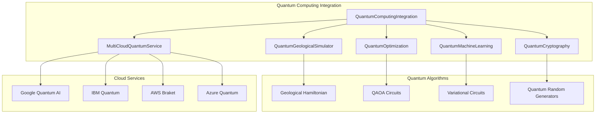

# Quantum Computing Integration for Geological Simulations

## Overview

The Quantum Computing Integration module provides comprehensive quantum computing capabilities for geological modeling, including quantum algorithms for geological simulations, quantum machine learning for complex pattern recognition, quantum optimization for resource allocation, and quantum cryptography for enhanced security.

## Features

### 1. Quantum Geological Simulation
- **Physics-Informed Quantum Circuits**: Quantum circuits that encode geological physics constraints
- **Geological Hamiltonian Construction**: Automatic creation of Hamiltonians representing geological systems
- **Multi-Process Quantum Modeling**: Simultaneous modeling of tectonic, magmatic, and hydrothermal processes
- **Quantum State Analysis**: Analysis of quantum states for geological insights

### 2. Quantum Machine Learning
- **Variational Quantum Classifiers**: Quantum neural networks for geological pattern recognition
- **Quantum Feature Maps**: Encoding of geological data into quantum states
- **Hybrid Classical-Quantum Training**: Optimization of quantum parameters using classical algorithms
- **Quantum Advantage Assessment**: Comparison with classical machine learning approaches

### 3. Quantum Optimization
- **QAOA Implementation**: Quantum Approximate Optimization Algorithm for resource allocation
- **QUBO Formulation**: Conversion of geological optimization problems to quantum format
- **Constraint Handling**: Integration of geological constraints into quantum optimization
- **Solution Validation**: Verification of quantum solutions against classical benchmarks

### 4. Quantum Cryptography
- **Quantum Key Generation**: True quantum random number generation for cryptographic keys
- **Quantum-Secured Data**: Encryption of sensitive geological data using quantum keys
- **Key Management**: Lifecycle management of quantum cryptographic keys
- **Security Level Configuration**: Configurable security levels for different data types

### 5. Multi-Cloud Quantum Services
- **Google Quantum AI**: Integration with Google's quantum computing platform
- **IBM Quantum**: Support for IBM Quantum Network services
- **AWS Braket**: Amazon's quantum computing service integration
- **Azure Quantum**: Microsoft's quantum computing platform support
- **Automatic Service Selection**: Intelligent selection of optimal quantum service

## Architecture



## Installation

### Prerequisites

```bash
# Install quantum computing libraries
pip install qiskit cirq

# Install cloud service libraries (optional)
pip install google-cloud-quantum
pip install qiskit-ibm-provider
pip install boto3
pip install azure-quantum
```

### Configuration

```python
config = {
    'num_qubits': 6,
    'circuit_depth': 4,
    'ml_qubits': 4,
    'ml_layers': 3,
    'opt_qubits': 6,
    'key_length': 256,
    'cloud_services': {
        'google_quantum': {
            'enabled': True,
            'project_id': 'your-project-id',
            'processor_id': 'rainbow'
        },
        'ibm_quantum': {
            'enabled': True,
            'token': 'your-ibm-token',
            'backend': 'ibmq_qasm_simulator'
        },
        'aws_braket': {
            'enabled': True,
            'access_key_id': 'your-access-key',
            'secret_access_key': 'your-secret-key',
            'region': 'us-east-1'
        },
        'azure_quantum': {
            'enabled': True,
            'subscription_id': 'your-subscription-id',
            'resource_group': 'your-resource-group',
            'workspace_name': 'your-workspace'
        }
    }
}
```

## Usage Examples

### 1. Quantum Geological Simulation

```python
import asyncio
from backend.modules.quantum_computing_integration import QuantumComputingIntegration, GeologicalDataset
from datetime import datetime

async def simulate_volcano():
    # Initialize quantum system
    quantum_system = QuantumComputingIntegration(config)
    await quantum_system.initialize()
    
    # Create geological dataset
    geological_data = GeologicalDataset(
        id="mount_vesuvius",
        timestamp=datetime.now(),
        data_type="volcanic_monitoring",
        spatial_extent=None,
        temporal_range=None,
        quality_metrics=None,
        metadata={
            'volcano_type': 'stratovolcano',
            'last_eruption': '1944-03-29',
            'magma_composition': 'intermediate'
        }
    )
    
    # Run quantum simulation
    result = await quantum_system.simulate_geological_process(geological_data)
    
    print(f"Dominant geological state: {result['geological_insights']['dominant_geological_state']}")
    print(f"System stability: {result['geological_insights']['system_stability']}")
    print(f"Quantum advantage: {result['geological_insights']['quantum_advantage']}")

asyncio.run(simulate_volcano())
```

### 2. Quantum Machine Learning for Seismic Classification

```python
import numpy as np
from sklearn.datasets import make_classification

async def train_seismic_classifier():
    # Generate synthetic seismic data
    X, y = make_classification(n_samples=100, n_features=4, n_classes=2, random_state=42)
    y = 2 * y - 1  # Convert to {-1, 1}
    
    # Initialize quantum system
    quantum_system = QuantumComputingIntegration(config)
    await quantum_system.initialize()
    
    # Train quantum classifier
    result = await quantum_system.train_quantum_geological_classifier(X, y)
    
    print(f"Quantum predictions: {result.predictions[:10]}")
    print(f"Confidence scores: {result.confidence_scores[:10]}")
    print(f"Quantum advantage: {result.classical_comparison['accuracy_difference']}")

asyncio.run(train_seismic_classifier())
```

### 3. Quantum Resource Optimization

```python
async def optimize_drilling_locations():
    # Define cost matrix for drilling locations
    cost_matrix = np.array([
        [10, 15, 20, 25],
        [15, 8, 18, 22],
        [20, 18, 12, 16],
        [25, 22, 16, 14]
    ])
    
    # Define constraints
    constraints = {
        'penalty_weight': 5.0,
        'max_resources': 2,
        'capacity_constraints': ['budget_limit', 'equipment_availability']
    }
    
    # Initialize quantum system
    quantum_system = QuantumComputingIntegration(config)
    await quantum_system.initialize()
    
    # Solve optimization problem
    result = await quantum_system.optimize_resource_allocation(cost_matrix, constraints)
    
    print(f"Optimal solution: {result.optimal_parameters}")
    print(f"Optimal cost: {result.optimal_value}")
    print(f"Quantum advantage: {result.quantum_advantage}")
    print(f"Execution time: {result.execution_time} seconds")

asyncio.run(optimize_drilling_locations())
```

### 4. Quantum Data Security

```python
async def secure_survey_data():
    # Sensitive geological survey data
    survey_data = b"""
    Geological Survey Report - Confidential
    Location: 40.7128° N, 74.0060° W
    Mineral deposits: High-grade copper ore
    Estimated reserves: 2.5 million tons
    Economic viability: Highly profitable
    """
    
    # Initialize quantum system
    quantum_system = QuantumComputingIntegration(config)
    await quantum_system.initialize()
    
    # Encrypt data using quantum cryptography
    encrypted_data, key_id = await quantum_system.secure_geological_data(
        survey_data, 
        security_level='high'
    )
    
    print(f"Data encrypted with quantum key: {key_id}")
    print(f"Encrypted data size: {len(encrypted_data)} bytes")
    
    # Decrypt data (for demonstration)
    decrypted_data = quantum_system.quantum_crypto.decrypt_geological_data(
        encrypted_data, 
        key_id, 
        quantum_system.quantum_crypto.quantum_keys[key_id].classical_verification
    )
    
    print(f"Decryption successful: {decrypted_data == survey_data}")

asyncio.run(secure_survey_data())
```

## Performance Benchmarking

```python
async def benchmark_quantum_performance():
    quantum_system = QuantumComputingIntegration(config)
    await quantum_system.initialize()
    
    # Run comprehensive benchmarks
    benchmarks = await quantum_system.benchmark_quantum_performance()
    
    print("Quantum Performance Benchmarks:")
    for test_name, metrics in benchmarks.items():
        print(f"\n{test_name}:")
        for metric, value in metrics.items():
            print(f"  {metric}: {value}")

asyncio.run(benchmark_quantum_performance())
```

## Quantum Algorithms

### 1. Geological Hamiltonian Construction

The system automatically constructs Hamiltonians that represent geological systems:

```python
# Stress field terms (Z operators)
H_stress = Σ σᵢ Zᵢ

# Thermal coupling terms (XX operators)  
H_thermal = Σ Jᵢⱼ XᵢXⱼ

# Magmatic interactions (YY operators)
H_magma = Σ Kᵢⱼ YᵢYⱼ

# Total geological Hamiltonian
H_geo = H_stress + H_thermal + H_magma
```

### 2. Variational Quantum Eigensolver (VQE)

For ground state energy calculations of geological systems:

```python
# Parameterized quantum circuit
|ψ(θ)⟩ = U(θ)|0⟩

# Energy expectation value
E(θ) = ⟨ψ(θ)|H_geo|ψ(θ)⟩

# Classical optimization
θ_opt = argmin E(θ)
```

### 3. Quantum Approximate Optimization Algorithm (QAOA)

For resource allocation optimization:

```python
# Problem Hamiltonian (cost function)
H_P = Σ cᵢⱼ ZᵢZⱼ

# Mixer Hamiltonian
H_M = Σ Xᵢ

# QAOA ansatz
|ψ(γ,β)⟩ = e^(-iβH_M)e^(-iγH_P)|+⟩
```

## Multi-Cloud Integration

### Service Selection Algorithm

The system automatically selects the optimal quantum service based on:

1. **Circuit Characteristics**: Number of qubits, circuit depth, gate types
2. **Service Availability**: Real-time status of quantum services
3. **Performance History**: Historical execution times and success rates
4. **Cost Optimization**: Balancing performance and cost across providers

### Error Mitigation

- **Zero Noise Extrapolation**: Extrapolation to zero noise limit
- **Readout Error Mitigation**: Correction of measurement errors
- **Symmetry Verification**: Validation using problem symmetries
- **Quantum Error Correction**: Implementation of error correction codes

## Security Considerations

### Quantum Key Distribution (QKD)

- **BB84 Protocol**: Implementation of quantum key distribution
- **Key Verification**: Classical verification of quantum keys
- **Security Levels**: Configurable security based on data sensitivity
- **Key Rotation**: Automatic rotation of quantum keys

### Post-Quantum Cryptography

- **Hybrid Approach**: Combination of quantum and classical cryptography
- **Algorithm Agility**: Support for multiple cryptographic algorithms
- **Future-Proofing**: Preparation for quantum-resistant algorithms

## Monitoring and Diagnostics

### Quantum System Status

```python
async def monitor_quantum_system():
    quantum_system = QuantumComputingIntegration(config)
    status = await quantum_system.get_quantum_status()
    
    print(f"System initialized: {status['initialized']}")
    print(f"Quantum libraries available: {status['quantum_libraries_available']}")
    print(f"Active cloud services: {status['active_cloud_services']}")
    print(f"Performance metrics: {status['performance_metrics']}")
```

### Performance Metrics

- **Quantum Volume**: Measure of quantum computer capability
- **Circuit Fidelity**: Accuracy of quantum circuit execution
- **Coherence Time**: Duration of quantum state preservation
- **Gate Error Rates**: Error rates for quantum gate operations
- **Execution Time**: Time required for quantum computations

## Best Practices

### 1. Circuit Design
- **Minimize Circuit Depth**: Reduce decoherence effects
- **Optimize Gate Count**: Minimize total number of quantum gates
- **Use Native Gates**: Utilize hardware-native gate sets
- **Error-Aware Design**: Design circuits robust to noise

### 2. Algorithm Selection
- **Problem Matching**: Match quantum algorithms to problem structure
- **Classical Preprocessing**: Use classical algorithms for preprocessing
- **Hybrid Approaches**: Combine quantum and classical computation
- **Benchmarking**: Compare quantum and classical performance

### 3. Resource Management
- **Queue Optimization**: Efficient use of quantum computing resources
- **Batch Processing**: Group similar quantum computations
- **Cost Monitoring**: Track usage across cloud providers
- **Fallback Strategies**: Classical alternatives for quantum failures

## Troubleshooting

### Common Issues

1. **Quantum Libraries Not Available**
   ```bash
   pip install qiskit cirq
   ```

2. **Cloud Service Authentication Errors**
   - Verify API keys and credentials
   - Check service availability and quotas
   - Ensure proper network connectivity

3. **Circuit Compilation Errors**
   - Reduce circuit complexity
   - Check qubit connectivity constraints
   - Verify gate set compatibility

4. **Performance Issues**
   - Optimize circuit depth and gate count
   - Use error mitigation techniques
   - Consider classical preprocessing

### Debugging Tools

```python
# Enable detailed logging
import logging
logging.basicConfig(level=logging.DEBUG)

# Circuit visualization
circuit.draw('mpl')

# Performance profiling
import time
start_time = time.time()
result = await quantum_system.simulate_geological_process(data)
execution_time = time.time() - start_time
```

## Future Enhancements

### 1. Advanced Quantum Algorithms
- **Quantum Machine Learning**: More sophisticated QML algorithms
- **Quantum Simulation**: Direct simulation of geological processes
- **Quantum Sensing**: Integration with quantum sensors
- **Quantum Communication**: Quantum networking capabilities

### 2. Hardware Integration
- **Quantum Processors**: Direct integration with quantum hardware
- **Hybrid Systems**: Classical-quantum hybrid architectures
- **Quantum Accelerators**: Specialized quantum processing units
- **Edge Quantum**: Quantum computing at the edge

### 3. Application Domains
- **Climate Modeling**: Quantum algorithms for climate simulation
- **Materials Science**: Quantum simulation of geological materials
- **Seismic Analysis**: Quantum pattern recognition for earthquakes
- **Resource Discovery**: Quantum optimization for exploration

## References

1. Nielsen, M. A., & Chuang, I. L. (2010). Quantum Computation and Quantum Information
2. Preskill, J. (2018). Quantum Computing in the NISQ era and beyond
3. Cerezo, M., et al. (2021). Variational quantum algorithms
4. Farhi, E., et al. (2014). A Quantum Approximate Optimization Algorithm
5. Biamonte, J., et al. (2017). Quantum machine learning

## License

This quantum computing integration is part of the Prometheus AI Platform and is subject to the same licensing terms.