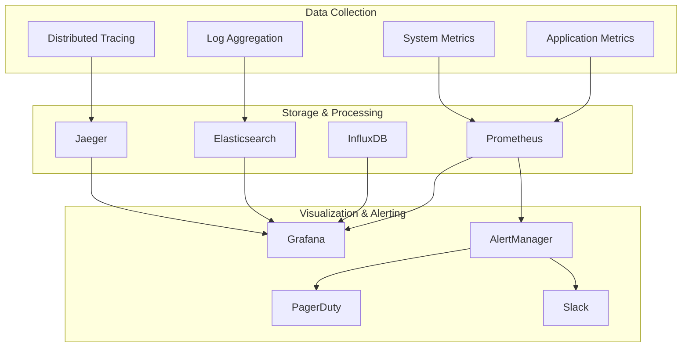
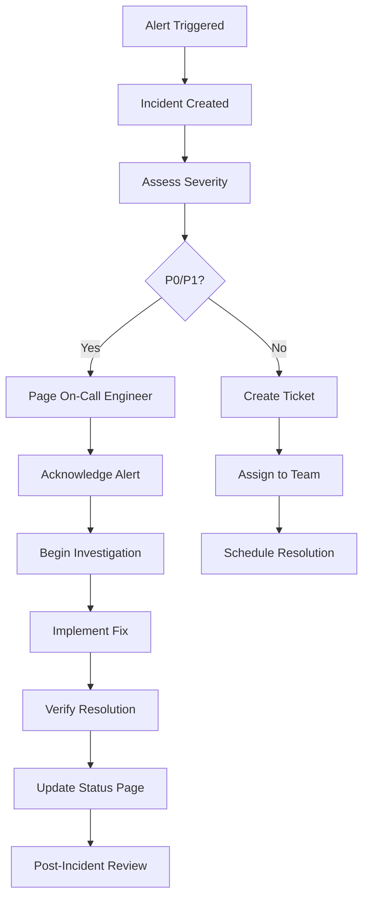

# Monitoring and Alerting Runbook - Prometheus AI Platform

## Overview

This runbook provides comprehensive procedures for monitoring, alerting, and incident response for the Prometheus AI Platform. It covers system health monitoring, performance metrics, alert handling, and troubleshooting procedures.

## 📊 Monitoring Architecture

### Monitoring Stack Components



### Key Metrics Categories

1. **Application Metrics**
   - Request rates and response times
   - Error rates and success rates
   - Business metrics (analyses completed, models trained)
   - Custom geological metrics

2. **Infrastructure Metrics**
   - CPU, memory, disk, and network utilization
   - Kubernetes cluster health
   - Database performance
   - Message queue metrics

3. **Security Metrics**
   - Authentication failures
   - Unauthorized access attempts
   - Security policy violations
   - Certificate expiration

4. **Business Metrics**
   - User activity and engagement
   - API usage patterns
   - System capacity utilization
   - Cost and resource optimization

---

## 🎯 Service Level Objectives (SLOs)

### Availability SLOs

| Service | Target Availability | Error Budget (Monthly) |
|---------|-------------------|----------------------|
| API Gateway | 99.9% | 43.2 minutes |
| Helios Core | 99.5% | 3.6 hours |
| Volcano Watchtower | 99.9% | 43.2 minutes |
| Data Ingestion | 99.0% | 7.2 hours |
| Database Services | 99.9% | 43.2 minutes |

### Performance SLOs

| Metric | Target | Measurement Window |
|--------|--------|-------------------|
| API Response Time (95th percentile) | < 500ms | 5 minutes |
| Geological Analysis Time | < 30 seconds | Per request |
| Real-time Alert Latency | < 10 seconds | Per alert |
| Dashboard Load Time | < 3 seconds | Per page load |

### Reliability SLOs

| Metric | Target | Measurement |
|--------|--------|-------------|
| Data Loss Rate | 0% | Monthly |
| Backup Success Rate | 100% | Daily |
| Security Incident Response | < 15 minutes | Per incident |
| System Recovery Time | < 30 minutes | Per outage |

---

## 🚨 Alert Definitions and Thresholds

### Critical Alerts (P0)

#### Service Down
```yaml
alert: ServiceDown
expr: up == 0
for: 1m
labels:
  severity: critical
  team: platform
annotations:
  summary: "Service {{ $labels.job }} is down"
  description: "Service {{ $labels.job }} has been down for more than 1 minute"
  runbook_url: "https://runbooks.prometheus-ai.com/service-down"
```

#### High Error Rate
```yaml
alert: HighErrorRate
expr: rate(http_requests_total{status=~"5.."}[5m]) / rate(http_requests_total[5m]) > 0.1
for: 2m
labels:
  severity: critical
  team: platform
annotations:
  summary: "High error rate on {{ $labels.job }}"
  description: "Error rate is {{ $value | humanizePercentage }} for {{ $labels.job }}"
  runbook_url: "https://runbooks.prometheus-ai.com/high-error-rate"
```

#### Database Connection Failure
```yaml
alert: DatabaseConnectionFailure
expr: postgresql_up == 0 or influxdb_up == 0 or neo4j_up == 0 or redis_up == 0
for: 30s
labels:
  severity: critical
  team: platform
annotations:
  summary: "Database connection failure"
  description: "Database {{ $labels.database }} is not responding"
  runbook_url: "https://runbooks.prometheus-ai.com/database-failure"
```

### Warning Alerts (P1)

#### High Response Time
```yaml
alert: HighResponseTime
expr: histogram_quantile(0.95, rate(http_request_duration_seconds_bucket[5m])) > 1.0
for: 5m
labels:
  severity: warning
  team: platform
annotations:
  summary: "High response time on {{ $labels.job }}"
  description: "95th percentile response time is {{ $value }}s"
  runbook_url: "https://runbooks.prometheus-ai.com/high-response-time"
```

#### High CPU Usage
```yaml
alert: HighCPUUsage
expr: 100 - (avg by(instance) (rate(node_cpu_seconds_total{mode="idle"}[5m])) * 100) > 80
for: 10m
labels:
  severity: warning
  team: platform
annotations:
  summary: "High CPU usage on {{ $labels.instance }}"
  description: "CPU usage is {{ $value }}% on {{ $labels.instance }}"
  runbook_url: "https://runbooks.prometheus-ai.com/high-cpu-usage"
```

#### High Memory Usage
```yaml
alert: HighMemoryUsage
expr: (1 - (node_memory_MemAvailable_bytes / node_memory_MemTotal_bytes)) * 100 > 85
for: 10m
labels:
  severity: warning
  team: platform
annotations:
  summary: "High memory usage on {{ $labels.instance }}"
  description: "Memory usage is {{ $value }}% on {{ $labels.instance }}"
  runbook_url: "https://runbooks.prometheus-ai.com/high-memory-usage"
```

### Info Alerts (P2)

#### Disk Space Warning
```yaml
alert: DiskSpaceWarning
expr: (1 - (node_filesystem_avail_bytes / node_filesystem_size_bytes)) * 100 > 75
for: 15m
labels:
  severity: info
  team: platform
annotations:
  summary: "Disk space warning on {{ $labels.instance }}"
  description: "Disk usage is {{ $value }}% on {{ $labels.instance }}:{{ $labels.mountpoint }}"
  runbook_url: "https://runbooks.prometheus-ai.com/disk-space-warning"
```

#### Certificate Expiration Warning
```yaml
alert: CertificateExpirationWarning
expr: (x509_cert_expiry - time()) / 86400 < 30
for: 1h
labels:
  severity: info
  team: platform
annotations:
  summary: "Certificate expiring soon"
  description: "Certificate {{ $labels.subject_cn }} expires in {{ $value }} days"
  runbook_url: "https://runbooks.prometheus-ai.com/certificate-expiration"
```

---

## 📋 Incident Response Procedures

### Incident Classification

#### P0 - Critical (Response: Immediate)
- Complete service outage
- Data loss or corruption
- Security breach
- Critical functionality unavailable

#### P1 - High (Response: 15 minutes)
- Significant performance degradation
- Partial service outage
- High error rates
- Database connectivity issues

#### P2 - Medium (Response: 1 hour)
- Minor performance issues
- Non-critical feature unavailable
- Resource warnings
- Monitoring alerts

#### P3 - Low (Response: Next business day)
- Documentation issues
- Minor UI problems
- Enhancement requests
- Informational alerts

### Incident Response Workflow



### On-Call Procedures

#### Primary On-Call Responsibilities
1. **Acknowledge alerts within 5 minutes**
2. **Assess incident severity and impact**
3. **Escalate to secondary if needed**
4. **Communicate status updates**
5. **Coordinate resolution efforts**

#### Escalation Matrix
```
Level 1: Primary On-Call Engineer
Level 2: Secondary On-Call Engineer
Level 3: Team Lead
Level 4: Engineering Manager
Level 5: VP Engineering
```

#### Communication Channels
- **Slack:** #incidents (primary)
- **PagerDuty:** Alert notifications
- **Status Page:** Customer communication
- **Email:** Stakeholder updates

---

## 🔧 Troubleshooting Procedures

### Service Down Investigation

#### Step 1: Initial Assessment
```bash
# Check service status
kubectl get pods -n prometheus-ai -l app=<service-name>

# Check recent events
kubectl get events -n prometheus-ai --sort-by='.lastTimestamp' | head -20

# Check service logs
kubectl logs -n prometheus-ai deployment/<service-name> --tail=100
```

#### Step 2: Health Check Verification
```bash
# Port forward to service
kubectl port-forward -n prometheus-ai service/<service-name> 8080:80

# Test health endpoint
curl -v http://localhost:8080/health

# Check readiness endpoint
curl -v http://localhost:8080/ready
```

#### Step 3: Dependency Check
```bash
# Check database connectivity
kubectl exec -n prometheus-ai deployment/postgres -- pg_isready -U prometheus

# Check Redis connectivity
kubectl exec -n prometheus-ai deployment/redis -- redis-cli ping

# Check service discovery
kubectl exec -n prometheus-ai deployment/consul -- consul members
```

#### Step 4: Resource Investigation
```bash
# Check resource usage
kubectl top pods -n prometheus-ai
kubectl describe pod -n prometheus-ai <pod-name>

# Check node resources
kubectl top nodes
kubectl describe node <node-name>
```

### High Error Rate Investigation

#### Step 1: Error Analysis
```bash
# Check error logs
kubectl logs -n prometheus-ai deployment/<service-name> | grep -i error | tail -50

# Check application metrics
curl -s "http://prometheus:9090/api/v1/query?query=rate(http_requests_total{status=~\"5..\"}[5m])"
```

#### Step 2: Trace Analysis
```bash
# Check Jaeger traces
curl -s "http://jaeger:16686/api/traces?service=<service-name>&limit=20"

# Analyze error patterns
kubectl logs -n prometheus-ai deployment/<service-name> | grep -E "(500|502|503|504)" | head -20
```

#### Step 3: Dependency Health
```bash
# Check downstream services
for service in helios-core volcano-watchtower data-ingestion; do
  echo "Checking $service..."
  kubectl exec -n prometheus-ai deployment/api-gateway -- curl -f http://$service:8001/health
done
```

### Performance Degradation Investigation

#### Step 1: Performance Metrics
```bash
# Check response times
curl -s "http://prometheus:9090/api/v1/query?query=histogram_quantile(0.95,rate(http_request_duration_seconds_bucket[5m]))"

# Check throughput
curl -s "http://prometheus:9090/api/v1/query?query=rate(http_requests_total[5m])"
```

#### Step 2: Resource Bottlenecks
```bash
# Check CPU usage
kubectl exec -n prometheus-ai deployment/<service-name> -- top -bn1 | head -20

# Check memory usage
kubectl exec -n prometheus-ai deployment/<service-name> -- free -h

# Check disk I/O
kubectl exec -n prometheus-ai deployment/<service-name> -- iostat -x 1 3
```

#### Step 3: Database Performance
```bash
# PostgreSQL performance
kubectl exec -n prometheus-ai deployment/postgres -- psql -U prometheus -c "
SELECT query, calls, total_time, mean_time 
FROM pg_stat_statements 
ORDER BY total_time DESC 
LIMIT 10;"

# InfluxDB performance
kubectl exec -n prometheus-ai deployment/influxdb -- influx query "
SHOW QUERIES"
```

---

## 📈 Performance Monitoring

### Key Performance Indicators (KPIs)

#### Application Performance
```promql
# Request rate
rate(http_requests_total[5m])

# Error rate
rate(http_requests_total{status=~"5.."}[5m]) / rate(http_requests_total[5m])

# Response time (95th percentile)
histogram_quantile(0.95, rate(http_request_duration_seconds_bucket[5m]))

# Throughput
sum(rate(http_requests_total[5m])) by (job)
```

#### Infrastructure Performance
```promql
# CPU utilization
100 - (avg by(instance) (rate(node_cpu_seconds_total{mode="idle"}[5m])) * 100)

# Memory utilization
(1 - (node_memory_MemAvailable_bytes / node_memory_MemTotal_bytes)) * 100

# Disk utilization
(1 - (node_filesystem_avail_bytes / node_filesystem_size_bytes)) * 100

# Network I/O
rate(node_network_receive_bytes_total[5m])
rate(node_network_transmit_bytes_total[5m])
```

#### Database Performance
```promql
# PostgreSQL connections
pg_stat_database_numbackends

# Query execution time
pg_stat_statements_mean_time_seconds

# InfluxDB write rate
influxdb_write_requests_total

# Redis operations per second
redis_commands_processed_total
```

### Performance Baselines

#### Normal Operating Ranges
| Metric | Normal Range | Warning Threshold | Critical Threshold |
|--------|-------------|------------------|-------------------|
| CPU Usage | 20-60% | 80% | 90% |
| Memory Usage | 30-70% | 85% | 95% |
| Disk Usage | 20-75% | 85% | 95% |
| Response Time | 50-200ms | 500ms | 1000ms |
| Error Rate | 0-0.1% | 1% | 5% |

#### Capacity Planning Metrics
```promql
# Predict when disk will be full (7 days)
predict_linear(node_filesystem_avail_bytes[1h], 7*24*3600) < 0

# Predict when memory will be exhausted (1 hour)
predict_linear(node_memory_MemAvailable_bytes[10m], 3600) < 0

# Growth rate of requests
deriv(rate(http_requests_total[5m])[1h:1m])
```

---

## 🔍 Log Analysis and Debugging

### Log Aggregation Setup

#### Structured Logging Format
```json
{
  "timestamp": "2025-01-09T10:00:00Z",
  "level": "INFO",
  "service": "helios-core",
  "correlation_id": "req-12345-abcde",
  "user_id": "user-67890",
  "message": "Geological analysis completed",
  "duration_ms": 2340,
  "metadata": {
    "analysis_type": "seismic",
    "data_points": 10000,
    "model_version": "v1.2.0"
  }
}
```

#### Log Collection Configuration
```yaml
# Fluent Bit configuration
apiVersion: v1
kind: ConfigMap
metadata:
  name: fluent-bit-config
data:
  fluent-bit.conf: |
    [SERVICE]
        Flush         1
        Log_Level     info
        Daemon        off
        Parsers_File  parsers.conf

    [INPUT]
        Name              tail
        Path              /var/log/containers/*prometheus-ai*.log
        Parser            docker
        Tag               kube.*
        Refresh_Interval  5
        Mem_Buf_Limit     50MB

    [FILTER]
        Name                kubernetes
        Match               kube.*
        Kube_URL            https://kubernetes.default.svc:443
        Kube_CA_File        /var/run/secrets/kubernetes.io/serviceaccount/ca.crt
        Kube_Token_File     /var/run/secrets/kubernetes.io/serviceaccount/token

    [OUTPUT]
        Name  es
        Match *
        Host  elasticsearch
        Port  9200
        Index prometheus-ai-logs
```

### Common Log Queries

#### Error Investigation
```bash
# Find errors in last hour
curl -X GET "elasticsearch:9200/prometheus-ai-logs/_search" -H 'Content-Type: application/json' -d'
{
  "query": {
    "bool": {
      "must": [
        {"term": {"level": "ERROR"}},
        {"range": {"timestamp": {"gte": "now-1h"}}}
      ]
    }
  },
  "sort": [{"timestamp": {"order": "desc"}}],
  "size": 100
}'

# Find specific error patterns
grep -E "(500|502|503|504|timeout|connection.*failed)" /var/log/prometheus-ai/*.log | tail -50
```

#### Performance Analysis
```bash
# Find slow requests
curl -X GET "elasticsearch:9200/prometheus-ai-logs/_search" -H 'Content-Type: application/json' -d'
{
  "query": {
    "bool": {
      "must": [
        {"range": {"duration_ms": {"gte": 5000}}},
        {"range": {"timestamp": {"gte": "now-1h"}}}
      ]
    }
  },
  "sort": [{"duration_ms": {"order": "desc"}}],
  "size": 50
}'
```

#### User Activity Tracking
```bash
# Track user activity
curl -X GET "elasticsearch:9200/prometheus-ai-logs/_search" -H 'Content-Type: application/json' -d'
{
  "query": {
    "bool": {
      "must": [
        {"term": {"user_id": "user-67890"}},
        {"range": {"timestamp": {"gte": "now-24h"}}}
      ]
    }
  },
  "aggs": {
    "activity_by_service": {
      "terms": {"field": "service"}
    }
  }
}'
```

---

## 🛡️ Security Monitoring

### Security Metrics and Alerts

#### Authentication Failures
```yaml
alert: HighAuthenticationFailures
expr: rate(auth_failures_total[5m]) > 10
for: 2m
labels:
  severity: warning
  team: security
annotations:
  summary: "High authentication failure rate"
  description: "Authentication failure rate is {{ $value }} per second"
```

#### Suspicious Activity Detection
```yaml
alert: SuspiciousAPIActivity
expr: rate(http_requests_total{status="401"}[5m]) > 5
for: 5m
labels:
  severity: warning
  team: security
annotations:
  summary: "Suspicious API activity detected"
  description: "High rate of 401 responses: {{ $value }} per second"
```

#### Security Policy Violations
```bash
# Monitor failed authorization attempts
kubectl logs -n prometheus-ai deployment/api-gateway | grep "403\|Forbidden" | tail -20

# Check for unusual access patterns
curl -X GET "elasticsearch:9200/prometheus-ai-logs/_search" -H 'Content-Type: application/json' -d'
{
  "query": {
    "bool": {
      "should": [
        {"term": {"status": "403"}},
        {"term": {"status": "401"}},
        {"match": {"message": "unauthorized"}}
      ]
    }
  },
  "aggs": {
    "by_ip": {
      "terms": {"field": "client_ip"}
    }
  }
}'
```

### Security Incident Response

#### Immediate Actions for Security Incidents
1. **Isolate affected systems**
2. **Preserve evidence and logs**
3. **Notify security team**
4. **Assess impact and scope**
5. **Implement containment measures**

#### Security Investigation Checklist
- [ ] Identify attack vector and timeline
- [ ] Assess data exposure and impact
- [ ] Check for lateral movement
- [ ] Verify system integrity
- [ ] Document findings and evidence
- [ ] Implement remediation measures
- [ ] Update security controls

---

## 📊 Dashboards and Visualization

### Executive Dashboard
- **System Health Overview**
- **SLA Compliance Status**
- **User Activity Metrics**
- **Cost and Resource Utilization**
- **Security Status Summary**

### Operations Dashboard
- **Service Status and Health**
- **Performance Metrics**
- **Error Rates and Trends**
- **Infrastructure Utilization**
- **Alert Status and History**

### Development Dashboard
- **Application Performance**
- **API Usage Statistics**
- **Error Analysis and Debugging**
- **Deployment Status**
- **Code Quality Metrics**

### Business Dashboard
- **User Engagement Metrics**
- **Feature Usage Analytics**
- **Revenue and Cost Metrics**
- **Growth and Adoption Trends**
- **Customer Satisfaction Scores**

---

## 🔄 Maintenance Procedures

### Regular Maintenance Tasks

#### Daily Tasks
- [ ] Review overnight alerts and incidents
- [ ] Check system health dashboards
- [ ] Verify backup completion
- [ ] Monitor resource utilization trends
- [ ] Review security logs for anomalies

#### Weekly Tasks
- [ ] Analyze performance trends
- [ ] Review and update alert thresholds
- [ ] Check certificate expiration dates
- [ ] Update documentation
- [ ] Conduct capacity planning review

#### Monthly Tasks
- [ ] Review SLA compliance
- [ ] Analyze incident trends and patterns
- [ ] Update monitoring configurations
- [ ] Conduct security assessment
- [ ] Review and optimize costs

#### Quarterly Tasks
- [ ] Comprehensive system health review
- [ ] Update disaster recovery procedures
- [ ] Review and update monitoring strategy
- [ ] Conduct performance benchmarking
- [ ] Security audit and penetration testing

### Preventive Maintenance

#### System Updates
```bash
# Update monitoring stack
helm upgrade prometheus prometheus-community/kube-prometheus-stack -n monitoring

# Update Grafana dashboards
kubectl apply -f monitoring/grafana/dashboards/

# Update alert rules
kubectl apply -f monitoring/prometheus/rules/
```

#### Performance Optimization
```bash
# Optimize Prometheus retention
kubectl patch prometheus prometheus-kube-prometheus-prometheus -n monitoring --type='merge' -p='{"spec":{"retention":"30d"}}'

# Clean up old logs
kubectl delete pods -n prometheus-ai -l app=log-cleaner

# Optimize database performance
kubectl exec -n prometheus-ai deployment/postgres -- psql -U prometheus -c "VACUUM ANALYZE;"
```

---

## 📞 Contact Information and Escalation

### On-Call Contacts
- **Primary On-Call:** +1-800-PROM-ONC (PagerDuty)
- **Secondary On-Call:** +1-800-PROM-SEC (PagerDuty)
- **Engineering Manager:** manager@prometheus-ai.com
- **VP Engineering:** vp-eng@prometheus-ai.com

### Team Contacts
- **Platform Team:** platform@prometheus-ai.com
- **Security Team:** security@prometheus-ai.com
- **DevOps Team:** devops@prometheus-ai.com
- **Support Team:** support@prometheus-ai.com

### External Vendors
- **Cloud Provider Support:** [Provider-specific contact]
- **Monitoring Vendor:** [Vendor-specific contact]
- **Security Vendor:** [Vendor-specific contact]

### Communication Channels
- **Slack Channels:**
  - #incidents (incident coordination)
  - #alerts (automated alerts)
  - #platform-team (team communication)
  - #security (security discussions)

- **Status Page:** https://status.prometheus-ai.com
- **Documentation:** https://docs.prometheus-ai.com
- **Runbooks:** https://runbooks.prometheus-ai.com

---

This monitoring runbook provides comprehensive procedures for maintaining the health and performance of the Prometheus AI Platform. Regular updates and team training ensure effective incident response and system reliability.