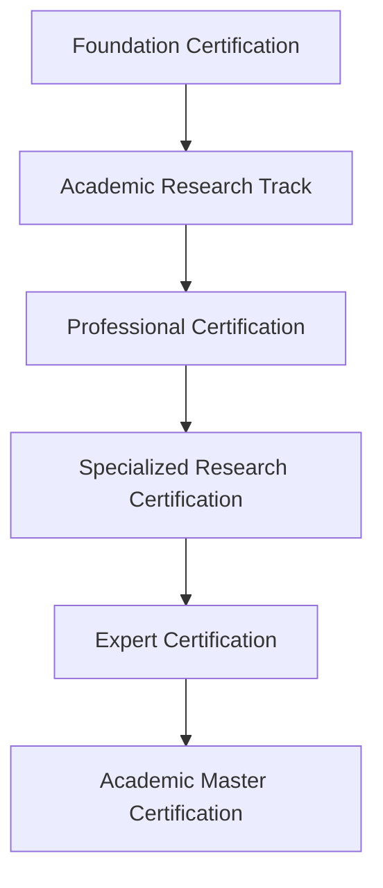
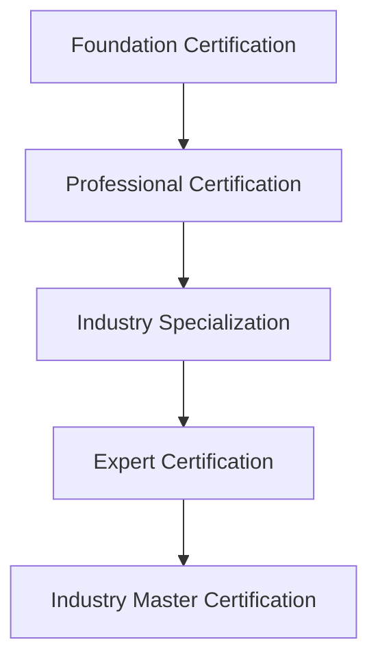
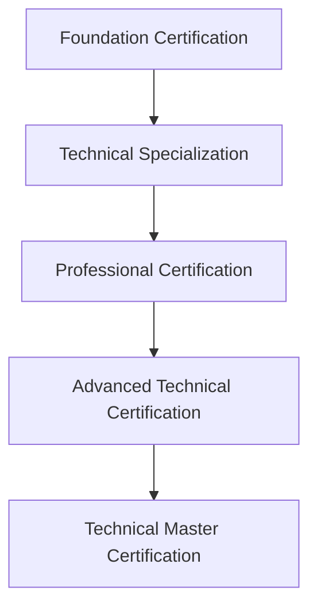

# Certification Program - Prometheus AI Platform

## Overview

The Prometheus AI Platform Certification Program provides industry-recognized credentials that validate expertise in AI-powered geological analysis and volcanic monitoring. Our comprehensive certification framework ensures professionals have the knowledge and skills needed to effectively use the platform in real-world scenarios.

## 🎓 Certification Levels

### Foundation Level
**Target Audience:** New users and students  
**Prerequisites:** None  
**Duration:** 20-30 hours of study  
**Validity:** 2 years  

**Competencies Covered:**
- Platform navigation and basic operations
- Fundamental geological data analysis
- Basic monitoring setup and configuration
- Understanding of AI/ML concepts in geosciences

### Professional Level
**Target Audience:** Working professionals and researchers  
**Prerequisites:** Foundation certification or equivalent experience  
**Duration:** 40-60 hours of study  
**Validity:** 3 years  

**Competencies Covered:**
- Advanced geological analysis techniques
- Physics-informed neural network applications
- Complex monitoring system design
- Scientific validation and uncertainty quantification

### Expert Level
**Target Audience:** Senior professionals and specialists  
**Prerequisites:** Professional certification + 2 years experience  
**Duration:** 60-80 hours of study  
**Validity:** 3 years  

**Competencies Covered:**
- Custom model development and training
- System architecture and optimization
- Research methodology and publication
- Leadership in geological AI applications

### Master Level
**Target Audience:** Industry leaders and researchers  
**Prerequisites:** Expert certification + 5 years experience  
**Duration:** 80-100 hours of study  
**Validity:** 5 years  

**Competencies Covered:**
- Platform development and customization
- Advanced research and innovation
- Training and mentorship capabilities
- Strategic implementation and governance

---

## 🏅 Specialized Certifications

### Volcanic Monitoring Specialist
**Focus:** Real-time volcanic monitoring and eruption forecasting  
**Prerequisites:** Foundation certification  
**Duration:** 30-40 hours  

**Core Competencies:**
- Multi-sensor data integration and analysis
- Real-time alert system configuration
- Eruption forecasting methodologies
- Crisis communication and emergency response
- Stakeholder engagement and reporting

**Assessment Components:**
- **Theoretical Exam (40%):** Volcanic processes, monitoring techniques, forecasting methods
- **Practical Assessment (40%):** Configure and operate monitoring systems
- **Case Study Analysis (20%):** Analyze historical volcanic events and responses

### Seismic Analysis Expert
**Focus:** Advanced seismic data analysis and interpretation  
**Prerequisites:** Professional certification  
**Duration:** 35-45 hours  

**Core Competencies:**
- Advanced seismic signal processing
- Earthquake source mechanism analysis
- Seismic tomography and imaging
- Real-time earthquake detection and location
- Seismic hazard assessment

**Assessment Components:**
- **Technical Exam (50%):** Seismology theory, analysis methods, interpretation
- **Hands-on Project (35%):** Complete seismic analysis project
- **Research Presentation (15%):** Present original research or case study

### Machine Learning for Geosciences
**Focus:** AI/ML model development for geological applications  
**Prerequisites:** Professional certification + programming experience  
**Duration:** 50-60 hours  

**Core Competencies:**
- Physics-informed neural network development
- Custom model architecture design
- Training data preparation and augmentation
- Model validation and uncertainty quantification
- Production deployment and monitoring

**Assessment Components:**
- **Coding Assessment (45%):** Develop and train custom PINN model
- **Technical Documentation (30%):** Document model methodology and validation
- **Peer Review (25%):** Review and critique peer submissions

### System Administration
**Focus:** Platform deployment, management, and optimization  
**Prerequisites:** Professional certification + system administration experience  
**Duration:** 40-50 hours  

**Core Competencies:**
- Kubernetes deployment and management
- Security configuration and monitoring
- Performance optimization and scaling
- Backup and disaster recovery
- User management and access control

**Assessment Components:**
- **Infrastructure Deployment (50%):** Deploy complete platform stack
- **Security Audit (30%):** Implement and validate security measures
- **Performance Optimization (20%):** Optimize system for specific requirements

---

## 📋 Certification Requirements

### Foundation Certification

#### Knowledge Areas (100 points total)
1. **Platform Fundamentals (25 points)**
   - Platform architecture and components
   - User interface navigation
   - Basic data management
   - Account and security settings

2. **Geological Data Analysis (30 points)**
   - Data types and formats
   - Basic analysis workflows
   - Result interpretation
   - Quality assessment

3. **Monitoring Basics (25 points)**
   - Monitoring system setup
   - Alert configuration
   - Dashboard customization
   - Basic troubleshooting

4. **AI/ML Concepts (20 points)**
   - Machine learning fundamentals
   - Neural network basics
   - Physics-informed modeling concepts
   - Uncertainty and validation

#### Assessment Format
- **Multiple Choice Exam:** 60 questions, 90 minutes
- **Practical Exercises:** 3 hands-on tasks, 2 hours
- **Passing Score:** 70% overall, minimum 60% in each knowledge area

### Professional Certification

#### Knowledge Areas (150 points total)
1. **Advanced Analysis Techniques (40 points)**
   - Multi-physics modeling
   - Advanced signal processing
   - Statistical analysis methods
   - Comparative studies

2. **Physics-Informed Neural Networks (35 points)**
   - PINN architecture and theory
   - Constraint implementation
   - Training methodologies
   - Validation techniques

3. **System Integration (35 points)**
   - API integration and development
   - Workflow automation
   - Performance optimization
   - Error handling and debugging

4. **Scientific Methodology (40 points)**
   - Research design and methodology
   - Validation and verification
   - Uncertainty quantification
   - Publication and documentation

#### Assessment Format
- **Comprehensive Exam:** 80 questions, 2.5 hours
- **Project Portfolio:** 2 major projects demonstrating competency
- **Technical Presentation:** 20-minute presentation with Q&A
- **Passing Score:** 75% overall, minimum 70% in each knowledge area

### Expert Certification

#### Knowledge Areas (200 points total)
1. **Advanced Model Development (50 points)**
   - Custom architecture design
   - Advanced training techniques
   - Transfer learning applications
   - Model interpretability

2. **Research and Innovation (50 points)**
   - Original research methodology
   - Novel application development
   - Peer review and publication
   - Conference presentations

3. **System Architecture (50 points)**
   - Scalable system design
   - Performance optimization
   - Security architecture
   - Integration patterns

4. **Leadership and Mentorship (50 points)**
   - Team leadership skills
   - Training and mentorship
   - Project management
   - Strategic planning

#### Assessment Format
- **Advanced Technical Exam:** 100 questions, 3 hours
- **Original Research Project:** Significant contribution to field
- **Peer Review Process:** Review and critique expert-level work
- **Leadership Assessment:** Demonstrate mentorship and leadership
- **Passing Score:** 80% overall, minimum 75% in each knowledge area

---

## 🎯 Assessment Methods

### Theoretical Assessments
- **Multiple Choice Questions:** Test conceptual understanding
- **Short Answer Questions:** Assess applied knowledge
- **Case Study Analysis:** Evaluate problem-solving skills
- **Technical Documentation Review:** Test comprehension of complex materials

### Practical Assessments
- **Hands-on Exercises:** Demonstrate platform proficiency
- **Project Development:** Create working solutions
- **System Configuration:** Set up and optimize systems
- **Troubleshooting Scenarios:** Resolve realistic problems

### Performance-Based Assessments
- **Live Demonstrations:** Show real-time capabilities
- **Peer Collaboration:** Work effectively in teams
- **Presentation Skills:** Communicate technical concepts
- **Mentorship Activities:** Guide and support others

### Continuous Assessment
- **Portfolio Development:** Build comprehensive work samples
- **Peer Review Participation:** Engage in professional review processes
- **Community Contributions:** Contribute to knowledge sharing
- **Professional Development:** Maintain current expertise

---

## 📊 Certification Pathways

### Academic Pathway
**Target:** Students and academic researchers

**Key Features:**
- Research-focused assessments
- Academic project requirements
- Thesis/dissertation integration
- University partnership programs

### Industry Pathway
**Target:** Working professionals and consultants

**Key Features:**
- Industry-relevant case studies
- Real-world project requirements
- Professional experience credit
- Corporate training programs

### Technical Pathway
**Target:** Developers and system administrators

**Key Features:**
- Programming and system administration focus
- Technical project portfolios
- Open-source contribution credit
- Developer community engagement

---

## 🏆 Certification Benefits

### Professional Recognition
- **Industry Credibility:** Recognized expertise in geological AI
- **Career Advancement:** Enhanced job prospects and promotion opportunities
- **Salary Premium:** Average 15-25% salary increase for certified professionals
- **Professional Network:** Access to exclusive professional communities

### Technical Advantages
- **Advanced Features:** Access to premium platform features
- **Priority Support:** Enhanced technical support and consultation
- **Beta Access:** Early access to new features and capabilities
- **Custom Training:** Personalized training and development opportunities

### Organizational Benefits
- **Team Competency:** Validated team capabilities and expertise
- **Quality Assurance:** Standardized knowledge and best practices
- **Competitive Advantage:** Differentiation in marketplace
- **Risk Mitigation:** Reduced project risk through certified expertise

### Continuing Education
- **Maintenance Requirements:** Ongoing learning and development
- **Advanced Workshops:** Exclusive access to advanced training
- **Research Opportunities:** Participation in cutting-edge research
- **Conference Discounts:** Reduced rates for professional conferences

---

## 📅 Certification Process

### Registration and Preparation
1. **Eligibility Check:** Verify prerequisites and requirements
2. **Study Plan Creation:** Develop personalized study schedule
3. **Resource Access:** Obtain study materials and practice exams
4. **Preparation Timeline:** Allow adequate preparation time

### Assessment Scheduling
1. **Exam Registration:** Schedule theoretical and practical assessments
2. **Project Submission:** Submit required projects and portfolios
3. **Interview Scheduling:** Arrange oral examinations and presentations
4. **Assessment Coordination:** Coordinate multiple assessment components

### Certification Award
1. **Results Processing:** Review and validate assessment results
2. **Certification Issuance:** Award digital and physical certificates
3. **Registry Update:** Update professional certification registry
4. **Badge Distribution:** Provide digital badges for professional profiles

### Maintenance and Renewal
1. **Continuing Education:** Complete required continuing education units
2. **Professional Development:** Participate in professional development activities
3. **Renewal Application:** Submit renewal application and documentation
4. **Updated Certification:** Receive renewed certification credentials

---

## 💰 Certification Costs

### Individual Certifications
- **Foundation Level:** $299
- **Professional Level:** $599
- **Expert Level:** $999
- **Master Level:** $1,499

### Specialized Certifications
- **Volcanic Monitoring Specialist:** $499
- **Seismic Analysis Expert:** $599
- **Machine Learning for Geosciences:** $699
- **System Administration:** $599

### Package Deals
- **Foundation + Professional:** $799 (Save $99)
- **Professional + Specialization:** $999 (Save $99)
- **Complete Pathway:** $1,999 (Save $299)

### Corporate Programs
- **Team Certification (5-10 people):** 20% discount
- **Enterprise Program (10+ people):** 30% discount
- **Custom Training Programs:** Contact for pricing
- **Academic Institutions:** 50% discount for students

### Financial Assistance
- **Student Scholarships:** Need-based financial assistance
- **Developing Country Discounts:** Reduced rates for qualifying regions
- **Unemployment Support:** Temporary assistance for job seekers
- **Military/Veteran Discounts:** Special rates for service members

---

## 🌐 Global Recognition

### Industry Partnerships
- **Professional Societies:** Recognition by geological and geophysical societies
- **Academic Institutions:** Credit toward degree programs
- **Government Agencies:** Accepted for contractor qualifications
- **International Organizations:** Recognized by global geological organizations

### Certification Registry
- **Public Verification:** Online verification of certification status
- **Professional Profiles:** Integration with LinkedIn and professional networks
- **Employer Verification:** Direct verification services for employers
- **Continuing Education Tracking:** Transparent maintenance of credentials

### Quality Assurance
- **Accreditation Standards:** Compliance with international certification standards
- **Regular Audits:** Periodic review and validation of certification processes
- **Stakeholder Feedback:** Continuous improvement based on industry input
- **Best Practice Alignment:** Alignment with industry best practices and standards

---

## 📞 Support and Resources

### Certification Support
- **Study Guides:** Comprehensive study materials and resources
- **Practice Exams:** Realistic practice assessments and feedback
- **Tutoring Services:** One-on-one tutoring and mentorship
- **Study Groups:** Collaborative learning opportunities

### Technical Support
- **Help Desk:** Technical assistance with platform and assessments
- **Documentation:** Comprehensive documentation and tutorials
- **Video Tutorials:** Step-by-step video instruction
- **Community Forums:** Peer support and knowledge sharing

### Career Services
- **Job Placement:** Career placement assistance for certified professionals
- **Resume Enhancement:** Professional resume and profile optimization
- **Interview Preparation:** Technical interview preparation and coaching
- **Networking Events:** Professional networking and career development events

### Contact Information
- **Certification Team:** certification@prometheus-ai.com
- **Technical Support:** support@prometheus-ai.com
- **Career Services:** careers@prometheus-ai.com
- **General Inquiries:** info@prometheus-ai.com

---

## 🚀 Get Started

### Ready to Begin?
1. **Assess Your Level:** Take our free assessment to determine your starting point
2. **Choose Your Path:** Select the certification pathway that matches your goals
3. **Register Today:** Begin your certification journey with our comprehensive program
4. **Join the Community:** Connect with other certified professionals and experts

### Next Steps
- **Visit our certification portal:** [https://certification.prometheus-ai.com](https://certification.prometheus-ai.com)
- **Download the certification guide:** Comprehensive PDF guide with all details
- **Schedule a consultation:** Speak with our certification advisors
- **Join our information session:** Attend our monthly certification overview webinar

Transform your career with industry-recognized expertise in AI-powered geological analysis. Start your certification journey today!