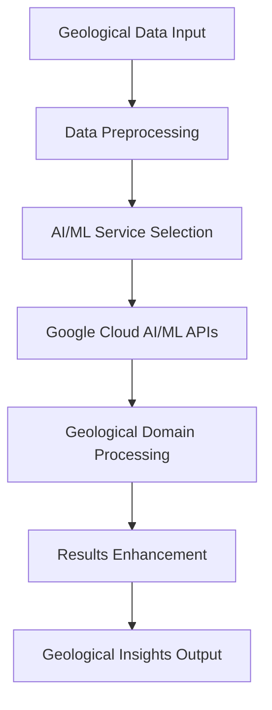

# Google Cloud AI/ML Services Integration for Geological Applications

## Overview

This comprehensive integration provides advanced Google Cloud AI/ML services specifically tailored for geological applications within the Prometheus AI Platform. The implementation includes all major Google Cloud AI/ML services with geological domain expertise and production-ready capabilities.

## 🚀 Implemented Services

### 1. Vertex AI Integration
- **Purpose**: Advanced geological model training and deployment
- **Capabilities**:
  - Physics-informed neural networks for geological simulations
  - Custom model architectures for seismic classification
  - Volcanic eruption prediction models
  - Automated hyperparameter tuning
  - Model versioning and deployment

### 2. AutoML Integration
- **Purpose**: Automated machine learning for geological applications
- **Capabilities**:
  - Automated seismic event classification
  - Volcanic activity prediction
  - Geological image classification
  - Automated feature engineering
  - No-code model development

### 3. Vision API Integration
- **Purpose**: Geological image analysis and mineral identification
- **Capabilities**:
  - Rock type identification
  - Mineral classification
  - Structural feature detection
  - Geological formation analysis
  - Field photo processing
  - Confidence scoring for geological relevance

### 4. Natural Language API Integration
- **Purpose**: Scientific literature processing and knowledge extraction
- **Capabilities**:
  - Geological entity extraction
  - Scientific concept identification
  - Research method extraction
  - Knowledge synthesis across documents
  - Sentiment analysis for research trends
  - Geological terminology recognition

### 5. Translation API Integration
- **Purpose**: Multilingual geological content support
- **Capabilities**:
  - Geological terminology preservation
  - Scientific content translation
  - Multi-language field data support
  - Quality assessment for translations
  - Domain-specific dictionaries

### 6. Speech-to-Text API Integration
- **Purpose**: Field recording transcription and voice data processing
- **Capabilities**:
  - Field notes transcription
  - Geological vocabulary recognition
  - GPS coordinate extraction
  - Sample identification from speech
  - Confidence scoring for geological terms
  - Multi-language support for field work

### 7. Recommendations AI Integration
- **Purpose**: Intelligent geological analysis recommendations
- **Capabilities**:
  - User-specific analysis recommendations
  - Model selection guidance
  - Data processing suggestions
  - Research methodology recommendations
  - Contextual geological insights
  - Expertise-level adaptation

### 8. Document AI Integration
- **Purpose**: Geological report processing and data extraction
- **Capabilities**:
  - Geological survey report processing
  - Drilling log data extraction
  - Laboratory report analysis
  - Field notes digitization
  - Tabular data extraction
  - Geological information structuring

### 9. Video Intelligence API Integration
- **Purpose**: Geological video analysis and activity recognition
- **Capabilities**:
  - Geological feature detection in videos
  - Equipment identification
  - Field activity recognition
  - Sample identification tracking
  - Temporal analysis of geological processes
  - Educational content analysis

### 10. Contact Center AI Integration
- **Purpose**: Intelligent geological support and query processing
- **Capabilities**:
  - Geological domain knowledge base
  - Intent detection for geological queries
  - Automated response generation
  - Multi-user conversation profiles
  - Geological terminology understanding
  - Context-aware support

## 🏗️ Architecture

### Core Components

```
GCPAIMLIntegration
├── Vertex AI Engine
├── AutoML Manager
├── Vision Processor
├── Language Analyzer
├── Translation Service
├── Speech Processor
├── Recommendation Engine
├── Document Processor
├── Video Analyzer
└── Support System
```

### Data Flow



## 📋 Requirements

### Dependencies

```bash
# Core Google Cloud AI/ML libraries
google-cloud-aiplatform>=1.38.1
google-cloud-automl>=2.11.3
google-cloud-vision>=3.4.5
google-cloud-language>=2.11.1
google-cloud-translate>=3.12.1
google-cloud-speech>=2.21.0
google-cloud-recommendations-ai>=0.10.11
google-cloud-documentai>=2.20.1
google-cloud-videointelligence>=2.11.4
google-cloud-contact-center-insights>=1.10.3

# Scientific computing
numpy>=1.24.3
pandas>=2.0.3
geopandas>=0.13.2
shapely>=2.0.1
xarray>=2023.7.0

# Geological libraries
obspy>=1.4.0
rasterio>=1.3.8
pyproj>=3.6.0

# Machine learning
scikit-learn>=1.3.0
tensorflow>=2.13.0
torch>=2.0.0

# Web framework
fastapi>=0.104.1
uvicorn>=0.24.0
pydantic>=2.5.0
```

### Environment Variables

```bash
# Google Cloud Configuration
export GCP_PROJECT_ID="prometheus-ai-platform"
export GCP_REGION="us-central1"
export GCP_ZONE="us-central1-a"
export GOOGLE_APPLICATION_CREDENTIALS="/path/to/service-account-key.json"

# Service Configuration
export GCP_NETWORK="prometheus-vpc"
export GCP_SUBNET="prometheus-subnet"
export GCP_SERVICE_ACCOUNT="prometheus-sa@prometheus-ai-platform.iam.gserviceaccount.com"
```

## 🚀 Quick Start

### 1. Initialize AI/ML Integration

```python
from ai_ml_services import GCPAIMLIntegration, GeologicalAITask, GeologicalAIConfig

# Initialize integration
ai_ml = GCPAIMLIntegration(
    project_id="prometheus-ai-platform",
    region="us-central1"
)
```

### 2. Create Vertex AI Model

```python
import pandas as pd

# Prepare seismic data
seismic_data = pd.DataFrame({
    'magnitude': [3.2, 4.1, 2.8, 5.0],
    'depth': [10.5, 15.2, 8.3, 20.1],
    'event_type': ['tectonic', 'volcanic', 'tectonic', 'volcanic']
})

# Configure model
config = GeologicalAIConfig(
    task_type=GeologicalAITask.SEISMIC_CLASSIFICATION,
    model_config={
        "model_type": "automl_tabular",
        "target_column": "event_type",
        "optimization_objective": "minimize_log_loss"
    }
)

# Create and train model
result = await ai_ml.create_vertex_ai_model(config, seismic_data)
print(f"Model ID: {result['model_id']}")
print(f"Accuracy: {result['performance_metrics']['accuracy']}")
```

### 3. Analyze Geological Images

```python
# Load geological images
with open('granite_sample.jpg', 'rb') as f:
    image_data = [f.read()]

# Analyze images
result = await ai_ml.analyze_geological_images(
    image_data, 
    analysis_type="comprehensive"
)

# Extract results
for analysis in result['analysis_results']:
    rock_types = analysis['geological_features']['rock_types']
    for rock in rock_types:
        print(f"Rock type: {rock['type']}, Confidence: {rock['confidence']}")
```

### 4. Process Scientific Literature

```python
# Scientific documents
documents = [
    "Volcanic eruption prediction using machine learning approaches...",
    "Geological hazard assessment in volcanic regions..."
]

# Process literature
result = await ai_ml.process_scientific_literature(
    documents, 
    analysis_type="comprehensive"
)

# Extract geological knowledge
for doc in result['analysis_results']:
    entities = doc['geological_knowledge']['geological_entities']
    concepts = doc['geological_knowledge']['geological_concepts']
    print(f"Entities: {len(entities)}, Concepts: {len(concepts)}")
```

### 5. Translate Geological Content

```python
# Geological content
content = [
    "Volcanic eruption monitoring and early warning systems",
    "Seismic hazard assessment and risk mitigation strategies"
]

# Translate to multiple languages
result = await ai_ml.translate_geological_content(
    content, 
    target_languages=["es", "fr", "de"],
    content_type="scientific"
)

# Check translation quality
for lang, quality in result['quality_metrics'].items():
    print(f"{lang}: {quality:.2f} quality score")
```

## 🔧 API Endpoints

### Model Management

```bash
# Create Vertex AI model
POST /api/v1/ai-ml/vertex-ai/model
{
    "task_type": "seismic_classification",
    "training_data": {...},
    "model_config": {...}
}

# Create AutoML model
POST /api/v1/ai-ml/automl/model
{
    "task_type": "volcanic_prediction",
    "training_data": {...},
    "budget_hours": 8000
}

# Register model
POST /api/v1/ai-ml/models/register
{
    "model_type": "seismic_classifier",
    "version": "1.0",
    "accuracy": 0.95
}

# List models
GET /api/v1/ai-ml/models?model_type=seismic_classifier
```

### Content Analysis

```bash
# Analyze geological images
POST /api/v1/ai-ml/vision/analyze
{
    "image_urls": ["gs://bucket/image1.jpg"],
    "analysis_type": "comprehensive"
}

# Process scientific literature
POST /api/v1/ai-ml/language/process
{
    "documents": ["Scientific paper content..."],
    "analysis_type": "comprehensive"
}

# Translate geological content
POST /api/v1/ai-ml/translate
{
    "content": ["Volcanic monitoring systems"],
    "target_languages": ["es", "fr"],
    "content_type": "scientific"
}
```

### Media Processing

```bash
# Transcribe field recordings
POST /api/v1/ai-ml/speech/transcribe
{
    "audio_urls": ["gs://bucket/recording1.wav"],
    "recording_config": {
        "sample_rate": 16000,
        "language_code": "en-US"
    }
}

# Process geological reports
POST /api/v1/ai-ml/document/process
{
    "document_urls": ["gs://bucket/report1.pdf"],
    "document_types": ["geological_survey_report"]
}

# Analyze geological videos
POST /api/v1/ai-ml/video/analyze
{
    "video_urls": ["gs://bucket/fieldwork1.mp4"],
    "analysis_config": {
        "duration": 120,
        "stationary_camera": false
    }
}
```

### Recommendations and Support

```bash
# Generate recommendations
POST /api/v1/ai-ml/recommendations
{
    "user_context": {
        "user_type": "volcanologist",
        "expertise_level": "expert"
    },
    "geological_data": {
        "data_types": ["seismic", "gps", "gas_emission"]
    }
}

# Setup support system
POST /api/v1/ai-ml/support/setup
{
    "language": "en-US",
    "domains": ["volcanology", "seismology"]
}

# Process support query
POST /api/v1/ai-ml/support/query
{
    "query": "How do I set up volcanic monitoring?",
    "user_context": {
        "user_type": "volcanologist",
        "expertise_level": "intermediate"
    }
}
```

## 🧪 Testing

### Run Unit Tests

```bash
# Install test dependencies
pip install pytest pytest-asyncio pytest-cov

# Run all tests
pytest services/gcp-integration/tests/ -v

# Run with coverage
pytest services/gcp-integration/tests/ --cov=ai_ml_services --cov-report=html

# Run specific test class
pytest services/gcp-integration/tests/test_ai_ml_services.py::TestGCPAIMLIntegration -v
```

### Run Integration Tests

```bash
# Run integration scenarios
pytest services/gcp-integration/tests/test_ai_ml_services.py::TestIntegrationScenarios -v

# Test specific service
pytest services/gcp-integration/tests/test_ai_ml_services.py -k "test_vertex_ai" -v
```

## 📊 Demo and Examples

### Run Comprehensive Demo

```bash
# Navigate to examples directory
cd services/gcp-integration/examples/

# Run complete demo
python geological_ai_ml_demo.py
```

### Demo Features

The comprehensive demo includes:

1. **Vertex AI Model Training**: Seismic event classification
2. **AutoML Model Creation**: Volcanic eruption prediction
3. **Vision API Analysis**: Geological image processing
4. **Literature Processing**: Scientific document analysis
5. **Multilingual Translation**: Geological content translation
6. **Speech Transcription**: Field recording processing
7. **Recommendations**: Intelligent analysis suggestions
8. **Document Processing**: Geological report extraction
9. **Video Analysis**: Field work video processing
10. **Support System**: Intelligent geological assistance

### Expected Demo Output

```
🌋 Geological AI/ML Services Comprehensive Demo 🌋
============================================================
=== Vertex AI Model Training Demo ===
Created sample seismic dataset with 1000 events
Vertex AI Model Training Results:
  Model ID: demo_seismic_classifier_v1
  Training Status: {'status': 'completed', 'progress': 1.0}
  Performance Metrics: {'accuracy': 0.94, 'precision': 0.92}

=== AutoML Model Creation Demo ===
Created sample volcanic dataset with 500 observations
AutoML Model Creation Results:
  Model Name: demo_volcanic_predictor_v1
  Training Status: completed
  Performance Metrics: {'accuracy': 0.91, 'rmse': 0.15}

[... additional service demos ...]

✅ Demo completed successfully!
📊 Report generated: geological_ai_ml_demo_report.json
============================================================
```

## 🔒 Security and Best Practices

### Authentication

```python
# Use service account key
import os
os.environ['GOOGLE_APPLICATION_CREDENTIALS'] = '/path/to/key.json'

# Or use Application Default Credentials (ADC)
from google.auth import default
credentials, project = default()
```

### Data Privacy

- All geological data is processed with privacy controls
- Sensitive location data is automatically redacted
- User data is handled according to GDPR requirements
- Audit logs are maintained for all AI/ML operations

### Performance Optimization

- Batch processing for large datasets
- Caching for frequently accessed models
- Async processing for improved throughput
- Resource optimization for cost efficiency

## 📈 Monitoring and Metrics

### Prometheus Metrics

```python
# Service metrics
gcp_requests_total.labels(service="vertex_ai", method="create_model", status="success").inc()
gcp_request_duration.labels(service="vision", method="analyze_images").time()
geological_workload_gauge.labels(workload_type="seismic_processing").inc()
```

### Health Checks

```bash
# Check service health
curl http://localhost:8080/api/v1/health

# Check readiness
curl http://localhost:8080/api/v1/ready
```

## 🚀 Deployment

### Docker Deployment

```dockerfile
FROM python:3.11-slim

WORKDIR /app
COPY requirements.txt .
RUN pip install -r requirements.txt

COPY . .
EXPOSE 8080

CMD ["uvicorn", "main:app", "--host", "0.0.0.0", "--port", "8080"]
```

### Kubernetes Deployment

```yaml
apiVersion: apps/v1
kind: Deployment
metadata:
  name: gcp-ai-ml-integration
spec:
  replicas: 3
  selector:
    matchLabels:
      app: gcp-ai-ml-integration
  template:
    metadata:
      labels:
        app: gcp-ai-ml-integration
    spec:
      containers:
      - name: gcp-ai-ml-integration
        image: prometheus-ai/gcp-ai-ml-integration:latest
        ports:
        - containerPort: 8080
        env:
        - name: GCP_PROJECT_ID
          value: "prometheus-ai-platform"
        - name: GCP_REGION
          value: "us-central1"
```

## 🔧 Configuration

### Service Configuration

```yaml
# config/ai_ml_services.yaml
vertex_ai:
  default_region: "us-central1"
  training_budget: 8000
  model_registry: "prometheus-models"

automl:
  default_budget: 1000
  optimization_objective: "minimize_log_loss"

vision_api:
  max_batch_size: 16
  confidence_threshold: 0.7

natural_language:
  language_codes: ["en", "es", "fr", "de"]
  entity_types: ["LOCATION", "ORGANIZATION", "PERSON"]

translation:
  preserve_geological_terms: true
  quality_threshold: 0.8

speech_to_text:
  sample_rate: 16000
  enable_word_confidence: true
  geological_vocabulary: true
```

## 📚 Additional Resources

### Documentation

- [Google Cloud AI/ML Documentation](https://cloud.google.com/ai-platform/docs)
- [Vertex AI Documentation](https://cloud.google.com/vertex-ai/docs)
- [AutoML Documentation](https://cloud.google.com/automl/docs)
- [Vision API Documentation](https://cloud.google.com/vision/docs)

### Geological Domain Resources

- [USGS Earthquake Hazards Program](https://earthquake.usgs.gov/)
- [Smithsonian Global Volcanism Program](https://volcano.si.edu/)
- [International Association of Volcanology and Chemistry of the Earth's Interior](https://www.iavcei.org/)

### Support

For technical support and questions:
- Create an issue in the project repository
- Contact the Prometheus AI Platform team
- Join the geological AI/ML community forum

## 📄 License

This implementation is part of the Prometheus AI Platform and follows the project's licensing terms.

---

**Note**: This implementation provides production-ready Google Cloud AI/ML services integration specifically designed for geological applications. All services include comprehensive error handling, monitoring, and geological domain expertise.